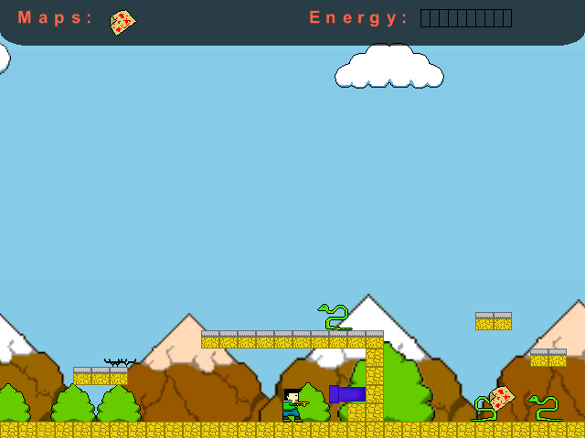
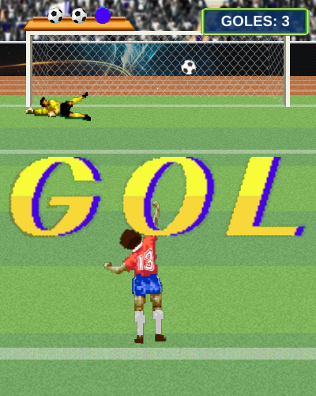
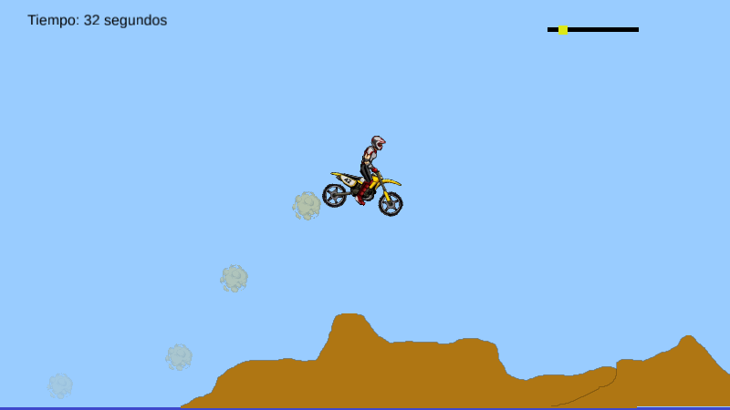

# Original Prototypes Ported — museo de prototipos

Los juegos y prototipos que publiqué en [itch.io](https://elvisbrevi.itch.io) entre 2009 y 2015,
recreados en **Rust + [macroquad](https://macroquad.rs)** para jugarse hoy en PC y en el navegador
(con controles táctiles en móvil). Cada port se reconstruye por ingeniería inversa del binario
original con [REA](https://rea.tools/) y usa los gráficos y sonidos originales extraídos de él.

Las versiones web de los ports reemplazarán a las de cada página de itch.io, y los juegos que no
tenían versión web la tendrán (fase 4 del plan). El avance está en [PLAN.md](PLAN.md). Cada push
compila todo en nativo y en wasm ([GitHub Actions](.github/workflows/build.yml)):


## Sala de exposición

| Año | Juego | Hecho con | Port a Rust + macroquad |
|---|---|---|---|
| 2009 | [Proyecto Nutria](#proyecto-nutria) | C# + XNA 3.1 (Windows) | ✅ [games/proyecto-nutria](games/proyecto-nutria) |
| 2009 | [IMAN](#iman) | C# + XNA 3.1 (Windows) | ✅ [games/iman](games/iman) |
| 2011 | [The Electric Eel Attack](#the-electric-eel-attack) | C# + XNA 3.1 + motor propio (Windows) | ✅ [games/the-electric-eel-attack](games/the-electric-eel-attack) |
| 2011 | [Go Ball](#go-ball) | Unity 3.4 (C# + UnityScript) | pendiente |
| 2011 | [The Meaning of Christmas](#the-meaning-of-christmas) | Java + libGDX (Android) | pendiente |
| 2013 | [Fast Car Racer](#fast-car-racer) | Android (Google Play) | bloqueado: falta el binario |
| 2014 | [Super Happy Jump](#super-happy-jump) | Unity 4.6 (Web Player, iOS, Android) | ✅ [games/super-happy-jump](games/super-happy-jump) |
| 2014–15 | [Que No Caiga](#que-no-caiga) | Construct 2 (HTML5) | ✅ [games/que-no-caiga](games/que-no-caiga) |
| 2015 | [Retro Penal](#retro-penal) | Construct 2 (HTML5 + NW.js) | ✅ [games/retro-penal](games/retro-penal) |
| 2015 | [One Button Prototype](#one-button-prototype) | Unity 5.1 (Mac, Linux, Android, WebGL) | pendiente |
| 2015 | [Neuro Battle](#neuro-battle) | Unity 5.1 (WebGL) | pendiente |
| 2015 | [Da Car](#da-car) | Construct 2 (HTML5) | ✅ [games/da-car](games/da-car) |

Las fechas salen de los propios binarios (fecha de compilación, de los archivos o de la exportación)
y de los videos de gameplay; los datos que todavía son deducciones están marcados como «por
confirmar» y se cierran en el triaje de cada juego.

---

### Proyecto Nutria


- **De qué trata:** plataformas de acción para dos. Un coipo (la «nutria» chilena) y un pollo
  recorren un nivel de plataformas de roca y recogen cajas con pistolas láser para dispararse. El
  pollo solo era jugable con un mando conectado. Tiene un nivel y un menú de pausa con el fondo
  desenfocado en gris.
- **Hecho en 2009** con C# + XNA 3.1 para Windows (instalador ClickOnce): compilado el
  11-nov-2009, según la cabecera del ejecutable (video del prototipo: 3-oct-2009).
- **Ahora:** ✅ portado a Rust + macroquad en [games/proyecto-nutria](games/proyecto-nutria), con
  la lógica traducida del C# decompilado y los gráficos, la fuente y el efecto de pausa de
  siempre. Se juega en PC y en el navegador, con controles táctiles en móvil. No tiene sonido.
- **itch.io:** [elvisbrevi.itch.io/proyecto-nutria](https://elvisbrevi.itch.io/proyecto-nutria) ·
  [video](https://vimeo.com/6882393)

### IMAN


- **De qué trata:** plataformas en el que un niño usa el imán de su mochila para atraer cajas y para
  elevarse hacia plataformas móviles. Dos niveles y un final.
- **Hecho en 2009** con C# + XNA 3.1 para Windows (instalador ClickOnce): compilado el
  13-nov-2009 (video: 15-dic-2009).
- **Ahora:** ✅ portado a Rust + macroquad en [games/iman](games/iman), con la lógica traducida del
  C# decompilado y los gráficos, la fuente, el shader de lápiz y el sonido de siempre. Se juega en
  PC y en el navegador, con controles táctiles en móvil.
- **itch.io:** [elvisbrevi.itch.io/iman](https://elvisbrevi.itch.io/iman) ·
  [video](https://vimeo.com/8196488)

### The Electric Eel Attack



- **De qué trata:** plataformas de acción. Yerko reúne los tres mapas de cada nivel para abrir el
  vórtice de salida, mientras lo atacan anguilas eléctricas: unas patrullan y se electrifican, las
  *kamikazes* saltan. Se las pisa o se las dispara con la energía de las pilas. Tiene cuatro
  niveles: campo, caverna, ciudad y una fábrica con un cañón que apunta.
- **Hecho en 2011** con C# + XNA 3.1 y un motor propio (`Engine.dll`: niveles en XML hechos con su
  editor, física, partículas y efectos), para Windows con ClickOnce. Compilado el 9-mar-2011,
  versión 1.0.0.13 (el motor, el 8-mar-2011), según las cabeceras de los ejecutables (video:
  24-feb-2011).
- **Ahora:** ✅ portado a Rust + macroquad en
  [games/the-electric-eel-attack](games/the-electric-eel-attack): motor y juego traducidos del C#
  decompilado, con los mapas, gráficos, fuentes, sonidos y música de siempre y los efectos
  reescritos en GLSL. Se juega en PC y en el navegador, con controles táctiles en móvil.
- **itch.io:** [elvisbrevi.itch.io/the-electric-eel-attack](https://elvisbrevi.itch.io/the-electric-eel-attack) ·
  [video](https://vimeo.com/20317603)

### Go Ball

- **De qué trata:** puzle con una bola, en 5 niveles. Por confirmar en el triaje.
- **Hecho en 2011** con Unity 3.4.0f5 (scripts en C# y UnityScript): build del 22-sep-2011
  (teaser: 23-sep-2011), demo para Windows (32 y 64 bits) y macOS.
- **Ahora:** pendiente de portar.
- **itch.io:** [elvisbrevi.itch.io/go-ball](https://elvisbrevi.itch.io/go-ball) ·
  [teaser](https://vimeo.com/29466492)

### The Meaning of Christmas

- **De qué trata:** puzle navideño, con «Noche de paz» como música. Por confirmar en el triaje.
- **Hecho en diciembre de 2011** con Java + libGDX para Android (APK final del 1-ene-2012; video:
  1-ene-2012).
- **Ahora:** pendiente de portar.
- **itch.io:** [elvisbrevi.itch.io/the-meaning-of-christmas](https://elvisbrevi.itch.io/the-meaning-of-christmas) ·
  [video](https://vimeo.com/34446793)

### Fast Car Racer

- **De qué trata:** carreras de autos.
- **Hecho en 2013** para Android y publicado en Google Play (`cl.gioco.fcr`); motor por confirmar
  (video: 21-ene-2013).
- **Ahora:** bloqueado: itch.io solo enlaza a Google Play y no hay binario descargable (ver
  PLAN.md).
- **itch.io:** [elvisbrevi.itch.io/fast-car-racer](https://elvisbrevi.itch.io/fast-car-racer) ·
  [video](https://vimeo.com/57856159)

### Super Happy Jump


- **De qué trata:** juego de saltos infinito. Un vaquero corre solo; se toca para saltar y otra vez
  en el aire para el doble salto. Cada 2,5 segundos aparece una pareja de cactus con una moneda en
  el hueco: la moneda suma un punto y tocar un cactus termina la partida. Guarda el mejor puntaje.
- **Hecho en 2014** con Unity 4.6.0f3 para el Unity Web Player (también salió en iOS y Android):
  compilado el 9-dic-2014, según la cabecera de su `Assembly-CSharp.dll`.
- **Ahora:** ✅ portado a Rust + macroquad en [games/super-happy-jump](games/super-happy-jump):
  los scripts traducidos del C# decompilado, y la física 2D (sobre `crates/box2d`), el Animator,
  las partículas y la GUI de `OnGUI` recreados en `crates/unity`, con las imágenes, los sonidos,
  la escena y los prefabs de siempre. Se juega con el ratón o tocando la pantalla.
- **itch.io:** [elvisbrevi.itch.io/super-happy-jump](https://elvisbrevi.itch.io/super-happy-jump)

### Que No Caiga


- **De qué trata:** dominar el balón para que no caiga al suelo: cada toque hace patear al jugador.
  Cuenta los segundos, y con el tiempo llegan más pelotas y bombas que explotan en los pies.
- **Hecho entre 2014 y 2015** con Construct 2 (una versión de 2015, r20x) para el navegador:
  exportado el 23-jul-2015, según su `offline.appcache`. Tiene la temática del Mundial de Brasil 2014; la fecha
  de creación sigue por confirmar.
- **Ahora:** ✅ portado a Rust + macroquad en [games/que-no-caiga](games/que-no-caiga): las hojas
  de eventos traducidas de su `data.js`, y lo que usa del runtime minificado (Platform,
  animaciones, colisiones) traducido también, con las imágenes, los sonidos y el proyecto de
  siempre. Se juega con el ratón o tocando la pantalla.
- **itch.io:** [elvisbrevi.itch.io/que-no-caiga](https://elvisbrevi.itch.io/que-no-caiga)

### Retro Penal



- **De qué trata:** penales con la selección chilena. Hay tres intentos: una flecha va y viene
  sobre el punto penal y el toque patea en esa dirección. El arquero se lanza o se agacha, y cada
  gol los hace más rápidos.
- **Hecho en julio de 2015** con Construct 2 (una versión de 2015, r20x), para el navegador y para
  escritorio con NW.js (Windows, macOS y Linux): los paquetes de escritorio son del 22-jul-2015 y
  la versión HTML5 se exportó el 23-jul-2015, según su `offline.appcache`.
- **Ahora:** ✅ portado a Rust + macroquad en [games/retro-penal](games/retro-penal): las hojas de
  eventos traducidas de su `data.js`, y lo que usa del runtime minificado (Bullet con rebote en los
  sólidos, Turret, Custom Movement, Wrap, colisiones con giro, Wait) traducido en
  `crates/construct2`, con las imágenes, los sonidos y el proyecto de siempre. Se juega con el
  ratón o tocando la pantalla.
- **itch.io:** [elvisbrevi.itch.io/retro-penal](https://elvisbrevi.itch.io/retro-penal)

### One Button Prototype

- **De qué trata:** plataformas-puzle de un solo botón; el código incluye un dragón como personaje.
- **Hecho entre julio y agosto de 2015** con Unity 5.1.2f1 (C# con los Standard Assets 2D), para
  macOS, Linux, Android y WebGL (builds del 11-jul al 17-ago-2015).
- **Ahora:** pendiente de portar.
- **itch.io:** [elvisbrevi.itch.io/prototipo-2000](https://elvisbrevi.itch.io/prototipo-2000)

### Neuro Battle

- **De qué trata:** shooter hecho en una game jam.
- **Hecho en 2015** con Unity 5.1.1f1, solo WebGL (C# compilado con IL2CPP), en la GameJam Santo
  Tomás Concepción 2015 (build WebGL del 31-ago-2015).
- **Ahora:** pendiente de portar.
- **itch.io:** [elvisbrevi.itch.io/neuro-battle](https://elvisbrevi.itch.io/neuro-battle)

### Da Car



- **De qué trata:** carreras de moto estilo Dakar (el proyecto se llama «Dakar 2015»). Se acelera,
  se inclina la moto para pasar los cerros que aparecen al azar y hay que llegar a la meta sin que
  el piloto se golpee la cabeza; al chocar se vuelve a empezar, pero el reloj sigue corriendo.
- **Hecho en 2015** con Construct 2 (una versión de 2015) para el navegador, con el comportamiento
  Physics (Box2D): exportado el 23-nov-2015, según su `offline.appcache`.
- **Ahora:** ✅ portado a Rust + macroquad en [games/da-car](games/da-car): la hoja de eventos
  traducida de su `data.js`; Box2D 2.3.1 traducido a Rust en `crates/box2d` (idéntico bit a bit al
  C++ de Box2D en las escenas de prueba) y el comportamiento Physics, ScrollTo y Particles en
  `crates/construct2`, con las imágenes, los sonidos y el proyecto de siempre. Se juega con el
  teclado, con el ratón o tocando la pantalla e inclinando el móvil.
- **itch.io:** [elvisbrevi.itch.io/da-car](https://elvisbrevi.itch.io/da-car)

---

## Cómo está organizado

```
games/<slug>/        un crate de Cargo por juego (port + assets extraídos + referencia del original)
crates/museo/        piezas comunes: pantalla virtual con bandas, paso fijo, controles táctiles y
                     preferencias guardadas (récords); plantilla web (index.html + mq_js_bundle.js
                     de macroquad) en crates/museo/web
crates/xna/          equivalentes de XNA 3.1 (Rectangle, Clamp, SpriteBatch.Draw, SpriteFont, Random)
crates/construct2/   runtime de Construct 2: data.js, Sprite, Text, Audio, comportamientos, colisiones
crates/box2d/        Box2D 2.3.1 en Rust (el del comportamiento Physics de Construct 2 y la física
                     2D de Unity), comparado bit a bit con el C++ original (crates/box2d/comparar)
crates/unity/        piezas de Unity 4.x: escena.json, Time, GameObjects, física 2D, Animator,
                     partículas (Shuriken), cámara y orden de dibujo, IMGUI y AudioSource
originales/          binarios originales (fuera de git) y catalogo.json con sus sha256
tools/originales.py  inventario y descarga de los originales desde itch.io
tools/build_web.sh   versión web de un juego en dist/<slug> a partir de la plantilla
tools/xnb_extract.py, tools/unity_assets.py, tools/c2_eventos.py
                     extracción de contenido XNA, Unity y Construct 2 (ver PLAN.md)
tools/rea_reconstruction.py   C# de ILSpy -> import-managed-reconstruction de REA
tools/ps20_desensamblar.py    píxel shaders ps_2_0 de los efectos XNA, para reescribirlos en GLSL
tools/humo/          tests de humo: nativo (Xvfb + xdotool) y web (Playwright: escritorio y móvil)
PLAN.md              plan por fases con checkpoints
```

## Jugar

```sh
cargo run --release -p iman            # PC (o proyecto-nutria, the-electric-eel-attack, que-no-caiga, retro-penal, da-car, super-happy-jump)
tools/build_web.sh iman                # web: sirve dist/iman con cualquier servidor estático
```

En Linux hace falta `libasound2-dev`. Para la versión web: `rustup target add wasm32-unknown-unknown`.

## Recuperar los originales

Los binarios no se versionan. Para bajarlos de nuevo desde itch.io (comprueba los sha256 de
`originales/catalogo.json`):

```sh
python3 -I tools/originales.py descargar
```
