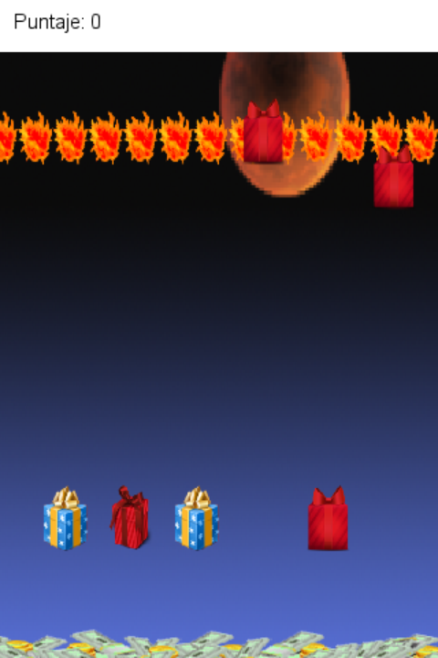
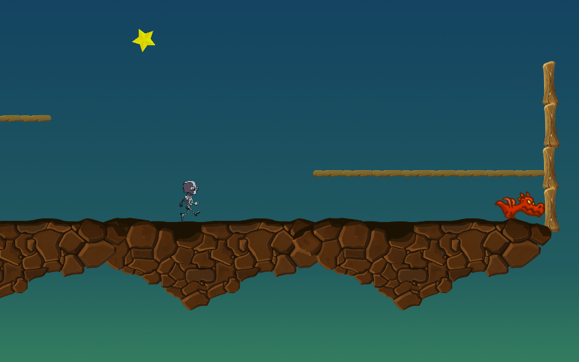

# Original Prototypes Ported — a museum of prototypes

The games and prototypes I published on [itch.io](https://elvisbrevi.itch.io) between 2009 and 2015,
recreated in **Rust + [macroquad](https://macroquad.rs)** so they can be played today on PC and in the
browser (with touch controls on mobile). Each port is rebuilt by reverse-engineering the original
binary with [REA](https://rea.tools/) and uses the original graphics and sounds extracted from it.

The web versions of the ports will replace the ones on each itch.io page, and the games that had no
web version will get one (phase 4 of the plan). Progress is tracked in [PLAN.md](PLAN.md). Every push
builds everything natively and for wasm ([GitHub Actions](.github/workflows/build.yml)):


## Showroom

| Year | Game | Made with | Rust + macroquad port |
|---|---|---|---|
| 2009 | [Proyecto Nutria](#proyecto-nutria) | C# + XNA 3.1 (Windows) | ✅ [games/proyecto-nutria](games/proyecto-nutria) |
| 2009 | [IMAN](#iman) | C# + XNA 3.1 (Windows) | ✅ [games/iman](games/iman) |
| 2011 | [The Electric Eel Attack](#the-electric-eel-attack) | C# + XNA 3.1 + custom engine (Windows) | ✅ [games/the-electric-eel-attack](games/the-electric-eel-attack) |
| 2011 | [Go Ball](#go-ball) | Unity 3.4 (C#, Windows and macOS) | ✅ [games/go-ball](games/go-ball) |
| 2011 | [The Meaning of Christmas](#the-meaning-of-christmas) | Java + libGDX (Android) | ✅ [games/the-meaning-of-christmas](games/the-meaning-of-christmas) |
| 2013 | [Fast Car Racer](#fast-car-racer) | Android (Google Play) | not ported: there is no binary |
| 2014 | [Super Happy Jump](#super-happy-jump) | Unity 4.6 (Web Player, iOS, Android) | ✅ [games/super-happy-jump](games/super-happy-jump) |
| 2014–15 | [Que No Caiga](#que-no-caiga) | Construct 2 (HTML5) | ✅ [games/que-no-caiga](games/que-no-caiga) |
| 2015 | [Retro Penal](#retro-penal) | Construct 2 (HTML5 + NW.js) | ✅ [games/retro-penal](games/retro-penal) |
| 2015 | [One Button Prototype](#one-button-prototype) | Unity 5.1 (Mac, Linux, Android, WebGL) | ✅ [games/one-button-prototype](games/one-button-prototype) |
| 2015 | [Neuro Battle](#neuro-battle) | Unity 5.1 (WebGL, IL2CPP) | ✅ [games/neuro-battle](games/neuro-battle) |
| 2015 | [Da Car](#da-car) | Construct 2 (HTML5) | ✅ [games/da-car](games/da-car) |

The dates come from the binaries themselves (build date, file dates or export date)
and from the gameplay videos. Whatever the files cannot confirm is stated in the entry: when
Que No Caiga was started and which engine Fast Car Racer was made with.

---

### Proyecto Nutria


- **What it is:** two-player action platforming. A coipo (the Chilean "otter") and a chicken
  cross a rock platforming level and pick up boxes with laser guns to shoot each other. The
  chicken was only playable with a controller connected. It has one level and a pause menu with a
  blurred grey background.
- **Made in 2009** with C# + XNA 3.1 for Windows (ClickOnce installer): compiled on
  11-Nov-2009, according to the executable header (prototype video: 3-Oct-2009).
- **Now:** ✅ ported to Rust + macroquad in [games/proyecto-nutria](games/proyecto-nutria), with
  the logic translated from the decompiled C# and the usual graphics, font and pause effect. It is
  playable on PC and in the browser, with touch controls on mobile. It has no sound.
- **itch.io:** [elvisbrevi.itch.io/proyecto-nutria](https://elvisbrevi.itch.io/proyecto-nutria) ·
  [video](https://vimeo.com/6882393)
- **Downloads:** Windows (`.exe`), macOS (universal, Intel + Apple Silicon) and Linux (x86_64) builds on the
  [itch.io page](https://elvisbrevi.itch.io/proyecto-nutria). The binaries are not kept in this repo.
  On macOS, right-click → Open the first time (the binary is not signed).

### IMAN


- **What it is:** a platformer in which a boy uses the magnet from his backpack to pull boxes and
  to lift himself onto moving platforms. Two levels and an ending.
- **Made in 2009** with C# + XNA 3.1 for Windows (ClickOnce installer): compiled on
  13-Nov-2009 (video: 15-Dec-2009).
- **Now:** ✅ ported to Rust + macroquad in [games/iman](games/iman), with the logic translated from
  the decompiled C# and the usual graphics, font, pencil shader and sound. It is playable on
  PC and in the browser, with touch controls on mobile.
- **itch.io:** [elvisbrevi.itch.io/iman](https://elvisbrevi.itch.io/iman) ·
  [video](https://vimeo.com/8196488)
- **Downloads:** Windows (`.exe`), macOS (universal, Intel + Apple Silicon) and Linux (x86_64) builds on the
  [itch.io page](https://elvisbrevi.itch.io/iman). The binaries are not kept in this repo.
  On macOS, right-click → Open the first time (the binary is not signed).

### The Electric Eel Attack


- **What it is:** an action platformer. Yerko collects the three maps of each level to open the
  exit vortex, while electric eels attack him: some patrol and electrify themselves, the
  *kamikazes* jump. You stomp on them or shoot them with battery energy. It has four
  levels: countryside, cavern, city and a factory with an aimed cannon.
- **Made in 2011** with C# + XNA 3.1 and a custom engine (`Engine.dll`: XML levels made with its
  editor, physics, particles and effects), for Windows with ClickOnce. Compiled on 9-Mar-2011,
  version 1.0.0.13 (the engine on 8-Mar-2011), according to the executable headers (video:
  24-Feb-2011).
- **Now:** ✅ ported to Rust + macroquad in
  [games/the-electric-eel-attack](games/the-electric-eel-attack): engine and game translated from the
  decompiled C#, with the usual maps, graphics, fonts, sounds and music and the effects
  rewritten in GLSL. It is playable on PC and in the browser, with touch controls on mobile.
- **itch.io:** [elvisbrevi.itch.io/the-electric-eel-attack](https://elvisbrevi.itch.io/the-electric-eel-attack) ·
  [video](https://vimeo.com/20317603)
- **Downloads:** Windows (`.exe`), macOS (universal, Intel + Apple Silicon) and Linux (x86_64) builds on the
  [itch.io page](https://elvisbrevi.itch.io/the-electric-eel-attack). The binaries are not kept in this repo.
  On macOS, right-click → Open the first time (the binary is not signed).

### Go Ball


- **What it is:** a 3D puzzle with a football that rolls and jumps along a row of
  boxes. To reach the diamond at the end of each level you have to drag some boxes up or
  down with the mouse, while other platforms, clouds and saws move on their own;
  fire and saws make the ball explode. Five levels and a menu in a meadow.
- **Made in 2011** with Unity 3.4.0f5 (C#, with iTween), as a demo for Windows (32 and 64 bit) and
  macOS: compiled on 22-Sep-2011, according to the header of its `Assembly-CSharp.dll` (teaser:
  23-Sep-2011).
- **Now:** ✅ ported to Rust + macroquad in [games/go-ball](games/go-ball): the scripts
  translated from the decompiled C#, and the 3D drawing with the Unity 3.4 shaders rewritten in
  GLSL, custom physics for the ball (instead of PhysX), the particles, the GUI with its skin and
  fonts, the menu terrain and the light flare recreated in `crates/unity`, with the usual
  meshes, textures, sounds and six scenes. It is played with the keyboard and the
  mouse, or on mobile with a D-pad and dragging the boxes with a finger.
- **itch.io:** [elvisbrevi.itch.io/go-ball](https://elvisbrevi.itch.io/go-ball) ·
  [teaser](https://vimeo.com/29466492)
- **Downloads:** Windows (`.exe`), macOS (universal, Intel + Apple Silicon) and Linux (x86_64) builds on the
  [itch.io page](https://elvisbrevi.itch.io/go-ball). The binaries are not kept in this repo.
  On macOS, right-click → Open the first time (the binary is not signed).

### The Meaning of Christmas



- **What it is:** a Christmas game about consumerism. Gifts fall and from below rises a
  mountain of money, which grows with every gift that reaches it. You have to burn the gifts
  three at a time, touching them at the same height, inside the band of fire lit by the
  first one; every burnt gift scores points and makes the money drop. When the money fills the
  screen, you lose. "Silent Night" plays on the title screen.
- **Made in December 2011** with Java + libGDX 0.9.2 for Android, on top of libGDX's
  "hello world": the APK was built on 1-Jan-2012, according to the zip dates (video: 1-Jan-2012).
- **Now:** ✅ ported to Rust + macroquad in
  [games/the-meaning-of-christmas](games/the-meaning-of-christmas): the game translated from the
  Java decompiled with JADX, and whatever it uses from libGDX (the default font, the animation, the
  frame time) translated from the libGDX in the same APK, with the usual images, font and music
  (converted from MP3 to Ogg). It is played with the mouse or by touching the screen, in portrait.
- **itch.io:** [elvisbrevi.itch.io/the-meaning-of-christmas](https://elvisbrevi.itch.io/the-meaning-of-christmas) ·
  [video](https://vimeo.com/34446793)
- **Downloads:** Windows (`.exe`), macOS (universal, Intel + Apple Silicon) and Linux (x86_64) builds on the
  [itch.io page](https://elvisbrevi.itch.io/the-meaning-of-christmas). The binaries are not kept in this repo.
  On macOS, right-click → Open the first time (the binary is not signed).

### Fast Car Racer

- **What it is:** car racing.
- **Made in 2013** for Android and published on Google Play (`cl.gioco.fcr`), according to the video
  from 21-Jan-2013; without the binary there is no telling which engine it used.
- **Now:** not ported: itch.io only links to Google Play and there is no downloadable binary, and
  without it there is no faithful port (see PLAN.md).
- **itch.io:** [elvisbrevi.itch.io/fast-car-racer](https://elvisbrevi.itch.io/fast-car-racer) ·
  [video](https://vimeo.com/57856159)

### Super Happy Jump


- **What it is:** an endless jumping game. A cowboy runs on his own; tap to jump and tap again
  in the air for the double jump. Every 2.5 seconds a pair of cacti appears with a coin in
  the gap: the coin scores a point and touching a cactus ends the run. It saves the best score.
- **Made in 2014** with Unity 4.6.0f3 for the Unity Web Player (it also came out on iOS and Android):
  compiled on 9-Dec-2014, according to the header of its `Assembly-CSharp.dll`.
- **Now:** ✅ ported to Rust + macroquad in [games/super-happy-jump](games/super-happy-jump):
  the scripts translated from the decompiled C#, and the 2D physics (on top of `crates/box2d`), the Animator,
  the particles and the `OnGUI` GUI recreated in `crates/unity`, with the usual images, sounds,
  scene and prefabs. It is played with the mouse or by touching the screen.
- **itch.io:** [elvisbrevi.itch.io/super-happy-jump](https://elvisbrevi.itch.io/super-happy-jump)
- **Downloads:** Windows (`.exe`), macOS (universal, Intel + Apple Silicon) and Linux (x86_64) builds on the
  [itch.io page](https://elvisbrevi.itch.io/super-happy-jump). The binaries are not kept in this repo.
  On macOS, right-click → Open the first time (the binary is not signed).

### Que No Caiga


- **What it is:** keep the ball in the air so it does not fall to the ground: every touch makes the
  player kick. It counts the seconds, and over time more balls and bombs that explode at your feet
  arrive.
- **Made between 2014 and 2015** with Construct 2 (a 2015 version, r20x) for the browser:
  exported on 23-Jul-2015, according to its `offline.appcache`; its itch.io page is from the same
  weeks as the Retro Penal and One Button Prototype pages (by page number). It has the
  theme of the 2014 Brazil World Cup, but the files do not say when it was started.
- **Now:** ✅ ported to Rust + macroquad in [games/que-no-caiga](games/que-no-caiga): the event
  sheets translated from its `data.js`, and whatever it uses from the minified runtime (Platform,
  animations, collisions) translated too, with the usual images, sounds and project.
  It is played with the mouse or by touching the screen.
- **itch.io:** [elvisbrevi.itch.io/que-no-caiga](https://elvisbrevi.itch.io/que-no-caiga)
- **Downloads:** Windows (`.exe`), macOS (universal, Intel + Apple Silicon) and Linux (x86_64) builds on the
  [itch.io page](https://elvisbrevi.itch.io/que-no-caiga). The binaries are not kept in this repo.
  On macOS, right-click → Open the first time (the binary is not signed).

### Retro Penal


- **What it is:** penalty kicks with the Chilean national team. There are three attempts: an arrow
  moves back and forth over the penalty spot and tapping kicks in that direction. The goalkeeper
  dives or crouches, and every goal makes them faster.
- **Made in July 2015** with Construct 2 (a 2015 version, r20x), for the browser and for
  desktop with NW.js (Windows, macOS and Linux): the desktop packages are from 22-Jul-2015 and
  the HTML5 version was exported on 23-Jul-2015, according to its `offline.appcache`.
- **Now:** ✅ ported to Rust + macroquad in [games/retro-penal](games/retro-penal): the event
  sheets translated from its `data.js`, and whatever it uses from the minified runtime (Bullet with
  bouncing off solids, Turret, Custom Movement, Wrap, collisions with rotation, Wait) translated in
  `crates/construct2`, with the usual images, sounds and project. It is played with the
  mouse or by touching the screen.
- **itch.io:** [elvisbrevi.itch.io/retro-penal](https://elvisbrevi.itch.io/retro-penal)
- **Downloads:** Windows (`.exe`), macOS (universal, Intel + Apple Silicon) and Linux (x86_64) builds on the
  [itch.io page](https://elvisbrevi.itch.io/retro-penal). The binaries are not kept in this repo.
  On macOS, right-click → Open the first time (the binary is not signed).

### One Button Prototype



- **What it is:** single-button platforming. A robot runs on his own and turns around when he hits
  a wall; clicking makes him jump. Spikes restart the level, dragons have to be landed on and a
  star at the end opens the window to choose between the three levels.
- **Made in July 2015** with Unity 5.1.2f1 (C#, with the character from the 2D example in the
  Standard Assets modified) for macOS, Linux and Android: compiled on 22-Jul-2015, according to the
  header of its `Assembly-CSharp.dll`. The WebGL version, with the same game, was exported on
  17-Aug-2015.
- **Now:** ✅ ported to Rust + macroquad in
  [games/one-button-prototype](games/one-button-prototype): the scripts translated from the
  decompiled C#, and the 2D physics (with polygonal colliders and interpolation), the
  Animator with blend trees, the GUI with Unity's built-in skin and `GUIText` recreated in
  `crates/unity`, with the usual graphics, font and three scenes. It is played with the
  mouse or by touching the screen. It has no sound, like the original.
- **itch.io:** [elvisbrevi.itch.io/prototipo-2000](https://elvisbrevi.itch.io/prototipo-2000)
- **Downloads:** Windows (`.exe`), macOS (universal, Intel + Apple Silicon) and Linux (x86_64) builds on the
  [itch.io page](https://elvisbrevi.itch.io/prototipo-2000). The binaries are not kept in this repo.
  On macOS, right-click → Open the first time (the binary is not signed).

### Neuro Battle


- **What it is:** action with a neuron that moves through red tissue and joins the neurons
  it touches (basic, long-tailed, defence and attack, which shoot), while enemies arrive from the
  edges: if they touch your neuron, it is over; if they touch a joined one, both die. The
  score is the number of seconds you lasted.
- **Made in 2015** with Unity 5.1.1f1, WebGL only (C# compiled with IL2CPP to asm.js), at the
  GameJam Santo Tomás Concepción 2015 with the team "GROUP_5": the build is from 31-Aug-2015.
- **Now:** ✅ ported to Rust + macroquad in [games/neuro-battle](games/neuro-battle): the logic
  reconstructed from the asm.js with the IL2CPP metadata compiled into its memory (without C#
  assemblies), compared with the original running in a current Chromium, and the 2D physics (with the layer
  matrix on top of `crates/box2d`), the Animator and the GUI in `crates/unity`, with the usual
  graphics, sounds and scenes. It is played with the keyboard, or on mobile with a D-pad and
  buttons.
- **itch.io:** [elvisbrevi.itch.io/neuro-battle](https://elvisbrevi.itch.io/neuro-battle)
- **Downloads:** Windows (`.exe`), macOS (universal, Intel + Apple Silicon) and Linux (x86_64) builds on the
  [itch.io page](https://elvisbrevi.itch.io/neuro-battle). The binaries are not kept in this repo.
  On macOS, right-click → Open the first time (the binary is not signed).

### Da Car


- **What it is:** Dakar-style motorbike racing (the project is called "Dakar 2015"). You accelerate and
  lean the bike to get over the randomly appearing hills and you have to reach the finish line without the
  rider hitting his head; when you crash you start over, but the clock keeps running.
- **Made in 2015** with Construct 2 (a 2015 version) for the browser, with the
  Physics behaviour (Box2D): exported on 23-Nov-2015, according to its `offline.appcache`.
- **Now:** ✅ ported to Rust + macroquad in [games/da-car](games/da-car): the event sheet
  translated from its `data.js`; Box2D 2.3.1 translated to Rust in `crates/box2d` (bit-for-bit identical to
  the Box2D C++ in the test scenes) and the Physics, ScrollTo and Particles behaviours in
  `crates/construct2`, with the usual images, sounds and project. It is played with the
  keyboard, with the mouse or by touching the screen and tilting the phone.
- **itch.io:** [elvisbrevi.itch.io/da-car](https://elvisbrevi.itch.io/da-car)
- **Downloads:** Windows (`.exe`), macOS (universal, Intel + Apple Silicon) and Linux (x86_64) builds on the
  [itch.io page](https://elvisbrevi.itch.io/da-car). The binaries are not kept in this repo.
  On macOS, right-click → Open the first time (the binary is not signed).

---

## How it is organised

```
games/<slug>/        one Cargo crate per game (port + extracted assets + reference from the original)
crates/museo/        shared pieces: virtual screen with letterboxing, fixed step, touch controls and
                     saved preferences (high scores); web template (index.html + mq_js_bundle.js
                     from macroquad) in crates/museo/web
crates/xna/          XNA 3.1 equivalents (Rectangle, Clamp, SpriteBatch.Draw, SpriteFont, Random)
crates/construct2/   Construct 2 runtime: data.js, Sprite, Text, Audio, behaviours, collisions
crates/box2d/        Box2D 2.3.1 in Rust (the one in the Construct 2 Physics behaviour and Unity's
                     2D physics, with its layer filter), compared bit for bit with the original
                     C++ (crates/box2d/comparar)
crates/unity/        Unity pieces: for 4.x and 5.x, escena.json, Time, GameObjects, 2D physics
                     (with polygonal colliders, interpolation and the layer matrix),
                     InputManager, Animator (with blend trees),
                     particles (Shuriken), camera and draw order, IMGUI, GUIText and AudioSource;
                     for 3.x in 3D, Forward rendering with its shaders in GLSL, the physics of a
                     sphere against triangles, the legacy particles, the InputManager, 3D
                     audio, bitmap fonts and the terrain
originales/          original binaries (outside git) and catalogo.json with their sha256
tools/originales.py  inventory and download of the originals from itch.io
tools/build_web.sh   web version of a game in dist/<slug> from the template
tools/xnb_extract.py, tools/unity_assets.py, tools/c2_eventos.py
                     XNA, Unity and Construct 2 content extraction (see PLAN.md)
tools/rea_reconstruction.py   ILSpy C# -> REA's import-managed-reconstruction
tools/ps20_desensamblar.py    pixel shaders ps_2_0 from the XNA effects, to rewrite them in GLSL
tools/humo/          smoke tests: native (Xvfb + xdotool) and web (Playwright: desktop and mobile)
PLAN.md              phased plan with checkpoints
```

## Playing

```sh
cargo run --release -p iman            # PC (or proyecto-nutria, the-electric-eel-attack, go-ball, the-meaning-of-christmas, que-no-caiga, retro-penal, da-car, super-happy-jump, one-button-prototype, neuro-battle)
tools/build_web.sh iman                # web: serve dist/iman with any static server
```

On Linux you need `libasound2-dev`. For the web version: `rustup target add wasm32-unknown-unknown`.

## Recovering the originals

The binaries are not versioned. To download them again from itch.io (it checks the sha256 values in
`originales/catalogo.json`):

```sh
python3 -I tools/originales.py descargar
```
