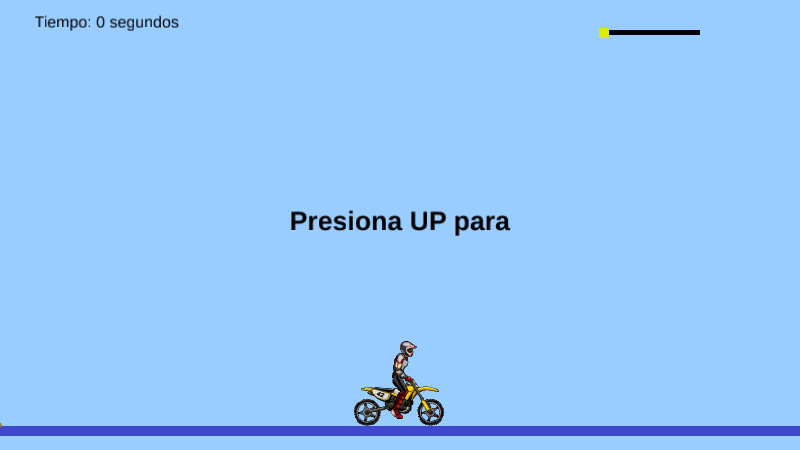
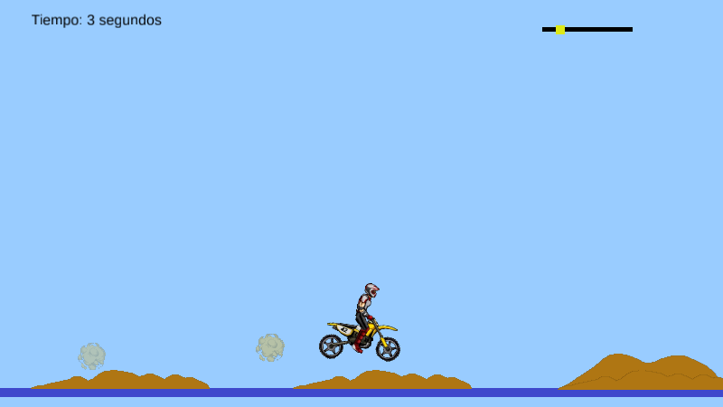
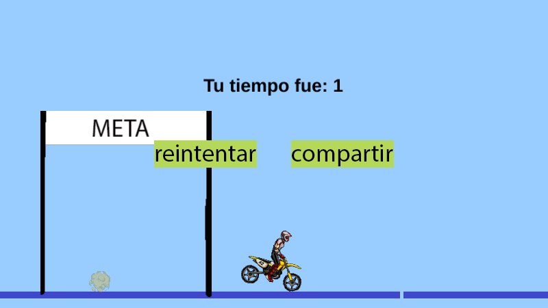
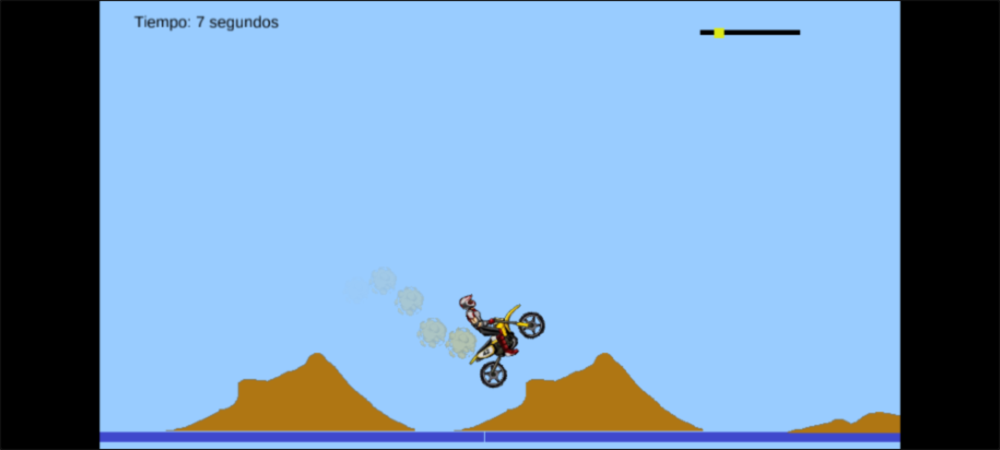

# Da Car — port a Rust + macroquad

Port de **Da Car** (Elvis Brevi, [itch.io](https://elvisbrevi.itch.io/da-car)), un prototipo de
carreras de moto estilo Dakar (el proyecto se llama «Dakar 2015»; sus etiquetas en itch.io son
*dakar* y *moto*), hecho con Construct 2 para el navegador. La moto avanza sobre un terreno con
cerros que aparecen al azar, y hay que llegar a la meta sin que el piloto se golpee la cabeza. Si
se la golpea, se vuelve a empezar, pero el reloj sigue corriendo. La moto, las ruedas y el piloto
son cuerpos de Box2D unidos por articulaciones.

La lógica se tradujo de la hoja de eventos del proyecto (`data.js`) y del runtime minificado de
Construct 2 (`c2runtime.js`), y Box2D, del C++ de Box2D 2.3.1 del que salió el que trae el
runtime. Las imágenes, los sonidos y el proyecto (tipos, polígonos de colisión, comportamientos y
layouts) son los originales: el port lee `data.js` al arrancar. Las piezas del runtime están en
[`crates/construct2`](../../crates/construct2) y Box2D en [`crates/box2d`](../../crates/box2d).

 

 

## Ejecutar

```sh
cargo run --release -p da-car
```

En Linux hacen falta las cabeceras de ALSA y OpenGL/X11 (`sudo apt install libasound2-dev`).
Los assets van embebidos en el binario.

### Versión web

```sh
rustup target add wasm32-unknown-unknown
../../tools/build_web.sh da-car   # genera dist/da-car
```

El `index.html` sale de la plantilla común de [`crates/museo/web`](../../crates/museo/web), que
además pasa la inclinación del dispositivo (`deviceorientation`) al juego. En iOS el permiso se
pide al primer toque.

### Controles táctiles



Como en el original, no hay botones: en móviles y tablets se acelera tocando la pantalla y la moto
se inclina girando el dispositivo. El juego aplica cada tick una velocidad angular de cinco veces
`beta`, la inclinación de adelante hacia atrás. Se juega en horizontal; en vertical queda
centrado.

<br clear="right">

## Controles

| Entrada | Acción |
|---|---|
| ↑ o W, clic o toque (mantener) | Empezar y acelerar |
| ← → o A D | Inclinar la moto hacia atrás o hacia delante |
| Inclinar el dispositivo | Inclinar la moto (solo en móvil) |
| Clic en «reintentar» o toque en «compartir» | Volver a empezar |

## Cómo se hizo

1. **Descarga**: la versión HTML5 que itch.io sirve en un iframe (32 archivos, que
   `tools/originales.py` rastrea uno por uno). Según su `offline.appcache`, se exportó el
   **23-nov-2015** a las 12:34 UTC.
2. **Triaje**:
   - REA ([rea.tools](https://rea.tools/), `rea-agents` 6.7.0), `analyze-javascript-application`:
     sobre toda la carpeta HTML5 pasó del límite de 5 minutos, porque `c2runtime.js` trae Box2D
     compilado a asm.js (quedó la evidencia parcial
     `ev_f8a800c21eda57ade14b763eb01e205e0e138e1f7f099f8827c93554a915dca6`). Se repitió sobre
     `index.html`, `data.js`, `sw.js` y `appmanifest.json`
     (`ev_64c5d91c4dbe33b092df1a5901d3d1a2a6f860445410aa2db0abf6ce0475e50e`, resumen
     `ev_97924980dd5d2edf8462771b8b27a08509732d8797d5c572c723630e687e43c3`), y el runtime se
     leyó a mano.
   - Plugins: Sprite, Text, Particles, Audio, Touch (con el ratón), Mouse y Keyboard.
     Comportamientos: Physics, Wrap y ScrollTo.
3. **Eventos**: [`tools/c2_eventos.py`](../../tools/c2_eventos.py) volcó la hoja «InGame» a
   pseudocódigo (`reference/eventos.txt`) y el proyecto a `reference/resumen.txt`. Los nombres de
   los objetos y de las condiciones y acciones minificadas, identificados leyendo su código
   (`reference/aces.txt`), están en `reference/nombres.json`. En `src/juego.rs` cada grupo de
   eventos es una función, en el orden de la hoja.
4. **Box2D** ([`crates/box2d`](../../crates/box2d)): el runtime trae el `box2d.js` de kripken
   (Box2D 2.3.1 compilado con Emscripten a asm.js). Lo que leía Construct 2 se identificó por los
   desplazamientos de los campos en la memoria del asm.js: la normal de un polígono está a +148
   bytes y su número de vértices a +276, así que `b2_maxPolygonVertices` vale 16 y no 8. Se tradujo
   del C++ de ese mismo commit (`1e6e9da`), en `f32` y con el mismo orden de operaciones:
   - el árbol AABB dinámico con su lista libre, y la fase ancha con su búfer de parejas ordenado y
     sin repetidos;
   - las colisiones círculo-círculo, polígono-círculo y polígono-polígono (SAT con recorte);
   - el solver de contactos con arranque en caliente y el solver por bloques de dos puntos;
   - las islas con el sueño de los cuerpos;
   - el TOI con subpasos;
   - la articulación de revolución con límites y motor.

   Los cuerpos, fijaciones y contactos viven en arenas con listas enlazadas por índice que
   conservan el orden de las del original, porque ese orden decide el resultado.
   [`comparar/comparar.sh`](../../crates/box2d/comparar/comparar.sh) compila ese Box2D con g++ y
   corre las mismas escenas en los dos (una caja, una pila, una bala y una moto con ruedas y
   articulaciones): las trayectorias coinciden bit a bit durante 200 a 600 pasos.
5. **Comportamiento Physics** (`crates/construct2/src/fisica.rs`), traducido del runtime:
   - escala de 50 px por metro;
   - la posición del cuerpo es el centro del cuadrilátero del sprite, no su origen;
   - las formas: el polígono de colisión, partido en piezas convexas con el mismo separador de
     Construct 2 (cada pieza va a `b2PolygonShape::Set`), una caja o un círculo de radio
     `0,01 · min(ancho, alto)` m;
   - un paso fijo de 1/60 s por tick (8 iteraciones de velocidad y 3 de posición), dado en el
     tick del primer objeto con Physics;
   - si un evento o Wrap mueven el sprite, el cuerpo se teletransporta con esa velocidad lineal;
   - los contactos nuevos (`BeginContact`) se registran para la condición «On collision»;
   - las articulaciones se anclan en un punto de imagen del sprite y se borran al destruirse el
     otro objeto.
6. **El resto del runtime**, también en `crates/construct2`:
   - ScrollTo, que lleva la vista al promedio de los objetos en el segundo tick (después de los
     eventos);
   - Wrap en modo «viewport», con la vista de cada capa según su parallax;
   - las capas con parallax, visibilidad y scroll sin límites;
   - el plugin Particles, con los números aleatorios pedidos en el mismo orden;
   - «Trigger once», «Is silent» y el clic de Mouse sobre un objeto.
7. **Entrada**: `crates/museo` ganó `sensores::beta()`, que en la web lee el último
   `deviceorientation` (en nativo vale 0).
8. **Assets**: [`tools/extraer.sh`](tools/extraer.sh) copia las imágenes, los OGG y `data.js`.

## Correspondencia con el original

| Construct 2 | Rust |
|---|---|
| `data.js` (tipos, animaciones, comportamientos, layouts) | `crates/construct2` (`datos.rs`) |
| Box2D 2.3.1 en asm.js | `crates/box2d` |
| Physics, Wrap, ScrollTo, Particles, Sprite, Text, Audio, On collision | `crates/construct2` |
| Tick del runtime y hoja «InGame» | `src/juego.rs` |
| `index.html` (canvas de 800×450) y Touch.Beta | `src/main.rs` con `museo::Pantalla` y `museo::sensores` |

## Rarezas del original que se conservan

- **El tiempo no se reinicia al chocar.** Las variables globales sobreviven a «Restart layout»: el
  reloj sigue sumando entre intentos y solo vuelve a 0 al llegar a la meta.
- El reloj marca 1 en cuanto empieza la carrera: «Every 1 second» no se evalúa mientras no se
  corre, y al volver a evaluarse ya pasó más de un segundo desde la última vez.
- **Los botones del final funcionan durante la carrera.** La capa «GUI Final» solo se oculta, y
  las condiciones de Construct 2 no miran si un objeto se ve. Un clic donde está «reintentar» o un
  toque donde está «compartir» (el centro derecha de la pantalla) reinicia la carrera. El Touch
  también recibe el ratón, así que un clic sobre «compartir» reinicia igual.
- «compartir» no comparte nada: reinicia, como «reintentar».
- En el móvil, tocar «reintentar» no hace nada: es un clic de Mouse, y el Touch de Construct 2
  cancela los clics que el navegador emula tras un toque. Solo «compartir» reinicia.
- Un clic en «reintentar» con el ratón también es un toque, así que la carrera empieza en cuanto
  se reinicia.
- **El juego va más rápido en pantallas de más de 60 Hz.** La física avanza 1/60 s por tick y la
  velocidad de las ruedas sube 15 °/s por tick, sin mirar el tiempo real. En el test de humo (Xvfb,
  sin sincronía vertical, unos 240 fps) la moto llega a la meta en un par de segundos.
- Antes de empezar, la moto se mece unos 30 px adelante y atrás, con un periodo de unos 7 s. Nada
  frena las ruedas, que giran libres en torno a los puntos de imagen de la moto, y esos puntos
  quedan a menos de 1 px de sus centros: ruedan apenas descentradas.
- Al soltar ← o → («Trigger once») se paran las dos ruedas durante un tick, aunque se esté
  acelerando.
- La velocidad sube hasta 2805 °/s, no 2800: se suman 15 mientras sea menor que 2800. Al soltar
  baja de 10 en 10, pero las ruedas siguen girando con lo último que se les dio: la moto sigue
  rodando hasta que algo la frene.
- Tras la meta la moto sigue sola: los eventos que la mueven dejan de correr, pero sus ruedas
  conservan el giro.
- «acelerar» suena una sola vez desde que se abre el juego: exige «Is silent», y el motor en bucle
  que arranca con él nunca deja de sonar, ni al reiniciar.
- Cada uno de los cuatro cerros tira su propio `round(random(0, 4))` y sale si el número es el
  suyo. El primero necesita un 0, que es la mitad de probable que el 1, el 2 o el 3, y el 4 no es
  de ninguno. A veces salen dos o tres cerros encimados. Si no sale ninguno, el spawn sigue atrás y
  se vuelve a tirar en el tick siguiente.
- Los textos se cortan: la caja de «Presiona UP para comenzar» solo tiene sitio para una línea y
  se lee «Presiona UP para». Al final se ve «Tu tiempo fue: N», sin «segundos.».
- El suelo son nueve tramos que Wrap pasa de un lado a otro de la vista. Cada uno reaparece a 1 px
  del borde sin mirar a los demás, así que a veces quedan rendijas.
- La capa del jugador tiene un parallax vertical de 0,1. Si la moto sube mucho (sobre y ≈ 175),
  Wrap ve el suelo por debajo de la vista y lo pasa arriba.
- En el móvil, la inclinación se aplica cada tick y pisa a las flechas. Si el navegador no da la
  orientación, la moto no gira.

## Diferencias con el original

- **Fuentes**: el original dibujaba los textos con la fuente del sistema "Arial". El port usa
  Liberation Sans 2.1.5 (SIL OFL 1.1), con las métricas de Arial, en
  [`crates/construct2/fuentes`](../../crates/construct2/fuentes).
- **Sonido**: se usan los OGG; el navegador elegía entre OGG y M4A, que son el mismo sonido. El
  volumen de 1 dB de los dos sonidos queda en el máximo de macroquad.
- **Box2D**: el del original es asm.js, que hace las cuentas intermedias en `f64` y redondea a
  `f32` al guardar en memoria. El port calcula en `f32`, como el C++ con el que coincide bit a bit,
  así que con el tiempo sus trayectorias se separan de las del navegador.
- **Azar**: el orden de los números aleatorios es el del original, pero el generador es el de
  macroquad, no `Math.random`.
- **Is on mobile**: el original miraba el navegador; el port mira si hay pantalla táctil.
- **Ventana**: el canvas de 800×450 se escala a la ventana con bandas negras, como el resto del
  museo.

## Regenerar los assets

```sh
tools/extraer.sh <carpeta html5>        # por ejemplo ../../originales/da-car/html5
```

## Pruebas

```sh
node ../../tools/humo/nativo.mjs da-car   # tras cargo build --release
node ../../tools/humo/web.mjs da-car      # tras tools/build_web.sh
```

Siguen los pasos de `humo.json`: el inicio, la carrera acelerando y los cerros. Se comprobó aparte:
- treinta segundos acelerando sin parar: choques de la cabeza, reinicios con el tiempo acumulado,
  saltos sobre los cerros, el polvo y el suelo con Wrap;
- con un cambio temporal sin subir (la meta en x = 1500), tomando la captura `meta.png`: la
  pantalla final, el clic en «reintentar», el reinicio con la capa oculta y la carrera que
  arranca con ese mismo clic;
- la inclinación: en Chromium, con la orientación emulada por CDP (`beta` de 0, 30 y −30 llega a
  la página), y en nativo con el juego forzado a móvil y `beta` fijo: con −40 y acelerando, la
  moto se levanta como con ←. No se probó en un móvil de verdad.
