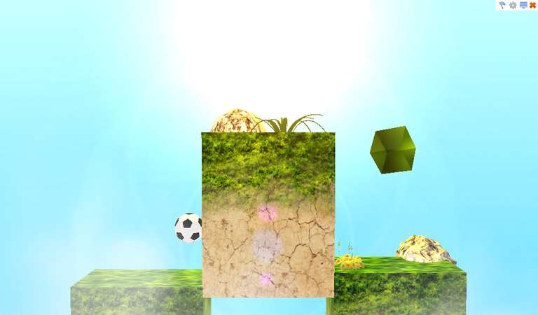
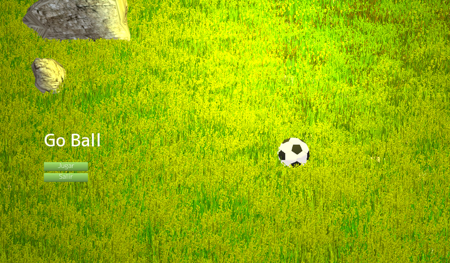
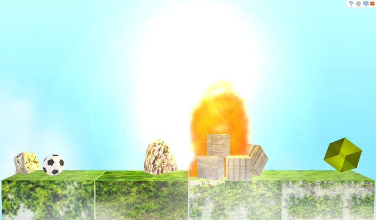
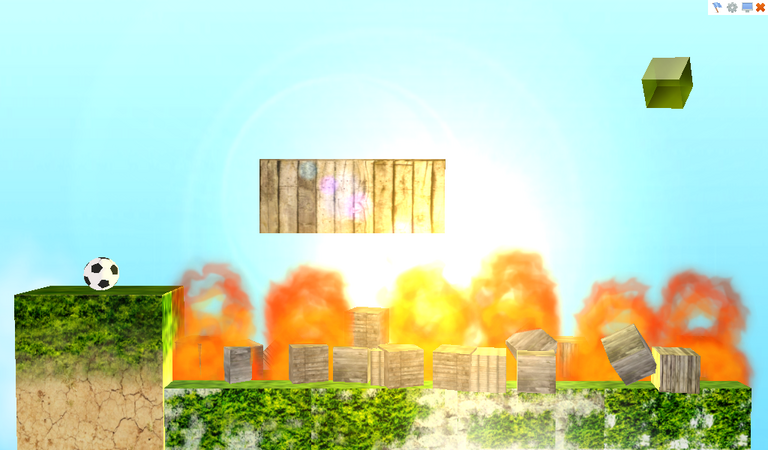
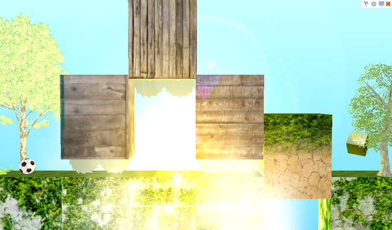
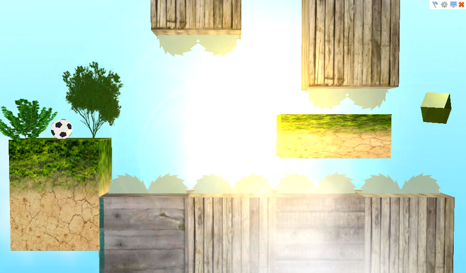
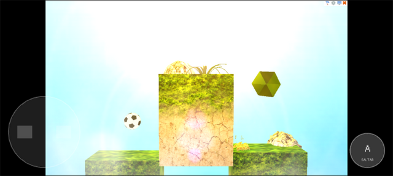

# Go Ball

**Go Ball** (Elvis Brevi, [itch.io](https://elvisbrevi.itch.io/go-ball)) es un juego de puzle
en 3D con una pelota de fútbol. Cada nivel es una fila de cajas con pasto y tierra, vistas de
frente: la pelota rueda a izquierda y derecha y salta, y para llevarla hasta el diamante amarillo
que gira al final hay que arrastrar con el ratón algunas cajas hacia arriba o hacia abajo. Otras
cosas se mueven solas: plataformas, nubes y unas sierras que cuelgan de bloques de madera. El
fuego y las sierras hacen estallar la pelota, y caerse también hace perder: el nivel vuelve a
empezar. Al tocar el diamante, la pelota y el diamante se deshacen en chispas y se pasa al nivel
siguiente; son cinco, y después del último se vuelve al menú, un prado con piedras y la pelota.
Arriba a la derecha hay botones para salir al menú, reiniciar, pasar a pantalla completa y
«Opciones», que solo suena.

Se hizo con Unity 3.4.0f5 (scripts en C# e iTween) en septiembre de 2011, como demo para
Windows y macOS: el build es del 22-sep-2011 y el teaser se subió a Vimeo al día siguiente. Ahora
está portado a Rust + macroquad y se juega en PC y en el navegador, también en móviles con
controles táctiles. La lógica se tradujo del C# decompilado de `Assembly-CSharp.dll`, y lo que
usa del motor (el dibujo 3D con los shaders de Unity 3.4, la física de la pelota, las partículas
heredadas, la GUI con su piel y sus fuentes, el terreno del menú y el destello de la luz) se
recreó en [`crates/unity`](../../crates/unity) a partir de los datos y del código compilado que
vienen en el propio build. Las mallas, las texturas, las fuentes, los sonidos y las seis escenas
son los originales: el port lee al arrancar el `escena.json` que se extrae del build de Windows.

 

 

 

## Ejecutar

```sh
cargo run --release -p go-ball
```

En Linux hacen falta las cabeceras de ALSA y OpenGL/X11 (`sudo apt install libasound2-dev`).
Los assets van embebidos en el binario.

### Versión web

```sh
rustup target add wasm32-unknown-unknown
../../tools/build_web.sh go-ball   # genera dist/go-ball
```

El `index.html` sale de la plantilla común de [`crates/museo/web`](../../crates/museo/web).

### Controles táctiles



En móviles y tablets aparecen una cruceta para rodar a izquierda y derecha y un botón «A» para
saltar. Fuera de los controles, el dedo hace de ratón: toca los botones de la GUI y arrastra las
cajas. Se juega en horizontal; en vertical el juego queda arriba y los controles debajo.

<br clear="right">

## Controles

| Entrada | Acción |
|---|---|
| ← → o A D | Rodar (la pelota acelera poco a poco) |
| ↑ o W | Saltar (después de un salto, solo al volver a tocar la parte de arriba de una caja) |
| Arrastrar con el ratón | Subir o bajar las cajas que se mueven |
| Botones de arriba a la derecha | Reiniciar, opciones (no hace nada), pantalla completa, salir al menú |
| «Jugar» / «Salir» | En el menú |

## Cómo se hizo

1. **Descarga**: los tres zips de la página de itch.io («Go Ball (Demo) Windows x32», «x64» y
   «osx», de 24, 23 y 21 MB), comprobados contra los sha256 de `originales/catalogo.json`. El de
   Windows de 32 bits se extrajo, sin ejecutar nada y sin el `.exe` ni el `.pdb`, en
   `originales/go-ball/win32`.
2. **Triaje**:
   - `Assembly-CSharp.dll`, `-firstpass` y `Assembly-UnityScript.dll` se compilaron el
     **22-sep-2011** a las 04:15 UTC (cabecera PE), con Unity **3.4.0f5** y Mono, y traen sus
     `.mdb`. Es un *Development Build* (`isDebugBuild`, y las capturas de itch.io muestran la
     marca de agua). La compañía es «Babilonis».
   - El build trae su `output_log.txt`: se probó en un netbook con una Intel GMA 3150 (Direct3D 9,
     Shader Model 2.0) a 1024×600, que es también la resolución por defecto del build.
   - `BuildSettings` lista seis escenas: `menuPrincipal` (en `mainData`) y `nivel1` a `nivel5`
     (`level0` a `level4`). La calidad por defecto es «Fantastic» (cuatro luces por píxel,
     vegetación suave) y el camino de render, Forward. No hay lightmaps ni sombras.
   - [REA](https://rea.tools/) (`rea-agents` 6.7.0), sin cargar ni ejecutar nada:
     - `inspect-managed-artifact` de `Assembly-CSharp.dll`
       (`ev_f3b10410c604e1409754d98b8d98c4beb49b09d7eb0ab19ef296839fedf7eb78`).
     - `inspect-managed-members` de los seis tipos del juego: 35 métodos, 54 campos, 382 llamadas,
       262 accesos a campos y los 30 literales que cargan («Horizontal», «Saltar», «Top»,
       «Sierra», «Explosivo1», «Player», «menuPrincipal», «cerrar», «maximizar»...)
       (`ev_8022ac3d81b5715672524d9edfad7041f0da03cf1ef2468f9c8b827d41080d8f`, y repetido al
       portar: `ev_aa3182e8f49e25256ecd11841c17c3ca37bf018c1196122902994edd0d3c7953`, con su
       resumen `ev_34ddca9160bad0e583f74ba99a74a1e278ea73b626a648c6df15bb35d55b6b12`).
3. **ILSpy** (`ilspycmd` 9.1) con el `UnityEngine.dll` 3.4 del mismo build. En
   `reference/csharp` quedan los seis scripts del juego (`Bola`, `MoverObjeto`, `Objetivo`,
   `Camara`, `Transicion` y `EmpezarJuego`, unas 600 líneas) e `iTween`, de terceros, del que solo
   se usa `RotateBy`. `WaterSimple` (Standard Assets) y `TimedObjectDestructor` (UnityScript)
   vienen en el build, pero ninguna escena los usa. Lo que el juego pide de Unity que es código
   administrado se leyó también decompilado de ese `UnityEngine.dll`: `SendMouseEvents` (cómo
   llegan `OnMouseDown` y `OnMouseDrag`), `GUI`, `GUIStyle` y `GUIUtility` (botones, ventanas,
   tooltips y que `GUI.color` vuelve a blanco en cada `OnGUI`).
4. **Assets** ([`tools/extraer.py`](tools/extraer.py), con UnityPy): Unity 3.4 guarda los type
   trees de las clases del motor, pero los MonoBehaviour comparten uno sin los campos del script,
   así que esos se generan con TypeTreeGeneratorAPI desde `Managed/`; la `GUISkin` y el
   `Terrain` son MonoBehaviour de `UnityEngine.dll` con el formato nativo de 3.4 y se leen a mano.
   Extrae:
   - `escena.json`: las seis escenas con su jerarquía y sus componentes (MeshRenderer,
     MeshCollider, BoxCollider, SphereCollider, Rigidbody, Light, Camera, AudioSource, GUITexture,
     las partículas heredadas y los campos de los scripts), los `RenderSettings`, los 44
     materiales con su shader, la piel (los estilos que usan los scripts), las tres fuentes de
     mapa de bits (solo ASCII y Latin-1 de los 1537 caracteres que traen), el destello «85mm
     Lens», el terreno del menú y los ajustes del proyecto;
   - 25 mallas en `mallas/*.bin`: Unity 3.4 guarda las submallas como tiras con triángulos
     degenerados, que se separan en triángulos, y los triángulos de colisión van aparte;
   - 58 texturas (DXT1 y DXT5 decodificadas; las Alpha8 de las fuentes, a blanco con su alfa) y
     las seis caras de los dos cubemaps del diamante;
   - los seis clips de audio (cinco OGG y un WAV) con su duración, y en `terreno/` el mapa de
     alturas (en 8 bits: el máximo es 219 de 32766) y los parches de pasto;
   - y `src/recursos.rs`, que embebe todo en el binario.

   Las 29 `Animation` de las escenas están vacías (las dejaron los modelos importados): lo que se
   mueve lo mueven los scripts e iTween.
5. **El motor** ([`crates/unity`](../../crates/unity)), que traía las piezas 2D de Super Happy
   Jump y One Button Prototype, ganó las de un juego 3D de Unity 3.x, con lo que no se ve leyendo
   el C#:
   - **Dibujo** (`render3d.rs`), con miniquad directamente: búferes estáticos por malla,
     texturas con mipmaps (Unity guarda las filas de abajo hacia arriba), cubemaps, la vista de
     Unity (con el eje z hacia adelante, invertida como su `worldToCameraMatrix`), el skybox y
     las colas de dibujo (opacos, alpha test, las hojas de los árboles en 2901 y los
     transparentes de atrás hacia adelante). miniquad 0.4 apaga el depth test en los pipelines
     que no escriben profundidad, así que los transparentes se dibujan con `glDepthMask` (en la
     web lo agrega el `index.html` de `crates/museo`).
   - **Shaders** (`shaders3d.rs`), reescritos en GLSL desde su código ARB, que viene en el build:
     - Diffuse y Bumped Specular, de superficie: la luz puntual de cada escena va por píxel (la
       calidad «Fantastic» permite cuatro), con la atenuación de Unity, 1 / (1 + 25 d²) sobre el
       rango y un fundido a cero entre 0,8 y 1, y «el doble» que en Unity 5: color × intensidad ×
       2. El ambiente (los armónicos esféricos, que sin luces de vértice son el color ambiente) va
       sin doblar: doblado, con un ambiente de 0,92 todo saldría casi blanco, y las capturas del
       original muestran las texturas con su color.
     - Nature/Tree Soft Occlusion (corteza y hojas): la luz como luz de vértice, la oclusión
       guardada en las tangentes y el combinador «double» de la función fija.
     - Transparent/Cutout/Soft Edge Unlit (los arbustos), con su segunda pasada suave.
     - El shader propio de las nubes («My Shaders/AlphaSelfIllum»), FX/Diamond (el diamante: dos
       pasadas con cubemaps por reflexión), RenderFX/Skybox y Particles/Alpha Blended.
     - El terreno (las capas mezcladas con el mapa de control) y el pasto de
       BillboardWavingDoublePass, con sus ondas de viento.
   - **Física** (`fisica3d.rs`): PhysX 2.8 es cerrado, así que es un solver propio para lo que
     usa el juego, una esfera contra los triángulos de los MeshCollider (cajas hechas de planos y
     sierras), una caja y otras esferas: impulsos secuenciales con 6 iteraciones, el roce de 0,6
     del material por defecto, el *skin width* de 0,01 (`minPenetrationForPenalty`), la
     velocidad angular máxima de 7 y la restricción `FreezePositionZ`. Los colisionadores sin
     Rigidbody son estáticos: si un script los mueve se teletransportan y empujan la pelota
     solo al sacarla de adentro. `AddForce` suma una fuerza que se usa en el próximo paso de
     física y se borra después de él. `OnCollisionEnter` y `OnCollisionStay` llegan por par de
     objetos después de cada paso, y `Physics.Raycast` sirve para el ratón, para las partículas y
     para tapar el destello.
   - **Partículas heredadas** (`particulas3d.rs`): EllipsoidParticleEmitter (el elipsoide son
     los semiejes), ParticleAnimator (cinco colores a lo largo de la vida, crecimiento,
     amortiguación como `damping^dt`), ParticleRenderer (billboards con el tamaño máximo en
     pantalla) y WorldParticleCollider (rebote y `OnParticleCollision`). Un emisor *One Shot*
     lanza toda su emisión cuando no le quedan partículas, y como Unity emite antes de borrar las
     muertas, los scripts llegan a ver `particleCount` en 0 un frame.
   - **Entrada** (`entrada.rs`): los ejes del InputManager con su suavizado (el «Horizontal» va
     hacia ±1 a 3 unidades por segundo, vuelve a 0 igual y con *snap* salta a 0 al cambiar de
     lado) y `GetButtonDown("Saltar")`.
   - **Audio** (`audio3d.rs`): los clips 3D bajan con la distancia a la cámara como el rolloff
     logarítmico de FMOD (distancia mínima / distancia), e `isPlaying` se lleva con la duración
     de cada clip.
   - **GUI** (`gui.rs`): las fuentes de mapa de bits (un rectángulo por carácter en la textura),
     `GUI.color` (que tiñe fondos y textos y vuelve a blanco en cada `OnGUI`), `GUI.DrawTexture`,
     los tooltips de `GUIContent`, que un control con el ratón encima impida `OnMouseDown` en el
     frame siguiente (`GUIUtility.mouseUsed`) y que un estado del estilo sin fondo use el normal.
   - **Terreno** (`terreno.rs`): la malla del mapa de alturas en la zona que ve la cámara (filas
     en z, alturas sobre 32766), las dos capas y unas 3400 matas de pasto en cuatro capas.
   - **El destello** de la luz (el LensFlare del FlareLayer de la cámara): los elementos en la
     línea que va de la luz al centro de la pantalla, con la disposición «1 Large 4 Small» de la
     textura, el giro hacia el centro y el fundido con un rayo de la cámara a la luz.
6. **Los scripts** (`src/juego.rs`): cada script es una estructura con sus campos; los `static`
   (`Bola.posicion`, `perdio`, `gano` y `Activo`, `Objetivo.fin` y los de `Transicion`) viven
   fuera de la escena. iTween `RotateBy` con `easeInOutBack` y `pingPong` está en `src/itween.rs`.
   El frame sigue el orden de Unity 3.4:
   1. si hay un `Application.LoadLevel` pendiente, la escena nueva, el `Start` de sus scripts y
      los AudioSource con *Play On Awake*;
   2. `Time` e `Input`;
   3. los pasos de física de 0,02 s, cada uno con sus `OnCollisionEnter` y `OnCollisionStay`;
   4. `SendMouseEvents`: el rayo de la cámara por el ratón y `OnMouseDown`/`OnMouseDrag`;
   5. los `Update` en el orden del archivo de la escena y las corrutinas (la espera de iTween);
   6. las partículas, con `OnParticleCollision`, y el borrado de lo destruido;
   7. el dibujo, el destello y `OnGUI` de cada script por evento (`Transicion`, `Camara`,
      `EmpezarJuego`), con las ventanas encima.
7. **Comparación con el original**: el build no se ejecuta, pero la página de itch.io tiene cinco
   capturas del juego en marcha (1440×900) y el teaser, de donde salen tres decisiones: el
   ambiente sin doblar, la orientación de las texturas y el tamaño del destello. Unity no publica
   en qué unidades está el tamaño de sus elementos; medido en la fila de la luz de la captura del
   nivel 1, el resplandor de tamaño 50 mide 1,25 altos de pantalla, y con eso la caída del rojo
   coincide punto a punto (blanco hasta 0,3 del alto, 222 a 0,4, 208 a 0,5).

## Correspondencia con el original

| Unity 3.4 | Rust |
|---|---|
| `Go Ball (Demo)_Data` (`mainData`, `level0..4`, `sharedassets*`, `unity default resources`) | `assets/` ([`tools/extraer.py`](tools/extraer.py)) |
| `Assembly-CSharp.dll` (los scripts e iTween) | `src/juego.rs` y `src/itween.rs` |
| `Time`, GameObject, Transform, `Destroy`, `LoadLevel` | `crates/unity` (`tiempo.rs`, `escena3d.rs`) |
| Render Forward, shaders integrados y del proyecto | `crates/unity` (`render3d.rs`, `shaders3d.rs`) |
| PhysX 2.8 (Rigidbody, MeshCollider, BoxCollider, SphereCollider, Raycast) | `crates/unity` (`fisica3d.rs`) |
| Partículas heredadas | `crates/unity` (`particulas3d.rs`) |
| InputManager | `crates/unity` (`entrada.rs`) |
| AudioSource 3D (FMOD) | `crates/unity` (`audio3d.rs`) |
| `OnGUI`, la `GUISkin` y las fuentes de mapa de bits | `crates/unity` (`gui.rs`) |
| Terrain y sus detalles | `crates/unity` (`terreno.rs`) |
| La ventana de 1024×600 | `src/main.rs` con `museo::Pantalla` |

## Rarezas del original que se conservan

- **La pelota acelera según los fps.** `Bola` empuja con `AddForce` desde `Update`, no desde
  `FixedUpdate`: cada fuerza espera al próximo paso de física y se borra después de él. A 60
  frames por segundo y 50 pasos, la aceleración es 1,2 veces la del código; con una pantalla
  más rápida es mayor, y con una más lenta, menor.
- **No rueda a más de 1,68 m/s.** La velocidad angular máxima de PhysX en el proyecto es 7, y con
  el roce la pelota (de radio 0,24) no puede ir más rápido sobre una caja; en el aire, en cambio,
  sigue acelerando.
- **Saltar solo después de tocar un «Top».** El salto fija la velocidad vertical en 4 si la
  pelota tocó algo alguna vez (`colision` no vuelve nunca a false) y no está saltando, y
  `saltando` solo vuelve a false al tocar un objeto con «Top» en el nombre: las paredes no
  sirven.
- **Las cajas se arrastran de 0,05 en 0,05 por frame** hacia el ratón y entre sus límites, así que
  también van más rápido con más fps; el arrastre se para en el borde de la ventana y hay que
  volver a agarrar. Al subir una caja con la pelota encima, la pelota sube porque queda dentro.
- **Las sierras giran siempre.** `MoverObjeto` compara la altura con los límites horizontales (que
  en las sierras son 0) en vez de con `MinRotar`/`MaxRotar`: cada sierra gira a 100°/s, hacia un
  lado si está sobre el suelo del mundo y hacia el otro si está debajo.
- **El fuego mata por sus partículas.** Las llamas son partículas con un WorldParticleCollider
  que choca con todo y avisa con `OnParticleCollision`: la pelota estalla cuando una la toca. Son
  planas (el elipsoide no tiene profundidad), y las cajas de madera de los niveles 2 y 3 no
  tienen colisionador: la pelota las atraviesa.
- **El sonido de la meta se repite** mientras dura el fundido: `Objetivo` lo vuelve a tocar cada
  vez que termina, hasta que carga el nivel siguiente.
- **La explosión se corta**: el AudioSource de la explosión es hijo de la pelota, y la pelota se
  destruye cuando terminan sus chispas.
- **Casi no se oye.** Los sonidos son 3D y la cámara está lejos: la música del menú suena a un 3 %
  (está a 32 unidades), y en los niveles los clics, el fuego y las sierras, a un 10–17 %. Solo
  la explosión, que es 2D, suena entera.
- **«Opciones» solo hace clic** y «Maximizar» cambia a pantalla completa (o a ventana).
- **Las ventanas pausan el juego** (`Time.timeScale = 0`) y oscurecen la pantalla al 70 %; su
  título queda encima de la ventana (el estilo no tiene relleno y desplaza el texto 18 píxeles
  hacia arriba) y sin «¿»: las fuentes del juego no traen ese carácter («Desea salir a la
  pantalla de inicio?», «Desea volver a iniciarla partida?»).
- **El GUITexture de la cámara no se ve**: Unity lo pone según la posición del objeto, que es la
  de la cámara en el mundo, y queda fuera de la pantalla. `Transicion` le cambia el color igual,
  y el fundido a negro se dibuja aparte en `OnGUI`.
- **El destello se apaga con las sierras**: en el nivel 4, cuando el bloque del medio baja, sus
  sierras tapan la luz (el rayo choca con sus MeshCollider) y el destello parpadea.
- La cámara corta a 10 unidades (20 en el menú), y `Camara` alejaría la cámara un 20 % si el
  juego corriera en el Unity Web Player, pero el build es de escritorio.
- `Bola` empujaría la pelota al tocar un «Explosivo1», que no está en ninguna escena.

## Diferencias con el original

- **Física**: un solver propio en lugar de PhysX 2.8 (cerrado). Sigue lo documentado (roce, skin,
  velocidad angular máxima, restricciones, fuerzas por paso), pero los contactos, la fricción y
  la corrección de la penetración no son los de PhysX, y los cuerpos no se duermen (la pelota
  recibe una fuerza en cada `Update`, así que con PhysX tampoco se dormía).
- **Lo que hace Unity por dentro** se dedujo de su documentación, de su código administrado y de
  las capturas: el ambiente sin doblar, la atenuación de las luces, que un estado de estilo sin
  fondo use el normal, el reparto y las ondas del pasto (`_WaveAndDistance` con los valores del
  terreno tal cual), las fórmulas de las partículas heredadas y el tamaño de los elementos del
  destello (calibrado con una captura).
- **Pasto**: las matas están en las mismas muestras y en la misma cantidad, pero en otro lugar
  dentro de cada una (Unity las reparte con su propio azar).
- **Imagen**: sin el antialiasing 2× de la calidad «Fantastic», sin filtrado anisotrópico, con
  mipmaps generados por OpenGL en lugar de los de Unity, y sin la marca de agua de *Development
  Build*.
- **Audio**: los sonidos bajan con la distancia pero no se panean a izquierda o derecha (macroquad
  no panea), y cada clip es una sola voz.
- **Ventana**: el build abría el diálogo de resolución de Unity, en pantalla completa; el port
  usa su resolución por defecto, 1024×600, escalada a la ventana con bandas negras, como el
  resto del museo, y sin la pantalla de presentación de Unity. En la web, «Salir» no cierra nada.
- El eje «Horizontal» también tenía una entrada de mando (eje X del joystick), que no se portó.

## Regenerar los assets

```sh
~/.venvs/museo/bin/python -I tools/extraer.py <carpeta>   # «.../win32/Go Ball (Demo) Windows/Go Ball (Demo)_Data»
```

## Pruebas

```sh
node ../../tools/humo/nativo.mjs go-ball   # tras cargo build --release
node ../../tools/humo/web.mjs go-ball      # tras tools/build_web.sh
```

Siguen los pasos de `humo.json`: el menú, «Jugar», rodar y saltar en el nivel 1, la ventana de
salir y la vuelta al menú. En la web se prueban escritorio, móvil horizontal y móvil vertical.
Se comprobó aparte:
- `cargo test -p unity -p go-ball`: el punto más cercano de un triángulo y los rayos, los ejes del
  InputManager, el ruido del pasto y la curva y el vaivén de iTween;
- en Xvfb, con un registro temporal de posiciones: arrastrar las cajas, rodar contra las paredes,
  saltar y subir con una caja;
- con un cambio temporal (la pelota puesta junto al diamante o al peligro): la meta y el paso al
  nivel siguiente, la muerte en el fuego y en las sierras con el reinicio, y que la meta del
  nivel 5 vuelve al menú;
- con Playwright, toques de CDP en móvil horizontal: arrastrar una caja con el dedo;
- el destello, comparado con la captura del nivel 1 de itch.io en la fila de la luz.

## Pendientes

- **`import-managed-reconstruction` en REA**: como en One Button Prototype, REA autentica la
  Evidence de miembros por su contenido y hay que pasarla entera en la llamada (unos 250 KB, por
  las 245 referencias de todo el ensamblado); no se importó.
- No se pudo comparar con el original en marcha: los binarios originales no se ejecutan, y la
  comparación se hizo con las capturas de itch.io (que no muestran el menú ni las ventanas).
- Los niveles no se jugaron de principio a fin sin ayuda: la meta, el fuego, las sierras y el
  final del nivel 5 se probaron con la pelota puesta a mano.
- El sonido no se probó en hardware real (el servidor no tiene tarjeta de sonido).
- Los controles táctiles se probaron solo en emulación de Chromium.
- El build de macOS no se revisó en detalle: es del mismo día, pero se compiló aparte (sus
  ensamblados y escenas no son idénticos byte a byte a los de Windows).
