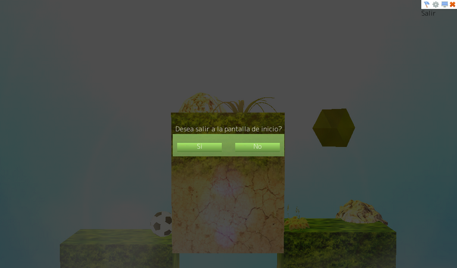

# Go Ball

**Go Ball** (Elvis Brevi, [itch.io](https://elvisbrevi.itch.io/go-ball)) is a 3D puzzle
game with a football. Each level is a row of grass-and-dirt boxes seen from the
front: the ball rolls left and right and jumps, and to take it to the yellow diamond
that spins at the end you have to drag some boxes up or down with the mouse. Other
things move on their own: platforms, clouds and some saws hanging from wooden blocks. The
fire and the saws make the ball explode, and falling also loses: the level starts
over. When you touch the diamond, the ball and the diamond dissolve into sparks and you go to the next
level; there are five, and after the last one you return to the menu, a meadow with stones and the ball.
At the top right there are buttons to go back to the menu, restart, switch to fullscreen and
"Options", which only makes a sound.

It was made with Unity 3.4.0f5 (scripts in C# and iTween) in September 2011, as a demo for
Windows and macOS: the build is from 22-Sep-2011 and the teaser was uploaded to Vimeo the next day. It is now
ported to Rust + macroquad and plays on PC and in the browser, also on mobile with
touch controls. The logic was translated from the C# decompiled from `Assembly-CSharp.dll`, and whatever it
uses from the engine (3D drawing with the Unity 3.4 shaders, the ball's physics, the legacy
particles, the GUI with its skin and fonts, the menu terrain and the light flare) was
recreated in [`crates/unity`](../../crates/unity) from the data and the compiled code that
come in the build itself. The meshes, textures, fonts, sounds and six scenes
are the originals: at startup the port reads the `escena.json` extracted from the Windows build.

 

 

 

## Running

```sh
cargo run --release -p go-ball
```

On Linux you need the ALSA and OpenGL/X11 headers (`sudo apt install libasound2-dev`).
The assets are embedded in the binary.

### Web version

```sh
rustup target add wasm32-unknown-unknown
../../tools/build_web.sh go-ball   # generates dist/go-ball
```

The `index.html` comes from the common template in [`crates/museo/web`](../../crates/museo/web).

### Touch controls


On phones and tablets a D-pad to roll left and right and an "A" button to
jump appear. Outside the controls, the finger acts as a mouse: it touches the GUI buttons and drags the
boxes. It is played in landscape; in portrait the game sits at the top and the controls below.

<br clear="right">

## Controls

| Input | Action |
|---|---|
| ← → or A D | Roll (the ball accelerates gradually) |
| ↑ or W | Jump (after a jump, only when touching the top of a box again) |
| Drag with the mouse | Raise or lower the boxes that move |
| Buttons at the top right | Restart, options (does nothing), fullscreen, back to the menu |
| "Jugar" / "Salir" | In the menu |



## How it was made

1. **Download**: the three zips from the itch.io page ("Go Ball (Demo) Windows x32", "x64" and
   "osx", of 24, 23 and 21 MB), checked against the sha256 values in `originales/catalogo.json`. The
   32-bit Windows one was extracted, without running anything and without the `.exe` or the `.pdb`, into
   `originales/go-ball/win32`.
2. **Triage**:
   - `Assembly-CSharp.dll`, `-firstpass` and `Assembly-UnityScript.dll` were compiled on
     **22-Sep-2011** at 04:15 UTC (PE header), with Unity **3.4.0f5** and Mono, and they bring their
     `.mdb` files. It is a *Development Build* (`isDebugBuild`, and the itch.io captures show the
     watermark). The company is "Babilonis".
   - The build brings its own `output_log.txt`: it was tested on a netbook with an Intel GMA 3150 (Direct3D 9,
     Shader Model 2.0) at 1024×600, which is also the build's default resolution.
   - `BuildSettings` lists six scenes: `menuPrincipal` (in `mainData`) and `nivel1` to `nivel5`
     (`level0` to `level4`). The default quality is "Fantastic" (four per-pixel lights,
     soft vegetation) and the render path is Forward. There are no lightmaps or shadows.
   - [REA](https://rea.tools/) (`rea-agents` 6.7.0), without loading or running anything:
     - `inspect-managed-artifact` of `Assembly-CSharp.dll`
       (`ev_f3b10410c604e1409754d98b8d98c4beb49b09d7eb0ab19ef296839fedf7eb78`).
     - `inspect-managed-members` of the game's six types: 35 methods, 54 fields, 382 calls,
       262 field accesses and the 30 literals they load ("Horizontal", "Saltar", "Top",
       "Sierra", "Explosivo1", "Player", "menuPrincipal", "cerrar", "maximizar"...)
       (`ev_8022ac3d81b5715672524d9edfad7041f0da03cf1ef2468f9c8b827d41080d8f`, and repeated when
       porting: `ev_aa3182e8f49e25256ecd11841c17c3ca37bf018c1196122902994edd0d3c7953`, with its
       summary `ev_34ddca9160bad0e583f74ba99a74a1e278ea73b626a648c6df15bb35d55b6b12`).
3. **ILSpy** (`ilspycmd` 9.1) with the 3.4 `UnityEngine.dll` from the same build. `reference/csharp`
   keeps the game's six scripts (`Bola`, `MoverObjeto`, `Objetivo`,
   `Camara`, `Transicion` and `EmpezarJuego`, about 600 lines) and `iTween`, third-party, of which only
   `RotateBy` is used. `WaterSimple` (Standard Assets) and `TimedObjectDestructor` (UnityScript)
   come in the build, but no scene uses them. Whatever the game asks of Unity that is managed
   code was also read decompiled from that `UnityEngine.dll`: `SendMouseEvents` (how
   `OnMouseDown` and `OnMouseDrag` arrive), `GUI`, `GUIStyle` and `GUIUtility` (buttons, windows,
   tooltips and the fact that `GUI.color` goes back to white on every `OnGUI`).
4. **Assets** ([`tools/extraer.py`](tools/extraer.py), with UnityPy): Unity 3.4 stores the type
   trees of the engine classes, but the MonoBehaviours share one without the script's fields,
   so those are generated with TypeTreeGeneratorAPI from `Managed/`; the `GUISkin` and the
   `Terrain` are MonoBehaviours from `UnityEngine.dll` with the 3.4 native format and are read by hand.
   It extracts:
   - `escena.json`: the six scenes with their hierarchy and components (MeshRenderer,
     MeshCollider, BoxCollider, SphereCollider, Rigidbody, Light, Camera, AudioSource, GUITexture,
     the legacy particles and the script fields), the `RenderSettings`, the 44
     materials with their shader, the skin (the styles the scripts use), the three bitmap
     fonts (only ASCII and Latin-1 of the 1537 characters they bring), the "85mm
     Lens" flare, the menu terrain and the project settings;
   - 25 meshes in `mallas/*.bin`: Unity 3.4 stores submeshes as strips with degenerate
     triangles, which are split into triangles, and the collision triangles are kept separate;
   - 58 textures (DXT1 and DXT5 decoded; the fonts' Alpha8 ones, turned white with their alpha) and
     the six faces of the diamond's two cubemaps;
   - the six audio clips (five OGG and one WAV) with their duration, and in `terreno/` the height
     map (8-bit: the maximum is 219 out of 32766) and the grass patches;
   - and `src/recursos.rs`, which embeds everything in the binary.

   The scenes' 29 `Animation`s are empty (the imported models left them that way): whatever moves
   is moved by the scripts and iTween.
5. **The engine** ([`crates/unity`](../../crates/unity)), which brought the 2D pieces from Super Happy
   Jump and One Button Prototype, gained those of a 3D game from Unity 3.x, with what you cannot see by reading
   the C#:
   - **Drawing** (`render3d.rs`), with miniquad directly: static buffers per mesh,
     textures with mipmaps (Unity stores the rows bottom-up), cubemaps, the Unity view
     (with the z axis forward, flipped like its `worldToCameraMatrix`), the skybox and
     the draw queues (opaque, alpha test, the tree leaves at 2901 and the
     transparents from back to front). miniquad 0.4 turns off depth test in pipelines
     that do not write depth, so the transparents are drawn with `glDepthMask` (on the
     web it is added by the `index.html` from `crates/museo`).
   - **Shaders** (`shaders3d.rs`), rewritten in GLSL from their ARB code, which comes in the build:
     - Diffuse and Bumped Specular, surface shaders: each scene's point light is per pixel (the
       "Fantastic" quality allows four), with Unity's attenuation, 1 / (1 + 25 d²) over the
       range and a fade to zero between 0.8 and 1, and "the double" that Unity 5 has: colour × intensity ×
       2. The ambient (the spherical harmonics, which without vertex lights are the ambient colour) goes
       without doubling: doubled, with an ambient of 0.92 everything would come out almost white, and the
       original's captures show the textures with their colour.
     - Nature/Tree Soft Occlusion (bark and leaves): the light as vertex light, the occlusion
       stored in the tangents and the fixed function's "double" combiner.
     - Transparent/Cutout/Soft Edge Unlit (the bushes), with its soft second pass.
     - The clouds' own shader ("My Shaders/AlphaSelfIllum"), FX/Diamond (the diamond: two
       passes with reflection cubemaps), RenderFX/Skybox and Particles/Alpha Blended.
     - The terrain (the layers blended with the control map) and the
       BillboardWavingDoublePass grass, with its wind waves.
   - **Physics** (`fisica3d.rs`): PhysX 2.8 is closed, so it is a custom solver for what the game
     uses, a sphere against the triangles of the MeshColliders (boxes made of planes and
     saws), a box and other spheres: sequential impulses with 6 iterations, the 0.6 friction
     of the default material, the *skin width* of 0.01 (`minPenetrationForPenalty`), the
     maximum angular velocity of 7 and the `FreezePositionZ` constraint. The colliders without a
     Rigidbody are static: if a script moves them they are teleported and push the ball
     only by getting it out of the inside. `AddForce` adds a force that is used in the next physics
     step and cleared after it. `OnCollisionEnter` and `OnCollisionStay` arrive per pair of
     objects after each step, and `Physics.Raycast` is used for the mouse, for the particles and
     to occlude the flare.
   - **Legacy particles** (`particulas3d.rs`): EllipsoidParticleEmitter (the ellipsoid is
     the semi-axes), ParticleAnimator (five colours over the lifetime, growth,
     damping as `damping^dt`), ParticleRenderer (billboards with the maximum size on
     screen) and WorldParticleCollider (bounce and `OnParticleCollision`). A *One Shot* emitter
     fires its whole emission when it has no particles left, and since Unity emits before erasing the
     dead ones, the scripts do get to see `particleCount` at 0 for one frame.
   - **Input** (`entrada.rs`): the InputManager axes with their smoothing ("Horizontal" goes
     towards ±1 at 3 units per second, returns to 0 the same way and with *snap* jumps to 0 when changing
     side) and `GetButtonDown("Saltar")`.
   - **Audio** (`audio3d.rs`): the 3D clips drop with the distance to the camera like FMOD's logarithmic
     rolloff (minimum distance / distance), and `isPlaying` is tracked with each clip's
     duration.
   - **GUI** (`gui.rs`): the bitmap fonts (one rectangle per character in the texture),
     `GUI.color` (which tints backgrounds and texts and goes back to white on every `OnGUI`), `GUI.DrawTexture`,
     the `GUIContent` tooltips, the fact that a control with the mouse over it prevents `OnMouseDown` on the
     next frame (`GUIUtility.mouseUsed`) and that a style state without background uses the normal one.
   - **Terrain** (`terreno.rs`): the height map's mesh in the area the camera sees (rows
     in z, heights over 32766), the two layers and about 3400 grass tufts in four layers.
   - **The flare** of the light (the LensFlare of the camera's FlareLayer): the elements on the
     line from the light to the centre of the screen, with the "1 Large 4 Small" layout of the
     texture, the rotation towards the centre and the fade with a ray from the camera to the light.
6. **The scripts** (`src/juego.rs`): each script is a struct with its fields; the `static`s
   (`Bola.posicion`, `perdio`, `gano` and `Activo`, `Objetivo.fin` and `Transicion`'s ones) live
   outside the scene. iTween `RotateBy` with `easeInOutBack` and `pingPong` is in `src/itween.rs`.
   The frame follows Unity 3.4's order:
   1. if there is a pending `Application.LoadLevel`, the new scene, its scripts' `Start` and
      the AudioSources with *Play On Awake*;
   2. `Time` and `Input`;
   3. the 0.02 s physics steps, each with its `OnCollisionEnter` and `OnCollisionStay`;
   4. `SendMouseEvents`: the camera ray through the mouse and `OnMouseDown`/`OnMouseDrag`;
   5. the `Update`s in the order of the scene file and the coroutines (iTween's wait);
   6. the particles, with `OnParticleCollision`, and the erasing of destroyed objects;
   7. the drawing, the flare and each script's `OnGUI` per event (`Transicion`, `Camara`,
      `EmpezarJuego`), with the windows on top.
7. **Comparison with the original**: the build is not run, but the itch.io page has five
   captures of the game running (1440×900) and the teaser, from which three decisions come: the
   ambient without doubling, the orientation of the textures and the size of the flare. Unity does not publish
   in which units its elements' size is; measured on the light's row in the level 1 capture,
   the size-50 glow measures 1.25 screen-heights, and with that the fall-off of red
   matches point by point (white up to 0.3 of the height, 222 at 0.4, 208 at 0.5).

## Correspondence with the original

| Unity 3.4 | Rust |
|---|---|
| `Go Ball (Demo)_Data` (`mainData`, `level0..4`, `sharedassets*`, `unity default resources`) | `assets/` ([`tools/extraer.py`](tools/extraer.py)) |
| `Assembly-CSharp.dll` (the scripts and iTween) | `src/juego.rs` and `src/itween.rs` |
| `Time`, GameObject, Transform, `Destroy`, `LoadLevel` | `crates/unity` (`tiempo.rs`, `escena3d.rs`) |
| Forward rendering, built-in and project shaders | `crates/unity` (`render3d.rs`, `shaders3d.rs`) |
| PhysX 2.8 (Rigidbody, MeshCollider, BoxCollider, SphereCollider, Raycast) | `crates/unity` (`fisica3d.rs`) |
| Legacy particles | `crates/unity` (`particulas3d.rs`) |
| InputManager | `crates/unity` (`entrada.rs`) |
| 3D AudioSource (FMOD) | `crates/unity` (`audio3d.rs`) |
| `OnGUI`, the `GUISkin` and the bitmap fonts | `crates/unity` (`gui.rs`) |
| Terrain and its details | `crates/unity` (`terreno.rs`) |
| The 1024×600 window | `src/main.rs` with `museo::Pantalla` |

## Original quirks that are kept

- **The ball accelerates according to fps.** `Bola` pushes with `AddForce` from `Update`, not from
  `FixedUpdate`: each force waits for the next physics step and is cleared after it. At 60
  frames per second and 50 steps, the acceleration is 1.2 times the code's; on a faster
  screen it is greater, and on a slower one, less.
- **It does not roll faster than 1.68 m/s.** The project's maximum PhysX angular velocity is 7, and with
  friction the ball (radius 0.24) cannot go faster on a box; in the air, on the other hand,
  it keeps accelerating.
- **Jump only after touching a "Top".** The jump sets the vertical velocity to 4 if the
  ball has ever touched something (`colision` never goes back to false) and is not jumping, and
  `saltando` only goes back to false when touching an object with "Top" in its name: the walls do not
  work.
- **The boxes are dragged in steps of 0.05 per frame** towards the mouse and within their limits, so
  they also move faster with more fps; the drag stops at the edge of the window and you have to
  grab again. When raising a box with the ball on top, the ball goes up because it ends up inside.
- **The saws always spin.** `MoverObjeto` compares the height with the horizontal limits (which
  in the saws are 0) instead of with `MinRotar`/`MaxRotar`: each saw spins at 100°/s, one
  way if it is above the world's ground and the other way if it is below.
- **The fire kills through its particles.** The flames are particles with a WorldParticleCollider
  that collides with everything and reports with `OnParticleCollision`: the ball explodes when one touches it. They are
  flat (the ellipsoid has no depth), and the wooden boxes in levels 2 and 3 have no
  collider: the ball goes through them.
- **The goal sound repeats** for as long as the fade lasts: `Objetivo` plays it again every
  time it ends, until the next level loads.
- **The explosion is cut off**: the explosion's AudioSource is a child of the ball, and the ball is
  destroyed when its sparks end.
- **You hardly hear anything.** The sounds are 3D and the camera is far away: the menu music plays at 3 %
  (it is 32 units away), and in the levels the clicks, the fire and the saws at 10–17 %. Only
  the explosion, which is 2D, plays in full.
- **"Options" only clicks** and "Maximizar" switches to fullscreen (or to a window).
- **The windows pause the game** (`Time.timeScale = 0`) and darken the screen to 70 %; their
  title sits above the window (the style has no padding and moves the text 18 pixels
  up) and without "¿": the game's fonts do not bring that character ("Desea salir a la
  pantalla de inicio?", "Desea volver a iniciarla partida?").
- **The camera's GUITexture is not seen**: Unity places it according to the object's position, which is the
  camera's in the world, and it ends up off screen. `Transicion` changes its colour anyway,
  and the fade to black is drawn separately in `OnGUI`.
- **The flare is occluded by the saws**: in level 4, when the middle block lowers, its
  saws cover the light (the ray hits their MeshColliders) and the flare flickers.
- The camera clips at 10 units (20 in the menu), and `Camara` would pull the camera back by 20 % if the
  game ran in the Unity Web Player, but the build is a desktop one.
- `Bola` would push the ball when touching an "Explosivo1", which is not in any scene.

## Differences from the original

- **Physics**: a custom solver instead of PhysX 2.8 (closed). It follows what is documented (friction, skin,
  maximum angular velocity, constraints, per-step forces), but the contacts, the friction and
  the penetration correction are not PhysX's, and the bodies do not sleep (the ball
  receives a force on every `Update`, so with PhysX it would not sleep either).
- **What Unity does internally** was deduced from its documentation, its managed code and
  the captures: the ambient without doubling, the light attenuation, that a style state without
  background uses the normal one, the distribution and the waves of the grass (`_WaveAndDistance` with the
  terrain's values as they are), the formulas of the legacy particles and the size of the flare
  elements (calibrated with a capture).
- **Grass**: the tufts are in the same samples and in the same quantity, but in a different place
  within each one (Unity distributes them with its own randomness).
- **Image**: without the 2× antialiasing of the "Fantastic" quality, without anisotropic filtering, with
  mipmaps generated by OpenGL instead of Unity's, and without the *Development
  Build* watermark.
- **Audio**: the sounds drop with distance but are not panned left or right (macroquad
  does not pan), and each clip is a single voice.
- **Window**: the build opened Unity's resolution dialog, in fullscreen; the port
  uses its default resolution, 1024×600, scaled to the window with black letterboxing, like the
  rest of the museum, and without Unity's splash screen. On the web, "Salir" closes nothing.
- The "Horizontal" axis also had a gamepad binding (the joystick's X axis), which was not ported.

## Regenerating the assets

```sh
~/.venvs/museo/bin/python -I tools/extraer.py <folder>   # ".../win32/Go Ball (Demo) Windows/Go Ball (Demo)_Data"
```

## Tests

```sh
node ../../tools/humo/nativo.mjs go-ball   # after cargo build --release
node ../../tools/humo/web.mjs go-ball      # after tools/build_web.sh
```

They follow the steps in `humo.json`: the menu, "Jugar", rolling and jumping in level 1, the exit
window and the return to the menu. On the web, desktop, mobile landscape and mobile portrait are tested.
Checked separately:
- `cargo test -p unity -p go-ball`: the closest point of a triangle and the rays, the InputManager
  axes, the grass noise and iTween's curve and back-and-forth;
- in Xvfb, with a temporary position log: dragging the boxes, rolling against the walls,
  jumping and going up on a box;
- with a temporary change (the ball placed next to the diamond or next to the danger): the goal and the move to the
  next level, death in the fire and in the saws with the restart, and that the level 5 goal
  returns to the menu;
- with Playwright, CDP taps in mobile landscape: dragging a box with a finger;
- the flare, compared with the level 1 capture from itch.io on the light's row.

## Pending

- **`import-managed-reconstruction` in REA**: as in One Button Prototype, REA authenticates the
  members Evidence by its content and it has to be passed whole in the call (about 250 KB, because of
  the 245 references of the whole assembly); it was not imported.
- It could not be compared with the original running: the original binaries are not run, and the
  comparison was made with the itch.io captures (which do not show the menu or the windows).
- The levels were not played from start to finish without help: the goal, the fire, the saws and the
  end of level 5 were tested with the ball placed by hand.
- Sound was not tested on real hardware (the server has no sound card). On the web, the
  menu music does not start until the first click or tap: browsers let nothing play
  before that.
- The touch controls were tested only in Chromium emulation.
- The macOS build was not reviewed in detail: it is from the same day, but it was compiled separately (its
  assemblies and scenes are not byte-for-byte identical to the Windows ones).
