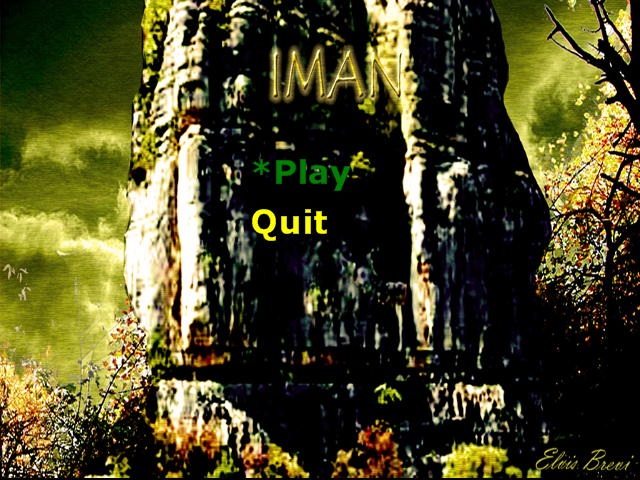
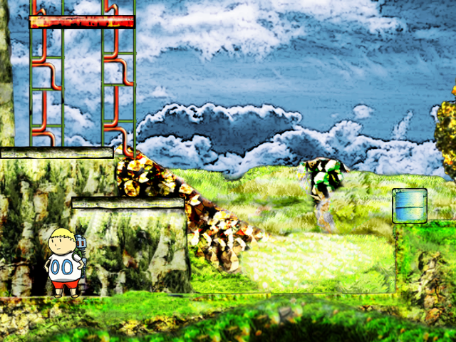

# IMAN (Prototipo) — port a Rust + macroquad

Port del plataformero **IMAN** (Elvis Brevi, 2009, [itch.io](https://elvisbrevi.itch.io/iman)),
escrito originalmente en C# con XNA 3.1. La lógica se reconstruyó por ingeniería inversa del
ejecutable publicado y se tradujo casi línea por línea. Los gráficos, la fuente, el shader y el
sonido son los originales, extraídos de los `.xnb` / `.xwb`.

 

## Ejecutar

```sh
cargo run --release -p iman
```

En Linux hacen falta las cabeceras de ALSA y OpenGL/X11 (`sudo apt install libasound2-dev`).
Los assets van embebidos en el binario, así que se puede ejecutar desde cualquier carpeta.

### Versión web

```sh
rustup target add wasm32-unknown-unknown
../../tools/build_web.sh iman   # genera dist/iman (index.html + mq_js_bundle.js + iman.wasm)
butler push ../../dist/iman elvisbrevi/imn-2026:html5   # prueba de publicación del port
```

El `index.html` sale de la plantilla común de [`crates/museo/web`](../../crates/museo/web), con el
título de `[package.metadata.museo]` en `Cargo.toml`. En la web, Esc y la opción "Quit" no hacen nada (no hay ventana que cerrar).

### Controles táctiles

En móviles y tablets aparecen una cruceta, los botones A (imán) y B (salto) y START. Los dibuja el
crate compartido [`crates/museo`](../../crates/museo), configurado en `src/main.rs`: se activan si el
navegador indica un puntero táctil (`(pointer: coarse)`) o en cuanto llega el primer toque. Admiten
varios dedos a la vez (andar y saltar). En vertical el juego se coloca arriba y los controles debajo.

## Controles

| Tecla | Acción |
|---|---|
| ← / → | Mover |
| X | Saltar (botón "B"; mantener para saltar más alto) |
| Z | Usar el imán (botón "A") / elegir opción del menú |
| ↑ | Apuntar el imán hacia arriba |
| ↑ / ↓ | Moverse por el menú |
| Enter | Pausa |
| F4 | Pantalla completa |
| Esc | Salir |

El imán sale de la mochila, así que apunta al lado contrario de donde mira el niño. Atrae las
cajas/barriles hacia el niño y, apuntando hacia arriba, lo eleva hacia una plataforma móvil.

## Cómo se hizo

1. **Descarga**: `IMAN_(Prototipo).rar` de itch.io. Es un despliegue ClickOnce de XNA 3.1:
   `Iman.exe` (43 KB, CIL puro, CLR 2.0) y la carpeta `Content/`.
2. **REA** ([rea.tools](https://rea.tools/), `rea-agents` 6.5.0):
   - `inspect-managed-artifact`: ensamblado PE32 x86, solo IL, metadatos completos.
   - `inspect-managed-members`: 33 tipos, 160 métodos, 214 campos, 28 cadenas (rutas de contenido,
     nombres del shader, textos del menú).
   - `import-managed-reconstruction`: el C# decompilado de los 75 métodos con lógica quedó anclado
     al hash exacto de IL y firma de cada método
     (`ev_407cda2868622f5d8af545932c3621da2277a883ae85946f3e3e2955380c71a0`).
3. **ILSpy** (`ilspycmd` 9.1) para obtener C# legible, resolviendo referencias contra los
   ensamblados del *XNA Framework Redistributable 3.1* de Microsoft. Esa referencia también sirvió
   para comprobar la semántica de XNA que el port tiene que copiar:
   - `SpriteSortMode.Immediate` vale 0 en XNA 3.1, así que el shader del título **sí** se aplica.
   - `MathHelper.Clamp` aplica primero el máximo y luego el mínimo; la física depende de ello.
   - `SpriteBatch` voltea solo las UV, filtra en lineal con clamp y mezcla alfa no premultiplicado.
   - `Game` usa paso fijo de 166667 ticks (~60 Hz); toda la física va en píxeles por paso.
   - Algoritmo de `SpriteFont.InternalDraw` (kerning, recorte y espaciado).
4. **Assets**: `tools/xnb_extract.py` lee los XNB v4 sin comprimir (texturas `Color` y DXT3), la
   `SpriteFont` (glifos, recortes, kerning) y el banco de ondas XACT (PCM de 8 bits a 8 kHz, que se
   remuestrea a 44,1 kHz porque quad-snd no remuestrea).
5. **Shader**: `PostprocessEffect.xnb` es el efecto del sample *Non-Photorealistic* de XNA; los
   valores por defecto se leyeron del binario (`SketchThreshold = 0.1`, `SketchBrightness = 0.333`)
   y la técnica `ColorSketch` se reescribió en GLSL.

`reference/csharp/` contiene el C# decompilado como referencia para comparar con el port.

## Correspondencia con el original

| C# (XNA) | Rust |
|---|---|
| `Game1`, `Program`, `Camaras.Camera2D` | `main.rs` (con `museo::PasoFijo` y `museo::Pantalla`), `escenarios::Camara` |
| `Controles.PCInput` / `Control` | `control.rs` |
| `Objetos.Objeto`, `Plataforma`, `Niño` | `objetos.rs` |
| `Fisicas.Fisica` | `fisica.rs` |
| `Escenarios.Escenario`, `Escenario_01`, `Escenario_02` | `escenarios.rs` |
| `Graficos.*` (Cielo, Background, Suelo, Front, Ramas) | `graficos.rs` |
| `Menus.Menu` | `menu.rs` |
| `Shaders.NonPhotoRealistic` | `shader.rs` |
| `MathHelper`, `Rectangle`, colores | `xna.rs` |

Se conservan también las rarezas del original, porque forman parte de cómo se juega: el niño y las
cajas quedan unos píxeles hundidos en el suelo (la gravedad nunca se reinicia al aterrizar), el
`Clamp` invertido de las colisiones, y que los créditos se activen (invisibles) al empezar el
nivel 2.

## Diferencias con el original

- **Mando**: el original usaba DirectInput (`JoystickNormal`); este port solo admite teclado.
- **F4**: el original alternaba pantalla completa en cada paso mientras F4 estaba pulsada; aquí
  alterna una vez por pulsación.
- **Ventana**: el juego se dibuja en 640×480 y se escala a la ventana con bandas negras.
- **Audio**: el motor XACT se sustituye por la reproducción directa de la única onda (`jump`).
- No se portó código que el original nunca usa: la cámara manual de depuración (desactivada en
  `Initialize`), `crearSubida`/`crearBajada`, la colisión por píxel (`IntersectPixels`) y la
  entrada de ratón.

## Regenerar los assets

```sh
python3 -I tools/xnb_extract.py "<ruta>/Application Files/Iman_1_0_0_0/Content" assets
```
