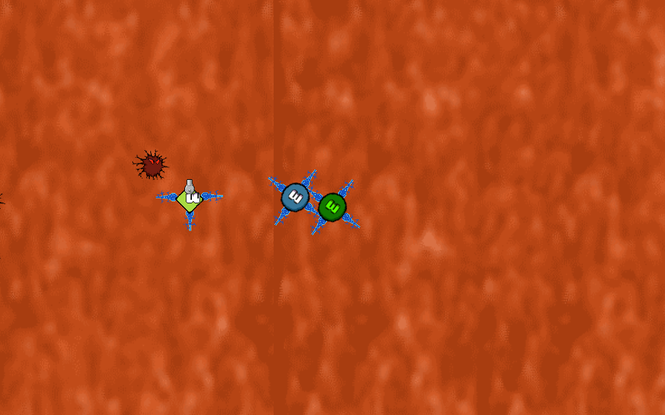
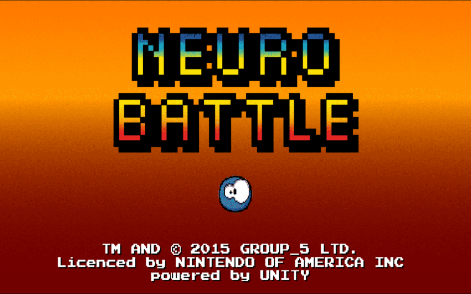
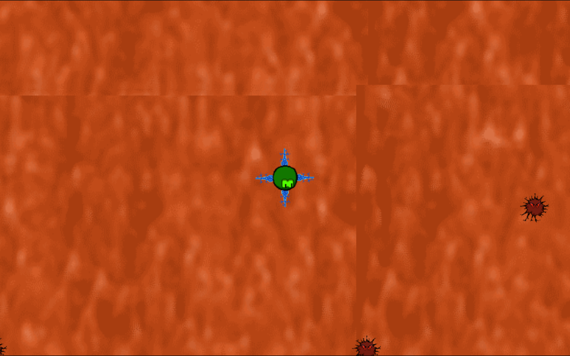
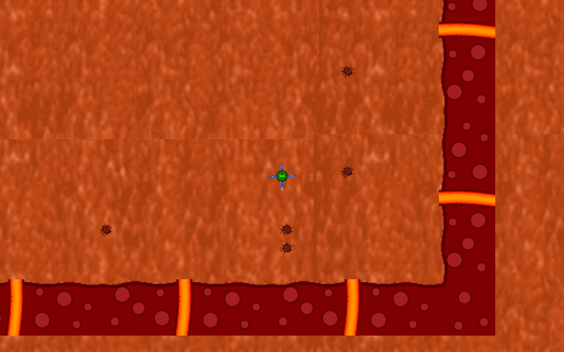
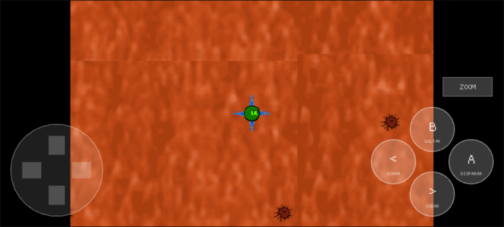

# Neuro Battle

**Neuro Battle** (Elvis Brevi and the "GROUP_5" team, [itch.io](https://elvisbrevi.itch.io/neuro-battle))
is an action prototype made at the GameJam Santo Tomás Concepción 2015. You control a green
neuron inside red tissue: other neurons (basic, long-tailed, defence
and attack) appear around the level and, when you touch them with your legs, they join yours and rotate with it. Enemies
arrive from the edges chasing you: if they touch your neuron, the run ends and the score is
the number of seconds you lasted; if they touch a joined neuron, both die. A joined attack
neuron shoots. The instructions sum it up as "Join NEURONS, FEED them and EVOLVE your
HUMAN" (feeding and evolving never got programmed).

It was made with Unity 5.1.1f1 and only published for WebGL, with the C# compiled with IL2CPP to asm.js: the
build is from 31 August 2015. It is now ported to Rust + macroquad and plays on PC and in the
browser, also on mobile, with touch controls. Since the WebGL brings no C# assemblies, the
logic was reconstructed from the asm.js with the IL2CPP metadata, which in this version of Unity
was compiled into its memory, and the original was observed running in a current Chromium.
The graphics, sounds and four scenes are the originals; the 2D physics (Box2D), the
Animator and the GUI are the pieces from [`crates/unity`](../../crates/unity).

 

 

## Running

```sh
cargo run --release -p neuro-battle
```

On Linux you need the ALSA and OpenGL/X11 headers (`sudo apt install libasound2-dev`).
The assets are embedded in the binary.

### Web version

```sh
rustup target add wasm32-unknown-unknown
../../tools/build_web.sh neuro-battle   # generates dist/neuro-battle
```

The `index.html` comes from the common template in [`crates/museo/web`](../../crates/museo/web).

### Touch controls



On phones and tablets a D-pad (the neuron moves in eight directions), the
"A" (shoot), "<" and ">" (rotate) and "B" (release the last joined neuron) buttons, and "ZOOM" appear. On the title,
the instructions and the game over, touching the screen is the same as E. It is played in landscape.

<br clear="right">

## Controls

| Input | Action |
|---|---|
| W, A, S, D | Move the neuron (with Unity's axis acceleration and inertia) |
| ← and → | Rotate the neuron |
| Right Shift | Shoot with the joined attack neurons |
| Left Alt or right mouse button | Release the last joined neuron |
| E | Play (on the title, the instructions and the game over) and zoom (in the level) |
| Esc | Return to the title (in the level, the instructions and the game over) |

## How it was made

1. **Download**: `Neuro Battle.zip` (13.99 MB), checked against the sha256 in
   `originales/catalogo.json` and extracted into `originales/neuro-battle/extraido` without running anything.
   It is a WebGL build of Unity 5.1.1f1 (product "Neuro", 960×600 canvas): `Neuro Battle.js` (24.7 MB
   of minified Emscripten asm.js), its initial memory `Neuro Battle.html.mem` (3.2 MB) and the
   file package `Neuro Battle.data` (28.9 MB), written on 31-Aug-2015 between 10:37 and
   10:47.
2. **Triage with [REA](https://rea.tools/)** (`rea-agents` 6.7.0):
   - `inspect-artifact` of the zip
     (`ev_ea8cecdb980921ee8e4cf64d048b4dcea8aee9aae7e8ec8c0943e8595ed99946`) and
     `analyze-javascript-application` of the loader (`index.html`, `UnityConfig.js`,
     `fileloader.js` and `UnityProgress.js`): with no network or storage of its own
     (`ev_6d65876e17591498545582fb9368462509ed6a7f5798fd55b1b3c3bca28647d2`).
   - The `.data` is unpacked with `tools/unity_assets.py emscripten` according to the `DataRequest`s in
     `fileloader.js`: the four scenes in `BuildSettings` (`titulo`, `instrucciones`, `level` and
     `game_over`, in `mainData` and `level0` to `level2`), `sharedassets0` to `3` and the built-in
     resources.
3. **The IL2CPP metadata**
   ([`tools/il2cpp.py`](tools/il2cpp.py)): the WebGL 5.1.2 of One Button Prototype brings a
   `global-metadata.dat`, but in 5.1.1 IL2CPP still compiled the metadata as static C++
   data, so it is in the asm.js initial memory (which Emscripten loads at address 8),
   and tools like Il2CppDumper do not read it. It is read like this:
   - the `Il2CppMetadataRegistration` (the only structure that points to the table of 5166
     `Il2CppType`s) leads to the eight assemblies, the generic methods and the table of method
     references that the generated code resolves;
   - each image has its list of `TypeInfo`s (0xa8 bytes: name, namespace, list of
     `MethodInfo`s, size, flags, number of fields) and the definitions of its fields (name,
     type and offset, in the order of the types); visibility and whether it is static are in the
     attributes of its `Il2CppType`;
   - each `MethodInfo` (0x38 bytes) brings the index of its function in the table of its signature. The
     asm.js tables are minified, but each exported `dynCall_<signature>` says which one it is: with
     the method's signature (static ones also receive a null `this`, all of them end with the
     hidden `MethodInfo*` and a struct is returned through a pointer that comes first) you reach the body
     of each method;
   - the literals are static `String` objects (class, monitor, length and UTF-16).

   The tool dumps into [`reference/il2cpp`](reference/il2cpp) the game's types
   (`metadatos.txt`), the 85 engine methods they call (`motor.txt`) and the asm.js of each method
   (`asmjs/`) with the calls, the types and methods resolved on first use (`DO`, `FO`),
   the calls inside a `try` (`invoke_*`) and the texts annotated.
4. **The logic, reconstructed by hand** from that asm.js in [`reference/csharp`](reference/csharp)
   (`BaseMovimiento` and `BaseRotacion`, the player's neuron; `Union` and `animacionUnion`, those of
   the others; `disparar` and `bala`; `bordescript`; `muerte_enemigo`; `Aparicion`, which makes neurons
   appear every 6 s and keeps the time; the `Camera2DFollow` from the Standard Assets; `titulo`,
   `intrucciones` and `gameover`; and `PlayerControl` and `matar_neurona`, which nobody uses) and in
   [`reference/unityscript`](reference/unityscript) (`GeneradorVitaminas`, the 17 generators that
   clone the enemy every 5 s, and `IA_Enemy`). What you do not see in a C#:
   - IL2CPP 5.1.1 does not check for nulls: in `bala`, subtracting life from a border (which has no
     `muerte_enemigo`) writes to the asm.js low memory and the bullet is destroyed anyway;
   - `Mathf.Round` was left *inlined* as `roundf` in `IA_Enemy.Seguir`;
   - in UnityScript, calls to their own methods are virtual;
   - `Aparicion`'s `try`/`catch (UnityException)` goes through Emscripten's `invoke_*`, and does not
     catch the `ArgumentException` from instantiating something null.
5. **Assets** ([`tools/extraer.py`](tools/extraer.py), with UnityPy, like the one in One Button
   Prototype): without assemblies, the MonoBehaviour fields are read with type trees that
   TypeTreeGeneratorAPI generates from *stub* assemblies with only the fields of each script,
   written with `il2cpp.py` and compiled with the `csc` from the .NET SDK against the `UnityEngine.dll`
   5.1.2 from One Button Prototype; the 72 MonoBehaviours are read whole. `escena.json` carries the
   four scenes (1, 1, 96 and 1 objects), the five prefabs the scripts instantiate, 189
   sprites (from 12 textures, cropped to what they use), the three GUI screens, 9 Mecanim clips and 7
   controllers, the score's `GUIStyle`, the InputManager axes and the 2D physics
   with its layer matrix. The two sounds, in AAC inside MP4 (Unity 5.1's format for
   WebGL), become Ogg Vorbis with ffmpeg. The score font, "Light Pixel-7" from Style-7, is
   free only for personal use and is not copied.
6. **The original running**: the 2015 WebGL still runs in Playwright's Chromium (headless,
   with WebGL through SwiftShader), served locally; it takes about 15 s to load and shows the
   "made with unity" screen before the title.
   - REA `capture-browser-scenario`, with the console and one capture per step
     (`ev_7e177af039fd0bb53b0ee21cea32633a6af97b34c31d1baa5250f791d35024f0`): title,
     instructions, level and, without touching anything, "game over" after 5.7 s ("TU PUNTAJE FUE DE 5
     SEGUNDOS"). Right on death 34 `NullReferenceException`s appear: the 34 copies of the enemy
     (17 generators, two batches) read the already destroyed player.
   - With Playwright and held keys: when crossing a free neuron, it joins and from then on it is
     dragged and rotates with yours. The legs are *kinematic* bodies with triggers, and in standard
     Box2D two kinematic bodies do not touch: Unity 5.1's did allow it with triggers.
   - With the original at 20 fps: a 40 ms E shows the instructions, 120 ms skips them and
     250 ms also enters the level with zoom (see [Quirks](#original-quirks-that-are-kept)).
   - Dying twice in a row, the second score is 10 seconds: the time accumulates.
   - With the WebAudio API hooked: `PlayOneShot(clip, 100)` sets the gain to 100.
7. **The engine** ([`crates/unity`](../../crates/unity)), which already brought One Button Prototype's, and
   [`crates/box2d`](../../crates/box2d):
   - Box2D gained `b2Filter` (`SetFilterData` with its `Refilter`), with 32 bits for Unity's
     layers: the object's layer is the category and its row of the collision matrix, the mask.
     Here it matters: the walls (`Background` layer) only collide with the neurons (`Neurona` layer),
     the bullets go through them and the neurons do not touch each other. It also gained the option that
     two kinematic bodies touch if one of the colliders is a trigger, which was observed
     in the original.
   - [`comparar.sh`](../../crates/box2d/comparar/comparar.sh) has a new scene,
     "neuronas": a dynamic neuron that the code teleports against a wall, kinematic legs
     that rotate with it, a piece that joins (its trigger moves to the neuron's body),
     a static enemy that moves, a bullet that the filter lets through the wall and a layer
     change halfway through. It is bit-for-bit identical to the Box2D 2.3.1 in C++ compiled with the same two
     changes, like the usual six scenes.
   - A collider without its own Rigidbody2D sticks to the nearest parent's: when a neuron
     joins, its trigger becomes part of yours (and so it protects you from the enemies,
     which are static colliders).
   - The InputManager gained `GetButton` and `GetButtonUp` (Fire2), the scene, `instanciar_datos` (an
     object from the scene cloned with "(Clone)"), the audio, `PlayOneShot`, and the GUI, a scale
     for drawing a substitute font the size of the original.
8. **The scripts and the frame** (`src/juego.rs`): each script is a variant with its fields; the
   `static`s (`Aparicion.contadorTiempo` and `BaseRotacion.choque`) live outside the scene. The frame
   follows Unity 5.1's order: the scene requested with `Application.LoadLevel` is loaded at the start of the
   next frame; the physics at a fixed step (no script has `FixedUpdate`) with its
   `OnTriggerEnter2D` and `OnCollisionEnter2D`; destroyed objects are erased after the physics and after
   the `Update`s; the pending `Start`s; the `Update`s in the order of the objects; the Animator; the
   drawing and `OnGUI`. A script that reads a destroyed object cuts its method there, like the original's
   exception (this reproduces that, once the player is dead, the enemies stay still that
   frame).

## Correspondence with the original

| Unity 5.1 WebGL | Rust |
|---|---|
| `Neuro Battle.data` (`mainData`, `level0` to `level2`, `sharedassets*`) | `assets/` ([`tools/extraer.py`](tools/extraer.py)) |
| The IL2CPP asm.js and its metadata | `reference/` ([`tools/il2cpp.py`](tools/il2cpp.py)) and `src/juego.rs` |
| `Time`, GameObject, Transform, `Instantiate`, `Destroy`, `LoadLevel` | `crates/unity` (`tiempo.rs`, `escena.rs`) |
| 2D physics (Box2D) with the layer matrix | `crates/unity` (`fisica2d.rs`) and `crates/box2d` |
| InputManager | `crates/unity` (`entrada.rs`) |
| Animator (Mecanim) | `crates/unity` (`animator.rs`) |
| Camera, SpriteRenderer | `crates/unity` (`render.rs`) |
| `OnGUI`: `GUI.DrawTexture` and `GUI.Label` with its `GUIStyle` | `crates/unity` (`gui.rs`) |
| `AudioSource.PlayOneShot` (WebAudio) | `crates/unity` (`audio.rs`) |
| The 960×600 WebGL canvas | `src/main.rs` with `museo::Pantalla` |

## Original quirks that are kept

- **The score accumulates.** `Aparicion.contadorTiempo` is static and never goes back to 0: the
   second run adds the first one's time (verified in the original). It is shown
  rounded, with `ToString("0")`.
- **E is read with `GetKey`.** If it is still held when the next scene loads, it counts again:
  an E lasting more than one frame skips the instructions, and if it lasts one more frame, the level
  starts with zoom (it is the same key). At 60 fps almost any press skips them; on mobile,
  a tap is E for a single frame.
- **The generators clone the scene's enemy**, not a prefab: each clone copies its state
  at that moment (its life, its target and its patrol point, which they share). If that enemy
  dies, `Instantiate` fails and no more enemies appear.
- **The enemy patrols to a point and stays there**: the patrol point is not renewed.
  It chases the neuron at less than 15 units, advancing separately in x and y
  (`Mathf.Sign(Mathf.Round(...))`: aligned to less than half a unit, it moves right or
  up), and disappears only if it gets within 1.1 of the centre. The "flee" state exists
  but nobody uses it (it multiplies the whole position by `deltaTime`).
- **The last neuron in the list never appears**: `Aparicion` has 20 and rolls with
  `Random.Range(0, 19)`. They appear anywhere in the rectangle (-66, -32)–(18, 17), also
  outside the walls.
- **The legs join any "leg"**: including the border's (which are called that), and a free
  neuron that touches the border ends up hanging from it and can no longer be joined. An attack neuron
  becomes valid for shooting with any leg that touches it, even if it is not joined.
- **The bullets advance one unit per frame**: their speed depends on fps.
- **The sound comes out saturated**: `PlayOneShot(clip, 100)` takes the WebAudio gain to 100.
- **Releasing neurons** (left Alt or the right button) releases the last neuron joined
  directly to yours, only if there is one and once per press; the ones hanging from it
  go with it.
- **Escape on the title** calls `Application.Quit`, which does nothing in the WebGL; in the port
  neither.
- `BaseRotacion.choque`, `Union.estado`, `velocidadHuida` and `rangoMovimiento` are written or
  serialized but nobody reads them; `animacionUnion` does nothing.

## Differences from the original

- **Font**: "Light Pixel-7" (Style-7) is free only for personal use; the port uses
  [Micro 5](https://fonts.google.com/specimen/Micro+5) (SIL OFL 1.1, in `assets/fuentes`), of the
  same style, drawn 2.1 times larger so the text measures the same, with the
  original's vertical metrics. Compared with a capture of the original, the score ends up in the same
  place (500×24 against 485×22 pixels).
- **What Unity does internally** was deduced from its behaviour and from what was observed:
  when the scenes are loaded (checked with the E timings) and when destroyed objects are
  erased, the order of the `Update`s (the objects' order in the file), and that two kinematic
  triggers do touch (observed). Whether a kinematic trigger and a static collider touched
  is not known; in this game it would change nothing, so the port follows Box2D (they do not touch).
- **`Instantiate` of an object from the scene** copies the object as it is in the file plus the state
  of its scripts, not the whole live object: for the enemy it is the same (only its position changes and
  its animation starts over, as in Unity).
- **The chance** is macroquad's, seeded with the time, not Unity's.
- **Window**: the 960×600 WebGL canvas scaled to the window with black letterboxing, like the rest of the
  museum, without the "made with unity" screen or the WebGL template page.

## Regenerating the assets

```sh
python3 -I tools/il2cpp.py "<Release folder>" reference/il2cpp
~/.venvs/museo/bin/python -I tools/extraer.py "<Release folder>" <unpacked data> <Unity 5.1 Managed>
# for example: ../../originales/neuro-battle/extraido/Neuro Battle/Release, ../../originales/neuro-battle/data
# and ../../originales/prototipo-2000/linux/_Linux/demo_Data/Managed
```

The `.data` is unpacked first with `tools/unity_assets.py emscripten` (see PLAN.md). The .NET
SDK (to compile the *stubs*) and ffmpeg are required.

## Tests

```sh
node ../../tools/humo/nativo.mjs neuro-battle   # after cargo build --release
node ../../tools/humo/web.mjs neuro-battle      # after tools/build_web.sh
```

They follow the steps in `humo.json`: title, instructions, level, moving and rotating, and the zoom; on the
web, on desktop, mobile landscape and mobile portrait. Checked separately:
- `crates/box2d/comparar/comparar.sh`: the "neuronas" scene and the usual ones, identical to the C++;
- `cargo test -p unity`: `GetButtonUp` and the earlier ones;
- against the original in Chromium: joining neurons with the same keys, the start of the level,
  the game over after ~5 s and the position of the score;
- with a temporary change (no enemies): joining neurons in a chain, shooting with a joined attack
  one (the border destroys the bullet), rotating and releasing the last one.

## Pending

- **The sound** was not tested on real hardware (the server has no sound card).
- **The touch controls** were tested only in Chromium emulation.
- **No long run was played** from start to finish: the mechanics were tested separately, and
  shooting and releasing neurons with a temporary change without enemies.
- **What Unity does internally and could not be observed** (the order of the `Update`s, the exact
  moment of erasing destroyed objects, the kinematic triggers against static ones) was left deduced.
- **REA** does not read the compiled IL2CPP metadata of Unity 5.1.1 (`tools/il2cpp.py` reads them) nor
  is there a managed assembly to import (`import-managed-reconstruction` does not apply).
