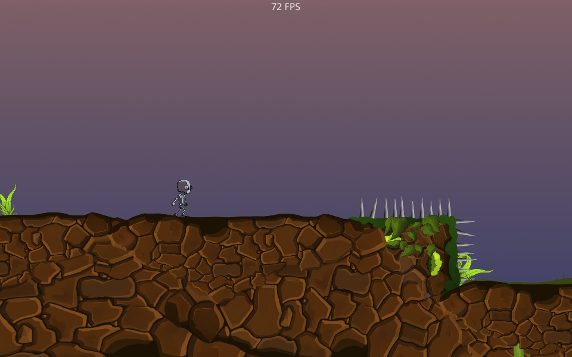
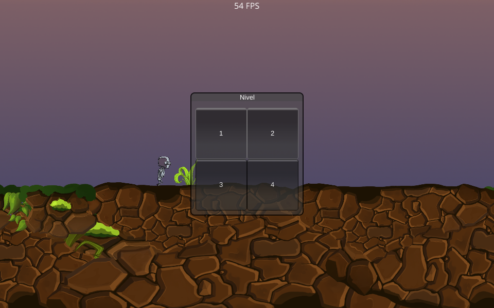
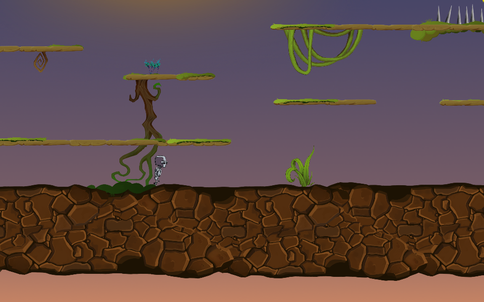
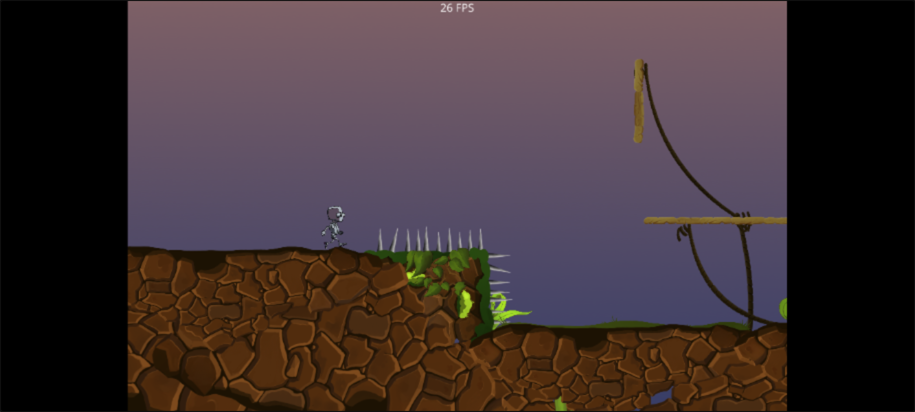

# One Button Prototype

**One Button Prototype** (Elvis Brevi, [itch.io](https://elvisbrevi.itch.io/prototipo-2000)) is a
single-button platformer prototype. A robot runs on his own and turns around every time he hits
a wall; the only control is the click (or the tap), which makes him jump. Spikes restart
the level, dragons walk from wall to wall and can only be beaten by landing on top of them, and a
star at the end of each level opens the "Nivel" window to choose between the three levels. The
P key pauses and shows the same window.

It was made with Unity 5.1.2f1 in July 2015, with the character from the 2D example in the Standard Assets
modified: the macOS, Linux and Android versions were compiled on 22-Jul-2015 and the WebGL one was
exported on 17-Aug-2015. It is now ported to Rust + macroquad and plays on PC and in the browser,
also on mobile, by touching the screen. The logic was translated from the C# decompiled from
`Assembly-CSharp.dll` and `-firstpass`, and the engine pieces it uses (2D physics with Box2D and its
polygonal colliders, body interpolation, the Animator with blend trees, the `OnGUI` GUI
with Unity's built-in skin, the `GUIText`) were recreated in
[`crates/unity`](../../crates/unity) from the game's own data. The graphics, the FPS counter's
font and the three scenes are the originals: at startup the port reads the
`escena.json` extracted from the Linux build. The original has no sound.

 

 

## Running

```sh
cargo run --release -p one-button-prototype
```

On Linux you need the ALSA and OpenGL/X11 headers (`sudo apt install libasound2-dev`).
The assets are embedded in the binary.

### Web version

```sh
rustup target add wasm32-unknown-unknown
../../tools/build_web.sh one-button-prototype   # generates dist/one-button-prototype
```

The `index.html` comes from the common template in [`crates/museo/web`](../../crates/museo/web).

### Touch controls



As in the Android version, there are no on-screen buttons: on phones and tablets the tap acts as a
click, for jumping and for the buttons in the "Nivel" window. Without a keyboard there is no pause, so the
window only appears when you reach the star. It is played in landscape; in portrait it stays centred.

<br clear="right">

## Controls

| Input | Action |
|---|---|
| Click or tap | Jump (if the robot is on the ground) |
| P | Pause and open the "Nivel" window (P again closes it) |
| Click or tap on 1, 2 or 3 | Go to that level |
| Left Ctrl (hold) | Crouch: runs at a quarter of the speed |

## How it was made

1. **Download**: the four files from the itch.io page (`_Mac.zip`, `_Linux.zip`,
   `demo.apk` and `Archivo comprimido.zip`, the WebGL one), checked against the sha256 values in
   `originales/catalogo.json`. They were extracted without running anything: the Linux build into
   `originales/prototipo-2000/linux` and the WebGL one into `originales/prototipo-2000/webgl`, with the `.data`
   unpacked by `tools/unity_assets.py emscripten`.
2. **Triage**:
   - The desktop and Android builds are from 22-Jul-2015 (zip dates; the APK also brings
     Unity's engine from 11-Jul). `Assembly-CSharp.dll` (23,552 bytes) and
     `Assembly-CSharp-firstpass.dll` (27,136) were compiled on **22-Jul-2015** at 06:12 UTC,
     according to their PE header. The project was still called "New Unity Project" and the executable
     "demo".
   - It is Unity **5.1.2f1** with Mono. `BuildSettings` lists three scenes
     (`Assets/_Niveles/1.unity`, `2.unity` and `3.unity`), stored in `mainData`, `level0` and
     `level1`, each with its own `sharedassetsN` (90, 97 and 45 GameObjects).
   - The WebGL from 17-Aug-2015 is the same game: its three scenes, compared object by object
     with UnityPy, are identical to the Linux ones, and the IL2CPP metadata brings the same member
     names and the same literals in the same order. That is why the port starts from the Linux build, which brings
     the C# assemblies (the WebGL one is compiled to asm.js).
   - [REA](https://rea.tools/) (`rea-agents` 6.7.0), without loading or running anything:
     - `inspect-managed-artifact`: PE32, IL only, complete metadata, `unity-mono` runtime, of
       `Assembly-CSharp.dll`
       (`ev_dad753d9bed54c725b2c8c7521a1808b2a96580eaa3e6aeeee10ce616d06df40`) and of
       `Assembly-CSharp-firstpass.dll`
       (`ev_9be371d572eeaa30a0b42e7da82768621275133f8ae5c678d5ef561c60742700`).
     - `inspect-managed-members` of the game's six types: 30 methods, 43 fields, the calls,
       the IL hashes of each method and the 15 literals the code loads ("p", "Nivel",
       "Spike", "Final", "ParedRight", "ParedLeft", "Dragon", "GroundCheck"...)
       (`ev_2da9f7381b7ad2b0b45538b07fd737f24b42adfc83d03b127add8c6c6f729869`); and the one of
       `FPSCounter` from the Standard Assets
       (`ev_1eb76c5fbece0623b6d179673f544f754ae9fda41c33e2329f2b5a35ba399efc`).
3. **ILSpy** (`ilspycmd` 9.1) with the references found in the same build (`UnityEngine.dll` from Unity
   5.1.2 and the Mono 2.0 libraries). `reference/csharp` keeps the seven scripts the
   scenes use: `GUI_Prototipo` (the level menu), `PlatformerDragon2D` and
   `Platformer2DDragonControl` (the dragons), which are the author's; `PlatformerCharacter2D`,
   `Platformer2DUserControl` and `Camera2DFollow`, from Unity's 2D example and modified (run
   on their own, bounce off walls, jump with the click, die and stomp dragons, the camera a little
   higher); and `FPSCounter`, from the Standard Assets. The rest of the assembly (CrossPlatformInput,
   `CameraFollow`, `Restarter` and the `-firstpass` utilities) is not used by any scene. The
   `Vector3` functions the camera uses (`SmoothDamp`, `MoveTowards`) were also translated
   from the C# of that `UnityEngine.dll`. [`tools/rea_reconstruction.py`](../../tools/rea_reconstruction.py)
   assembles the `import-managed-reconstruction` payload with 24 of the 30 methods (the other six are
   constructors that only initialise fields), but it was not imported (see
   [Pending](#pending)).
4. **Assets** ([`tools/extraer.py`](tools/extraer.py), with UnityPy): the build brings no type trees,
   so the engine classes are read with UnityPy's and the MonoBehaviour fields with
   TypeTreeGeneratorAPI from the `Managed/` assemblies. It extracts:
   - the 39 textures of the visible sprites, cropped to the rectangle their sprites occupy (the
     2048x2048 traps sheet only contributes the spikes), and the eight from the GUI's built-in
     skin;
   - the OpenSans Regular font of the FPS counter, which comes whole in the build (Apache 2.0, with
     its licence in `assets/fuentes`);
   - and `escena.json`: the three scenes with their hierarchy and components (also the
     `PolygonCollider2D`s of the spikes and stars and the counter's `GUIText`); the 138
     sprites, each as the rectangle that wraps its mesh, which is tight (*Tight*), with the
     part of the texture that corresponds to it according to its `uvTransform`; the 17 Mecanim clips; the
     two controllers, with the jump's 1D blend tree; the `box`, `button`, `label` and
     `window` styles of Unity's built-in `GameSkin` (in `unity default resources`); the metrics of
     Arial and OpenSans; the two `PhysicsMaterial2D`s ("Slippery", no friction, and "BouncyBox", with
     bounce 1) and the time, 2D physics and sorting layer settings.
5. **The engine** ([`crates/unity`](../../crates/unity)), which already brought Super Happy Jump's
   (Unity 4.6) and gained what this game uses, with what you cannot see by reading the C#:
   - Several scenes: `Application.LoadLevel(n)` loads scene `n` at the start of the next
     frame; if `n` is not in the build, Unity only writes an error.
   - 2D physics:
     - `PolygonCollider2D`: Box2D only accepts convex polygons of up to 8 vertices, so
       each path is triangulated by ear clipping and neighbouring triangles are merged while the
       result remains convex (Hertel-Mehlhorn). The pieces go through Box2D
       2.3.1's `Set` as published, which welds vertices closer than 0.05 units.
     - Contacts are grouped by collider pair: `OnCollisionEnter2D` and
       `OnTriggerEnter2D` arrive when the pair's first fixture starts touching, and
       `Collision2D.collider` is the other object's collider.
     - `Physics2D.OverlapCircleAll`, and `Collider2D.bounds` as the box that wraps the collider's
       fixtures.
     - *Interpolate*: before a frame's `FixedUpdate`s the interpolated bodies have the
       physics pose back in their Transform, and afterwards they are drawn (and seen by `Update`, like
       the camera) at `(Time.time - Time.fixedTime) / fixedDeltaTime` between the pose from before the
       last step and the one after it.
     - Unity 5 replaced `fixedAngle` with body constraints: `FreezeRotation` is Box2D's
       fixed rotation.
   - Animator (Unity 5 Mecanim):
     - 1D blend trees: the `Jumping` state blends eleven one-frame clips according to `vSpeed`; since
       sprite curves are not blended, the clip with the most weight is the one seen.
     - The robot's *AnimatePhysics* mode: its Animator advances on each fixed step, after the
       `FixedUpdate`s and before the physics; the dragons run in normal mode, with `Update`.
     - Constant curves on other components, with *Write Defaults*: the crouching clips
       change the `BoxCollider2D`'s size, and when leaving them the original returns. Those
       clips are from Unity 4 and also point at `m_Center`, the old name of `m_Offset`,
       which no longer exists in Unity 5.1: that part of the curve is not applied.
     - Exit time and fixed durations (this game does not use them).
   - IMGUI: `GUI.Window` with id, title and focus (the window where the mouse was pressed is drawn
     with the *on* state, "window on"), and the default size of each font (13 for the built-in
     Arial) for styles with size 0.
   - `GUIText`: text in view coordinates, anchored and aligned, which the `GUILayer` draws
     after the scene and before `OnGUI`.
   - With an orthographic camera, sprites in the same layer and order are sorted by their depth
     in the view (here they are all at z = 0, so the file order remains). The camera is
     18 units tall: 33.3 pixels per unit.
   - `matematica.rs`: `Vector3.SmoothDamp`, `Vector3.MoveTowards` and `Mathf.Sign`.
6. **Box2D** ([`crates/box2d`](../../crates/box2d)): gained `set_soldando`, the
   `b2PolygonShape::Set` with the vertex welding that Construct 2's box2d.js has
   commented out. [`comparar.sh`](../../crates/box2d/comparar/comparar.sh) now also compiles a
   Box2D like Unity's (welding enabled and `b2_maxPolygonVertices` = 8) for the new
   "rebote" scene: a runner that turns around when touching frictionless walls, jumps by force, a
   box with bounce 1 on a ledge and polygonal sensors with welded vertices. The
   trajectories, contacts, queries and the vertices left after welding are
   bit-for-bit identical to the C++ for 400 steps, like the usual scenes.
7. **The scripts** (`src/juego.rs`): each one is a struct with its fields; the `static`s
   (`PlatformerCharacter2D.m_Grounded` and `PlatformerDragon2D`'s) live outside the scene. The
   frame follows Unity's order:
   1. if there are fixed steps, the interpolated bodies return to their physics pose;
   2. for each 0.02 s step: the `FixedUpdate`s in the order of the objects (the robot first
      `PlatformerCharacter2D` and then `Platformer2DUserControl`; the dragons), the robot's Animator,
      the physics and the `OnTriggerEnter2D`/`OnCollisionEnter2D`;
   3. the interpolation;
   4. the `Update`s in the order of the objects (`Camera2DFollow` and `GUI_Prototipo` on the camera,
      the robot's click, the `FPSCounter`);
   5. the dragons' Animator and the erasing of destroyed objects (stomped dragons and the
      `Platformer2DDragonControl` that destroys itself);
   6. the drawing, the `GUIText` and `GUI_Prototipo.OnGUI`.

## Correspondence with the original

| Unity 5.1 | Rust |
|---|---|
| `demo_Data` (`mainData`, `level0`, `level1`, `sharedassets*`) | `assets/` ([`tools/extraer.py`](tools/extraer.py)) |
| `Assembly-CSharp.dll` and `-firstpass` | `src/juego.rs` |
| `Time`, GameObject, Transform, `Destroy`, `LoadLevel` | `crates/unity` (`tiempo.rs`, `escena.rs`) |
| 2D physics (Box2D), `PolygonCollider2D` | `crates/unity` (`fisica2d.rs`, `poligonos.rs`) and `crates/box2d` |
| Animator (Mecanim) | `crates/unity` (`animator.rs`) |
| Camera, SpriteRenderer | `crates/unity` (`render.rs`) |
| `OnGUI`, the built-in `GameSkin` and `GUIText` | `crates/unity` (`gui.rs`) |
| `Vector3`, `Mathf` | `crates/unity` (`matematica.rs`) |
| The 960×600 WebGL canvas | `src/main.rs` with `museo::Pantalla` |

## Original quirks that are kept

- **One button, really.** The robot cannot brake or turn: he runs on his own (`h = 1`) and turns
   around when he hits an object whose name contains "ParedRight" or "ParedLeft", which are
   invisible colliders placed as walls. The walls have no friction ("Slippery"), the
   ground does, and the robot runs at 9.76 instead of 10: the code sets the velocity before each step
   and friction takes a little away inside the step.
- **Button 4 does nothing.** `GUI_Prototipo` draws four buttons (`cantidadNiveles = 4`), but
   the build has three scenes: `Application.LoadLevel(3)` only writes an error.
- **The star does not lead to the next level**: it pauses the game and opens the "Nivel" window, where you
   choose. Spikes reload the same level.
- **The click in the window is also a jump.** `Platformer2DUserControl` checks the mouse button
   in `Update`, also with the game paused, and leaves the jump pending for the next
   `FixedUpdate`: if the window is closed with P, the robot jumps right away. When choosing a level it does not
   happen, because the new scene starts with no pending jump.
- **The ground is "everything".** `m_WhatIsGround` has all the layers and the Physics2D queries see
   the triggers: the robot counts as on the ground on top of a dragon, next to the star or
   brushing the spikes. The circle that looks for it (radius 0.2) reaches 0.19 units below the feet, so
   you can jump an instant before landing.
- **Stomp or die.** When colliding with a dragon, if the robot's `GroundCheck` is higher than the
   centre of the dragon's box, the dragon is destroyed; if not, the level starts over. The
   second dragon in level 3 starts far back, to the left of the robot, and arrives later.
- A dragon that touches the spikes has its own control script destroyed (`Destroy(this)`): it keeps
   going with the velocity it had and no longer turns around.
- **The camera looks 10 units ahead** (`lookAheadFactor = 10` and threshold 0): every time the
   robot turns around, the view goes to the other side. It is also one unit higher than the robot, and
   the `tiempoSalto` field added to `Camera2DFollow` is not used.
- **The FPS counter is only in level 1** (the `FramerateCounter` object only exists in that
   scene) and when the level restarts it shows "FPS" for half a second, until its first measurement.
- In the air, the transition from *Any State* to `Jumping` can return to the same state and restarts it
   on every update; it is not noticeable because the jump clips are one frame long.
- Crouching (left Ctrl) leaves the robot's box lower and wider, but centred where it
   was (see the `m_Center` curve in [How it was made](#how-it-was-made)).
- The "Nivel" window uses Unity's built-in skin, semi-transparent: the paused game is visible
   behind it, and clicking on it switches to the "window on" texture, a little more opaque.

## Differences from the original

- **Font**: the GUI used the system Arial (Unity's built-in font); the port uses
  Liberation Sans 2.1.5 (SIL OFL 1.1), with Arial's metrics, from
  [`crates/construct2/fuentes`](../../crates/construct2/fuentes). The counter uses the original
  OpenSans.
- **Box2D**: Unity 5.1 brought its own compiled Box2D, of unpublished version; the port uses
  `crates/box2d` (2.3.1) with the vertex welding of the published Box2D. Unity groups the
  colliders without a `Rigidbody2D` into one static body; here each object has its own.
- **The pieces of the `PolygonCollider2D`s** are not Unity's, which does not publish its algorithm,
  but they cover the same region, which is what the triggers and queries see.
- **What Unity does internally** was deduced from its documentation and its known behaviour,
  because the engine is native and the original binaries are not run: that interpolated bodies
  return to their physics pose before the `FixedUpdate`s, the timing of the animation in
  *AnimatePhysics*, that the `m_Center` curve is no longer applied, that a window takes focus when
  clicked, that `Collider2D.bounds` uses the body's current pose and that in a
  Mecanim transition the sprite of the heavier state is seen.
- **Sprites**: each one is drawn as the rectangle that wraps its tight mesh; whatever is left
  outside the mesh is transparent in the texture.
- **Draw order**: with sprites in the same layer, the same order and the same depth, Unity
  does not guarantee an order; here it is the scene file's.
- **Window**: the desktop builds opened Unity's resolution dialog, in full
  screen (1024×768 by default), with the title "New Unity Project"; the port uses the canvas from the
  WebGL version (960×600) scaled to the window with black letterboxing, like the rest of the museum, and
  is called "One Button Prototype". It does not have Unity's splash screen.

## Regenerating the assets

```sh
~/.venvs/museo/bin/python -I tools/extraer.py <demo_Data>   # for example ../../originales/prototipo-2000/linux/_Linux/demo_Data
```

## Tests

```sh
node ../../tools/humo/nativo.mjs one-button-prototype   # after cargo build --release
node ../../tools/humo/web.mjs one-button-prototype      # after tools/build_web.sh
```

They follow the steps in `humo.json`: level 1 with the FPS counter, a jump, the pause with P and the
"Nivel" window, and levels 2 and 3 chosen in it (on mobile, where there is no keyboard, the
taps are jumps). On the web, desktop, mobile landscape and mobile portrait are tested. Checked
separately:
- `crates/box2d/comparar/comparar.sh`: the usual scenes and the new "rebote" one, identical to the
  Box2D 2.3.1 C++;
- `cargo test -p unity`: polygon decomposition, the blend tree, `SmoothDamp` and the
  above;
- with a temporary physics log: that the robot runs, lands, turns around at the
  walls and dies on the spikes, and that the dragons walk, turn around and kill him head-on;
- with a temporary change (the robot placed next to the level 1 star): that the star pauses
  and opens the window.

## Pending

- **`import-managed-reconstruction` in REA**: REA authenticates the members Evidence by its
  content and it has to be passed whole in the call (about 250 KB for these six types, because of the
  references of the whole assembly); it was not imported. The payload is regenerated with
  `tools/rea_reconstruction.py` from that Evidence.
- It could not be compared with the original running: the original binaries are not run.
- The levels were not played from start to finish without help, and landing on a dragon was not tested (in
  level 3, the first one walks under a platform and the second next to the edge wall).
- The touch controls were tested only in Chromium emulation.
