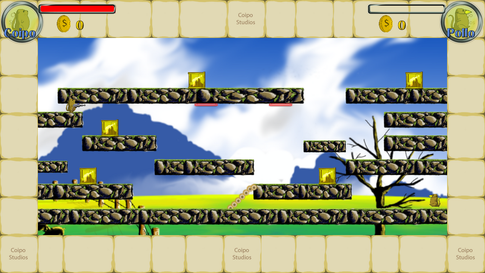
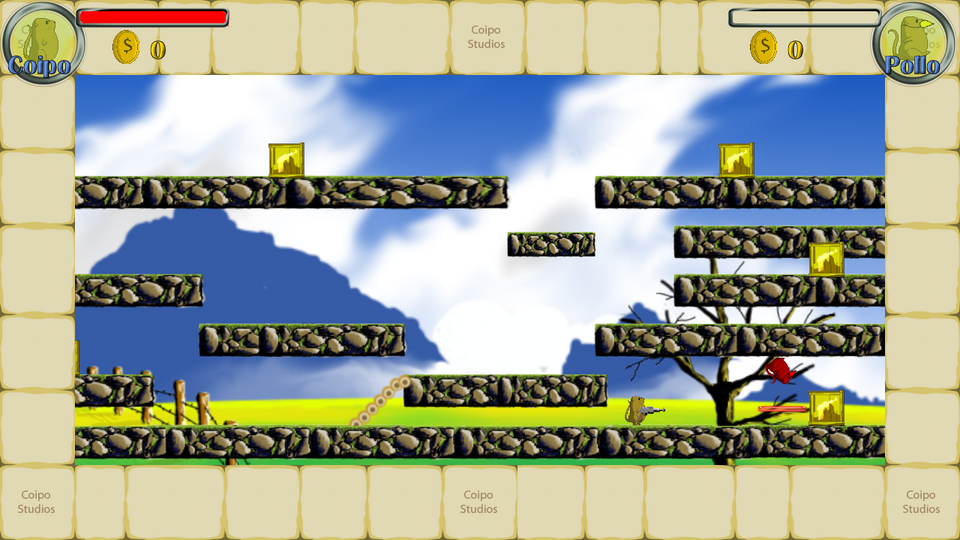
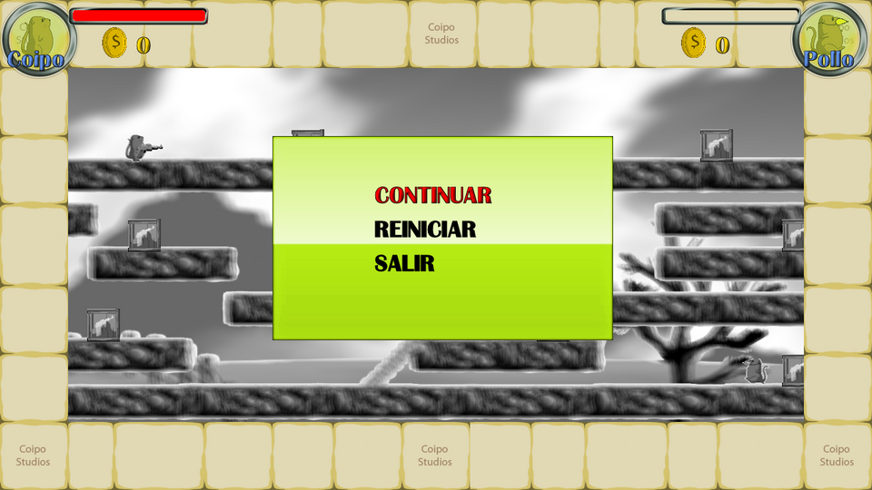
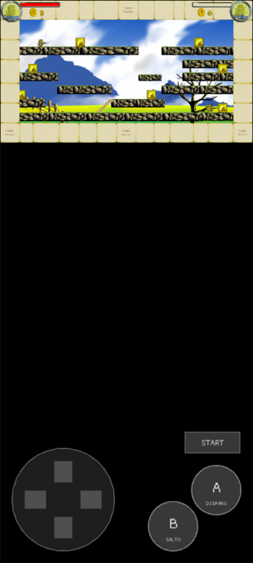

# Proyecto Nutria (Version Prototipo) — port a Rust + macroquad

Port del prototipo **Proyecto Nutria** (Elvis Brevi, 2009,
[itch.io](https://elvisbrevi.itch.io/proyecto-nutria)), escrito originalmente en C# con XNA 3.1.
Es un plataformero de acción para dos: un coipo (la «nutria» chilena) y un pollo recorren un nivel
de plataformas de roca, recogen cajas con pistolas láser y se disparan. Si una bala alcanza a un
personaje, este sale despedido hacia arriba, girando y en rojo. La lógica se reconstruyó por
ingeniería inversa del ejecutable publicado y se tradujo casi línea por línea. Los gráficos, la
fuente y el efecto de la pausa son los originales, extraídos de los `.xnb`.



 

## Ejecutar

```sh
cargo run --release -p proyecto-nutria
```

En Linux hacen falta las cabeceras de ALSA y OpenGL/X11 (`sudo apt install libasound2-dev`).
Los assets van embebidos en el binario. El juego original no tiene sonido.

### Versión web

```sh
rustup target add wasm32-unknown-unknown
../../tools/build_web.sh proyecto-nutria   # genera dist/proyecto-nutria
```

El `index.html` sale de la plantilla común de [`crates/museo/web`](../../crates/museo/web). En la
web, Esc no hace nada (no hay ventana que cerrar).

### Controles táctiles



En móviles y tablets aparecen una cruceta, los botones A (disparo) y B (salto) y START (pausa).
Los dibuja el crate compartido [`crates/museo`](../../crates/museo), configurado en `src/main.rs`.
Se activan si el navegador indica un puntero táctil (`(pointer: coarse)`) o en cuanto llega el
primer toque. En vertical el juego se coloca arriba y los controles debajo. En horizontal, como el
juego ocupa toda la pantalla (16:9), los controles quedan sobre el marco.

<br clear="right">

## Controles

| Tecla | Acción |
|---|---|
| ← / → | Correr (acelera hasta 6 px por paso y patina al soltar) |
| X | Saltar (botón "B"; mantener para saltar hasta 250 px) |
| Z | Disparar con la pistola (botón "A"; 10 balas por caja) / elegir opción del menú |
| Enter | Pausa: CONTINUAR, REINICIAR, SALIR |
| ↑ / ↓ | Moverse por el menú |
| Esc | Salir |

Con un solo teclado se maneja al coipo. El pollo solo se movía con un mando DirectInput, que no se
portó (ver más abajo), así que queda quieto en su plataforma como en un PC sin mando, pero recibe
los disparos.

## Cómo se hizo

1. **Descarga**: `Proyecto_Nutria.rar` de itch.io. Es un despliegue ClickOnce de XNA 3.1:
   `Proyecto Nutria.exe` (52 KB, CIL puro, CLR 2.0, x86) y la carpeta `Content/`. Según la cabecera
   PE se compiló el **11-nov-2009** a las 12:52 UTC (los manifiestos de ClickOnce son del mismo día).
2. **REA** ([rea.tools](https://rea.tools/), `rea-agents` 6.7.0):
   - `inspect-managed-artifact`: ensamblado PE32 x86, solo IL, metadatos completos, versión 1.0.0.0
     (`ev_df021cd93d7021058a4e8a709710e50f3b1c383df812627c7166c2abbbbdf3d7`).
   - `inspect-managed-members`: 42 tipos, 155 métodos, 234 campos y las cadenas que carga el código
     (rutas de contenido, nombres de armas, opciones del menú, `..\..\..\Datos\Save.xml`)
     (`ev_2c96271246856c5b3e62c535b736e8b44296dc9729b428bb2b71b0c864faea9c`).
   - `import-managed-reconstruction`: el C# decompilado de los 104 métodos con cuerpo quedó anclado
     al hash exacto de IL y la firma de cada método
     (`ev_6eec8dd8725bcdb315c64fae70749ec7bfb500226ea0d9b3b4b07892673e71e3`). Los 31 restantes son
     constructores implícitos y accesores de propiedades automáticas, sin código propio.
3. **ILSpy** (`ilspycmd` 9.1) para obtener C# legible, con las referencias del *XNA Framework
   Redistributable 3.1* de Microsoft. El payload de REA se arma con
   [`tools/rea_reconstruction.py`](../../tools/rea_reconstruction.py).
4. **Assets**: [`tools/xnb_extract.py`](../../tools/xnb_extract.py) (el extractor de IMAN
   generalizado) convierte a PNG las texturas `Color` y la `SpriteFont`, solo las que el juego usa
   (lista en `tools/contenido.txt`).
5. **Efecto de pausa**: `Shaders/blur_grayscale.xnb` no trae el código fuente, así que su píxel
   shader ps_2_0 se desensambló con `tools/ps20_desensamblar.py` y se reescribió en GLSL
   (`src/shader.rs`): suma 12 muestras de un disco de Poisson de radio 0,005 (en coordenadas de
   cada textura, sin la muestra central), pasa a gris con `(r + g + b) / 3` y divide por 12. Deja
   como alfa la suma de los 12 alfas, y no usa el tinte del sprite.

`reference/csharp/` contiene el C# decompilado como referencia para comparar con el port.

## Correspondencia con el original

| C# (XNA) | Rust |
|---|---|
| `Game1`, `Program` | `main.rs` (con `museo::PasoFijo` y `museo::Pantalla`) |
| `Camara`, `Camera2D` | `camara.rs` |
| `Control`, `Teclado` | `control.rs` |
| `Nivel`, `Nivel_1` | `nivel.rs` |
| `Personaje`, `Coipo`, `Pollo` | `personaje.rs` |
| `Fisica` | `fisica.rs` |
| `Plataforma` | `plataforma.rs` |
| `Caja`, `Arma`, `Pistola`, `Bala` | `caja.rs`, `arma.rs` |
| `Generador`, `Explosion`, `Particula` | `particulas.rs` |
| `MenuPersonajes`, `Menu` | `menu.rs` |
| `Iconos.IconoPersonajes` | `iconos.rs` |
| `Shaders.Blur_Grayscale` | `shader.rs` |
| `MathHelper.Clamp`, `Rectangle`, `SpriteBatch.Draw`, `SpriteFont`, `System.Random` | [`crates/xna`](../../crates/xna) |

## Rarezas del original que se conservan

- `MenuPersonajes` no es un menú para elegir personaje, sino la pausa. Sus caras se cargan pero
  nunca se dibujan, y la opción **SALIR no sale**: reinicia igual que REINICIAR, solo que sin
  mover la cámara.
- Al reiniciar, el coipo es el mismo objeto y **conserva la pistola** y las balas que le queden. El
  pollo, en cambio, se crea de nuevo. Las cajas ya recogidas siguen como estaban.
- Solo se actualiza el icono de los personajes con control, así que **la barra de vida del pollo
  no se ve nunca** (su rectángulo se queda con ancho 0).
- Las balas no desaparecen nunca: siguen volando fuera del nivel.
- La gravedad solo vuelve a 0 al saltar. Mientras el personaje está en el suelo sigue cayendo 9 px
  por paso y la colisión lo devuelve a la superficie. Al soltar el salto el personaje pasa a «cayendo»
  en cada paso.
- Hacia la derecha el personaje avanza aunque esté chocando con una pared; hacia la izquierda, no.
- `MathHelper.Clamp` aplica primero el máximo, lo que fija la posición tras un choque por debajo.
- La cámara encuadra a los dos personajes (alejándose hasta escala 0,38) y sigue al que va más a la
  izquierda con un retraso de 6 px por paso. La posición (500, 500) que le da `Game1` se pierde
  porque `Camera2D.Initialize` la reinicia. REINICIAR le pone escala 0,36 durante un fotograma.
- El recorte del fondo `scroll1` es 150 px más alto que la textura. El modo Clamp de `SpriteBatch`
  estira su última fila, y cuando la cámara se aleja se ven unas franjas verticales bajo el campo.
- Las hojas que levanta el personaje al correr suman a su temporizador el tiempo total de juego
  (no el del paso). La primera partícula mira a la última a través de una
  `IndexOutOfRangeException` capturada. El alfa resta como un byte de C#.
- `Nivel_1` crea un coipo y un pollo (y por error coloca dos veces al coipo), pero el menú los
  reemplaza enseguida por el coipo en (0, 280) y el pollo en (2600, 800).

## Diferencias con el original

- **Mando**: el original usaba DirectInput (`JoystickGenerico`) y con un mando conectado el
  segundo personaje pasaba a ser jugable. Este port solo admite teclado (y controles táctiles),
  como el original en un PC sin mando.
- **Aleatoriedad**: las partículas usan una copia de `System.Random` de .NET 2.0 sembrada con el
  reloj, como `new Random()`; las secuencias no coinciden con una partida concreta del original.
- **Ventana**: el juego se dibuja en 1280×720 y se escala a la ventana con bandas negras. El
  original pedía 1280×720 en ventana.
- No se portó código que el original nunca usa en pantalla: el cronómetro (se actualiza pero no se
  dibuja, y por eso tampoco se extrajo su fuente de 8 MB), las monedas (la lista del nivel siempre
  está vacía; el contador sí está), el lanzallamas (ninguna caja lo crea), los efectos `Filter` y
  `Negative`, el guardado en `Datos\Save.xml`, la cámara manual de depuración y la clase `Enemigo`
  (vacía).

## Regenerar los assets

```sh
python3 -I ../../tools/xnb_extract.py "<ruta>/Application Files/Proyecto Nutria_1_0_0_0/Content" assets tools/contenido.txt
```

## Pruebas

```sh
node ../../tools/humo/nativo.mjs proyecto-nutria   # tras cargo build --release
node ../../tools/humo/web.mjs proyecto-nutria      # tras tools/build_web.sh
```

Siguen los pasos de `humo.json`: correr hasta la primera caja, disparar, saltar, pausar y
continuar. El impacto de una bala en el pollo se comprobó aparte, bajando hasta su plataforma.
