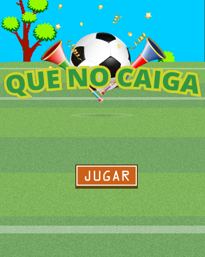
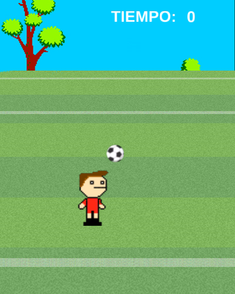
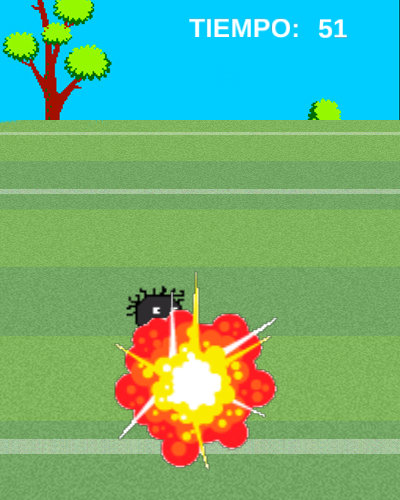
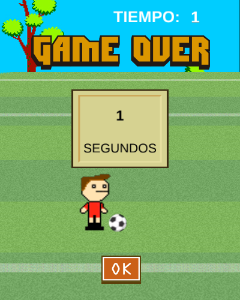
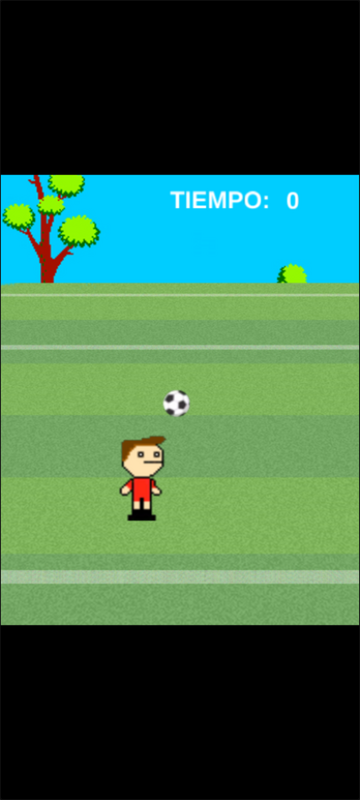

# Que No Caiga — port a Rust + macroquad

Port de **Que No Caiga** (Elvis Brevi, [itch.io](https://elvisbrevi.itch.io/que-no-caiga)), un
juego de Construct 2 para el navegador con la temática del Mundial (las etiquetas dicen *brasil*,
*chile*, *mundial*). Hay que dominar el balón: cada toque hace patear al jugador, y si la pelota
pasa por la zona de sus pies se acaba la partida. Cuenta los segundos que aguantas. En el segundo 9
y en el 40 aparece otra pelota. Desde el 50 caen bombas: pateadas brillan y explotan en el aire,
pero si llegan a los pies explotan ahí y queman al jugador.

La lógica se tradujo de las hojas de eventos del proyecto (`data.js`) y del runtime minificado de
Construct 2 (`c2runtime.js`). Las imágenes, los sonidos y el proyecto (tipos, animaciones,
polígonos de colisión y layouts) son los originales: el port lee `data.js` al arrancar.

   

## Ejecutar

```sh
cargo run --release -p que-no-caiga
```

En Linux hacen falta las cabeceras de ALSA y OpenGL/X11 (`sudo apt install libasound2-dev`).
Los assets van embebidos en el binario.

### Versión web

```sh
rustup target add wasm32-unknown-unknown
../../tools/build_web.sh que-no-caiga   # genera dist/que-no-caiga
```

El `index.html` sale de la plantilla común de [`crates/museo/web`](../../crates/museo/web).

### Controles táctiles



El original ya se jugaba tocando la pantalla (su objeto Touch, que también acepta el ratón), así
que no hacen falta botones: en móviles y tablets se toca el juego, y en vertical queda centrado.
[`crates/museo`](../../crates/museo) igual detecta el puntero táctil y lo comunica a la página.

<br clear="right">

## Controles

| Entrada | Acción |
|---|---|
| Clic o toque | Empezar, patear, pulsar JUGAR y OK |

Las flechas también llegaban al comportamiento Platform de la pelota y de las bombas (con los
controles por defecto activados), pero su velocidad máxima y su fuerza de salto son 0: no hacen
nada, y no se portaron.

## Cómo se hizo

1. **Descarga**: la versión HTML5 que itch.io sirve en un iframe (`tools/originales.py` la rastrea
   archivo por archivo): `index.html`, `c2runtime.js` (runtime de Construct 2 minificado con
   Closure Compiler), `data.js` (el proyecto), `images/` y `media/` (OGG y M4A). Según su
   `offline.appcache`, se exportó el **23-jul-2015** a las 14:31 UTC.
2. **REA** ([rea.tools](https://rea.tools/), `rea-agents` 6.7.0): `analyze-javascript-application`
   sobre la carpeta HTML5 (`ev_db50787b1eb906e7188fabc23c036767b52d9d8d02634d473a6564c5a1921c31`,
   resumen `ev_32ce2708b515db2bf7bb58b69e5a7695ed2c51260558007c87a532409e50d36a`). Encontró los
   cuatro scripts y avisó de los dos bloques en línea de `index.html`. Ninguno define las funciones
   `inicio()`, `tiempo()`, `fin()`, `reiniciar()` ni `compartir()` que llama el juego.
3. **Eventos**: [`tools/c2_eventos.py`](../../tools/c2_eventos.py) lee `data.js` y vuelca las hojas
   de eventos a pseudocódigo (`reference/eventos.txt`) y el proyecto a `reference/resumen.txt`.
   La exportación minificada perdió los nombres de los objetos (`t0`, `t1`...) y de las
   condiciones y acciones (`kc.prototype.ca.Mr`). Los objetos se nombraron por su imagen, y las
   condiciones y acciones leyendo su código minificado (`reference/aces.txt`). Todo eso queda en
   `reference/nombres.json`.
4. **Runtime**: del runtime minificado se tradujeron:
   - el comportamiento Platform;
   - el tick y el cambio de animación de Sprite;
   - la prueba de colisión entre polígonos;
   - Text (alineación y alto de línea);
   - Audio (volumen en dB, etiquetas);
   - el tick del runtime: dt de 0 a 0,1 s, escala de tiempo, y el orden de behaviors,
     animaciones, cambio de layout y eventos.

   Los fragmentos están en `reference/runtime.txt`.
5. **Assets**: [`tools/extraer.sh`](tools/extraer.sh) copia las imágenes, los OGG y `data.js`.

## Correspondencia con el original

| Construct 2 | Rust |
|---|---|
| `data.js` (tipos, animaciones, layouts) | `datos.rs` |
| Sprite, Text, Audio, comportamiento Platform, colisiones | `runtime.rs` |
| Tick del runtime, hojas "Start events" y "Game events" | `juego.rs` |
| `index.html` (canvas de 400×500, *letterbox*) | `main.rs` con `museo::Pantalla` |

## Rarezas del original que se conservan

- **Un evento sin condiciones** en el grupo "Game Over" toca el sonido `click` **en cada tick** de
  la partida, y llama a `javascript:compartir(...)`. Seguramente quedó así al borrar un botón de
  compartir. El plugin Audio crea una instancia nueva mientras las anteriores siguen sonando, así
  que se oye un zumbido continuo.
- Las llamadas a JavaScript (`inicio()`, `tiempo()`, `fin()`, `reiniciar()`, `compartir()`) no
  hacen nada: la página exportada no define esas funciones.
- Al empezar la partida la escala de tiempo es 0. El juego queda congelado hasta el primer toque,
  y vuelve a 0 al perder.
- `ContadorBomba` es una variable global que no se reinicia: en la partida siguiente las bombas
  llegan con el ritmo en que quedó la anterior.
- Las zonas de los pies (la roja, que hace perder, y la verde, donde la patada alcanza la pelota)
  están detrás del fondo y no se ven.
- Patear depende de la animación «patear», que dura una quinta de segundo (1 cuadro a velocidad
  5). La pelota debe estar en la zona verde mientras tanto.
- La patada usa `random(250, 400)` desde el segundo 20 y `random(350, 450)` desde el 30, cuando
  además la gravedad de las pelotas que haya sube a 450 (las que aparecen después siguen con 400).
- Al cambiar de cuadro un Sprite toma la proporción del nuevo. La explosión de la bomba usa
  cuadros de 110 px en lugar de 50, y en los pies además se escala ×2.
- La bomba que explota en los pies se destruye en un disparador. Sigue existiendo para el segundo
  disparador «al terminar la animación», que es el que acaba la partida.
- Tras perder, los toques siguen poniendo al jugador en pose de patada.
- La bomba del layout empieza fuera de la pantalla (x = −93) y cae para siempre.

## Diferencias con el original

- **Fuentes**: el original dibujaba los textos con las fuentes del sistema, "Arial" y "Arial
  Black". El port usa Liberation Sans 2.1.5 (normal y negrita, SIL OFL 1.1, con las métricas de
  Arial). Arial Black no tiene equivalente libre y se usa la negrita.
- **Sonido**: se usan los OGG. El navegador elegía entre OGG y M4A; los dos son el mismo sonido.
- **Aleatoriedad**: `random()` usa el generador de macroquad en lugar de `Math.random()`.
- **Ventana**: el canvas de 400×500 se escala con bandas negras, como el modo *letterbox* del
  original. La pantalla completa y la orientación del manifiesto web no se portaron.

## Regenerar los assets

```sh
tools/extraer.sh <carpeta html5>        # por ejemplo ../../originales/que-no-caiga/html5
```

## Pruebas

```sh
node ../../tools/humo/nativo.mjs que-no-caiga   # tras cargo build --release
node ../../tools/humo/web.mjs que-no-caiga      # tras tools/build_web.sh
```

Siguen los pasos de `humo.json`: el menú, JUGAR, la primera patada y el final. Se comprobaron
aparte con clics al ritmo de la pelota:
- varias patadas seguidas;
- con un cambio temporal sin subir (el tiempo empezando en 47), la bomba del segundo 50, su
  explosión en los pies y el final.
