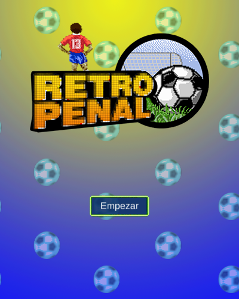
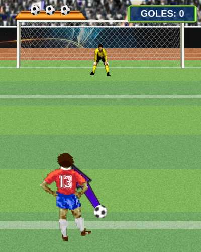
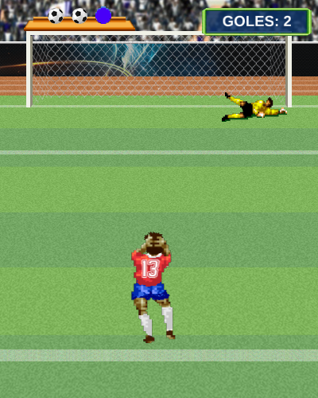
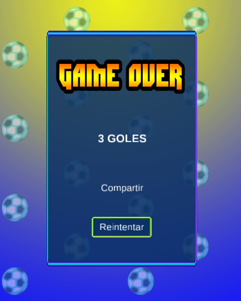
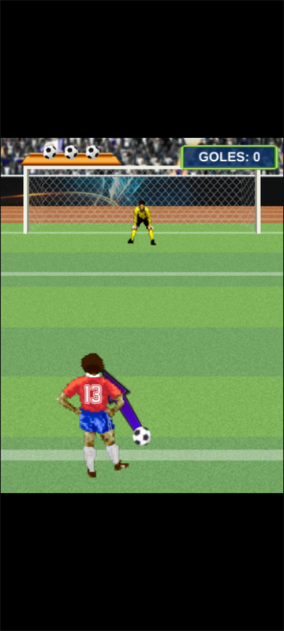

# Retro Penal — port a Rust + macroquad

Port de **Retro Penal** (Elvis Brevi, [itch.io](https://elvisbrevi.itch.io/retro-penal)), un juego
de penales hecho con Construct 2 para el navegador y para escritorio (NW.js en Windows, macOS y
Linux). Sus etiquetas en itch.io (*chile*, *seleccion-chilena*, *mundial*, *cazely*) apuntan a la
selección chilena. Hay tres intentos: una flecha va y viene sobre el punto penal, y al tocar el
jugador patea en esa dirección. El arquero se lanza hacia un lado o se agacha, y los palos y el
arquero desvían la pelota. Cada gol hace más rápidos la flecha y el arquero.

La lógica se tradujo de las hojas de eventos del proyecto (`data.js`) y del runtime minificado de
Construct 2 (`c2runtime.js`). Las imágenes, los sonidos y el proyecto (tipos, animaciones,
polígonos de colisión, comportamientos y layouts) son los originales: el port lee `data.js` al
arrancar. Las piezas del runtime están en [`crates/construct2`](../../crates/construct2), que
también usa [Que No Caiga](../que-no-caiga).

  

 

## Ejecutar

```sh
cargo run --release -p retro-penal
```

En Linux hacen falta las cabeceras de ALSA y OpenGL/X11 (`sudo apt install libasound2-dev`).
Los assets van embebidos en el binario.

### Versión web

```sh
rustup target add wasm32-unknown-unknown
../../tools/build_web.sh retro-penal   # genera dist/retro-penal
```

El `index.html` sale de la plantilla común de [`crates/museo/web`](../../crates/museo/web).

### Controles táctiles



El original ya se jugaba tocando la pantalla (su objeto Touch, que también acepta el ratón), así
que no hacen falta botones: en móviles y tablets se toca el juego, y en vertical queda centrado.
[`crates/museo`](../../crates/museo) igual detecta el puntero táctil y lo comunica a la página.

<br clear="right">

## Controles

| Entrada | Acción |
|---|---|
| Clic o toque | Empezar, OK, patear (en cualquier parte) y Reintentar |

Sobre los botones el cursor pasa a ser una mano, como en el original (Mouse.SetCursor).

## Cómo se hizo

1. **Descarga**: la versión HTML5 que itch.io sirve en un iframe (`tools/originales.py` la rastrea
   archivo por archivo) y los paquetes de escritorio `win32.zip`, `osx32.zip` y `linux32.zip`.
   Según su `offline.appcache`, la HTML5 se exportó el **23-jul-2015** a las 14:40 UTC.
2. **Triaje**:
   - REA ([rea.tools](https://rea.tools/), `rea-agents` 6.7.0): `analyze-javascript-application`
     sobre la carpeta HTML5
     (`ev_d2026d791a06ca6424b5fd5eb563fdb82b69a3d9ba1d818e0c724848d4d34f4b`, resumen
     `ev_cedb30a278038548b36d7e9cac9325d026c5ffe2291dd9c983fbc9d85b897e40`) y sobre el `package.nw`
     de Windows (`ev_12cfcc4a45b1af48c0f002ecb023e0e60165b9ea85f6aa9737cd305eb4718131`, resumen
     `ev_ccb1164a0f4828c2da782a24f50a4d42d15bfe8a4d2dc3ed224bb698640f0d0d`).
   - Los paquetes NW.js (NW.js de marzo de 2015) se abrieron sin ejecutarlos. Los tres traen los
     mismos archivos del juego, fechados el **22-jul-2015** a las 10:07 (hora local del zip); solo
     cambia `package.json` entre Windows y los demás. Las imágenes y los OGG son idénticos a los de
     la HTML5, pero `data.js`, `c2runtime.js` e `index.html` no: es una exportación del día anterior.
     Todavía tiene el plugin Browser, con llamadas a `javascript:goles()`, `intentos()`,
     `inicio()`, `reiniciar()`, `compartir()` y `fin()` (funciones que la página no define), y el
     tipo del botón «Compartir» del final, con su evento. El port sigue a la HTML5, la que se juega
     en itch.io.
3. **Eventos**: [`tools/c2_eventos.py`](../../tools/c2_eventos.py) lee `data.js` y vuelca las hojas
   de eventos a pseudocódigo (`reference/eventos.txt`) y el proyecto a `reference/resumen.txt`. Los
   nombres de los objetos (`t0`, `t1`...) y de las condiciones y acciones minificadas
   (`Y.prototype.D.ir`) se identificaron leyendo su código (`reference/aces.txt`) y están en
   `reference/nombres.json`.
4. **Runtime**: del runtime minificado se tradujeron (en `crates/construct2`):
   - los comportamientos Bullet (con el rebote en los sólidos: el ángulo de rebote, el empuje
     hacia fuera y el empuje fraccional), Turret, Custom Movement, Solid y Wrap, y su orden de
     tick;
   - la colisión con giro y espejo (cajas, cuadriláteros y polígonos);
   - la condición «On collision with another object», con su memoria por parejas y las colisiones
     que registran los comportamientos;
   - System.Wait, que guarda las instancias elegidas y sigue en el tick en que se cumple;
   - los bloques de eventos: O (con un disparador entre sus condiciones), Sino y los disparadores
     de Touch y Audio;
   - Audio con etiquetas, bucle, volumen en dB, Stop, Stop all y «On ended»;
   - Mouse.SetCursor e «Is over object».

   Los fragmentos están en `reference/runtime.txt`.
5. **Assets**: [`tools/extraer.sh`](tools/extraer.sh) copia las imágenes, los OGG que suenan y
   `data.js`.

## Correspondencia con el original

| Construct 2 | Rust |
|---|---|
| `data.js` (tipos, animaciones, comportamientos, layouts) | `crates/construct2` (`datos.rs`) |
| Sprite, Text, Audio, comportamientos, colisiones, Wait, Every, On collision | `crates/construct2` |
| Tick del runtime, hojas "Menu Principal", "Juego" y "Game Over" | `src/juego.rs` |
| `index.html` (canvas de 400×500) | `src/main.rs` con `museo::Pantalla` |

## Rarezas del original que se conservan

- **En la pantalla final suena `click` en cada tick** mientras no se pulse «Reintentar». El
  paquete NW.js explica por qué: allí era el evento del botón «Compartir» (al tocarlo sonaba el
  clic y se llamaba a `javascript:compartir(...)`). Para la versión HTML5 se borró ese botón (y el
  plugin Browser), Construct 2 quitó las condiciones y acciones que lo usaban, y quedó un evento
  sin condiciones. El texto «Compartir» sigue en pantalla, sin botón. Lo que queda del evento
  («si no suena "comenzar"») siempre se cumple, y cada clic se suma a los anteriores: se oye un
  zumbido continuo.
- La flecha (Turret) apunta a un punto invisible que está 3 px por encima de su base y va y viene
  entre x = 197 y 203. Por eso barre de −135° a −45° (45° a cada lado de la vertical) y gira más
  rápido cerca de la vertical. El punto se mueve a `velocidadFlecha` px/s: 5 al empezar y 0,5 más
  por gol, hasta 15.
- El arquero decide al salir el tiro. Su marca invisible va y viene entre x = 190 y 210 a
  `velocidadArquero` px/s (3 al empezar y 5 más por gol, hasta 28). Si la marca está entre 197 y
  203 se agacha; si no, se lanza hacia donde iba la marca. Vuela 3 px por tick (depende de los
  fotogramas por segundo) hasta x = 75 o 320, y ahí queda tirado.
- Tras lanzarse a la izquierda el arquero queda espejado: nada lo devuelve a la normal hasta que
  se lanza a la derecha.
- La pelota se achica una sola vez: la escala baja de 0,6 a 0,42 en el primer tick del tiro (la
  condición es «escala > 0,5»).
- El gol cuenta solo si la pelota queda entera dentro de un cuadro invisible que va de x = 51 a
  350, más estrecho que el arco (los palos están en 32 y 368). Los tiros pegados a un palo entran
  en la red sin contar, siguen de largo y salen por arriba: fallo.
- Tocar otra vez antes de que salga el tiro (la patada sale en el tercer cuadro, a los 0,4 s)
  reinicia la animación y vuelve a apuntar con la flecha, que sigue girando aunque esté oculta.
- El siguiente tiro llega cuando termina el sonido del gol (1,9 s) o 3 s después de un fallo.
- Las esperas (System.Wait) sobreviven al cambio de layout. La espera de 3 s del último fallo
  termina ya en la pantalla final y marca el fallo. Si se pulsa «Reintentar» en ese primer
  segundo, ResetGlobals llega antes y la marca se queda: en la partida siguiente la flecha aparece
  antes de pulsar OK.
- Tres sonidos (`chute`, `comenzar3` y `pitazo3`) se precargan pero ningún evento los reproduce.
- El fondo de pelotas del menú y del final usa Wrap. Cada mitad reaparece a 1 px del borde
  derecho sin mirar a la otra, así que entre las dos queda un hueco de hasta lo que avanzan en un
  tick (8 px a 60 fps).
- Quedan objetos fuera de la pantalla: los textos «TITULO DEL JUEGO» del menú y «GAME OVER» del
  final, reemplazados por imágenes.
- «Is on mobile» oculta la barra de los intentos al empezar en un móvil, pero la barra ya empieza
  oculta y OK la muestra igual: no tiene efecto.

## Diferencias con el original

- **Fuentes**: el original dibujaba los textos con la fuente del sistema "Arial". El port usa
  Liberation Sans 2.1.5 (normal y negrita, SIL OFL 1.1), con las métricas de Arial, en
  [`crates/construct2/fuentes`](../../crates/construct2/fuentes).
- **Sonido**: se usan los OGG. El navegador elegía entre OGG y M4A; los dos son el mismo sonido.
  macroquad no distingue las reproducciones de un mismo archivo: Stop y SetVolume actúan sobre
  todo el archivo. Aquí cada etiqueta tiene su archivo (salvo `click3`, que nunca se detiene), así
  que no cambia nada. Como Web Audio, detener un sonido que suena lanza su «On ended».
- **Ventana**: el original escalaba el canvas de 400×500 solo por múltiplos enteros (*letterbox
  integer scale*). El port lo escala a la ventana con bandas negras, como el resto del museo.
- **Is on mobile**: el original miraba el navegador; el port mira si hay pantalla táctil.

## Regenerar los assets

```sh
tools/extraer.sh <carpeta html5>        # por ejemplo ../../originales/retro-penal/html5
```

## Pruebas

```sh
node ../../tools/humo/nativo.mjs retro-penal   # tras cargo build --release
node ../../tools/humo/web.mjs retro-penal      # tras tools/build_web.sh
```

Siguen los pasos de `humo.json`: el menú, las instrucciones, la flecha, el tiro y su resultado. Se
comprobaron aparte:
- diez tiros seguidos: goles, fallos al palo y afuera, las cruces de los intentos y el final;
- el rebote en el palo, tick a tick;
- con un cambio temporal sin subir (un solo intento): el final, «Reintentar» y la espera que
  sobrevive al cambio de layout.
