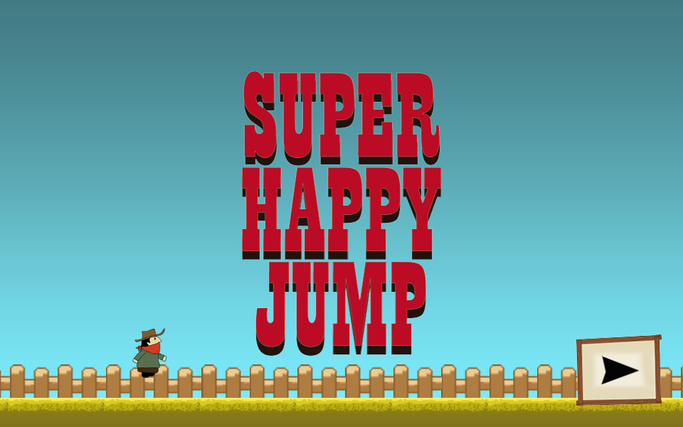
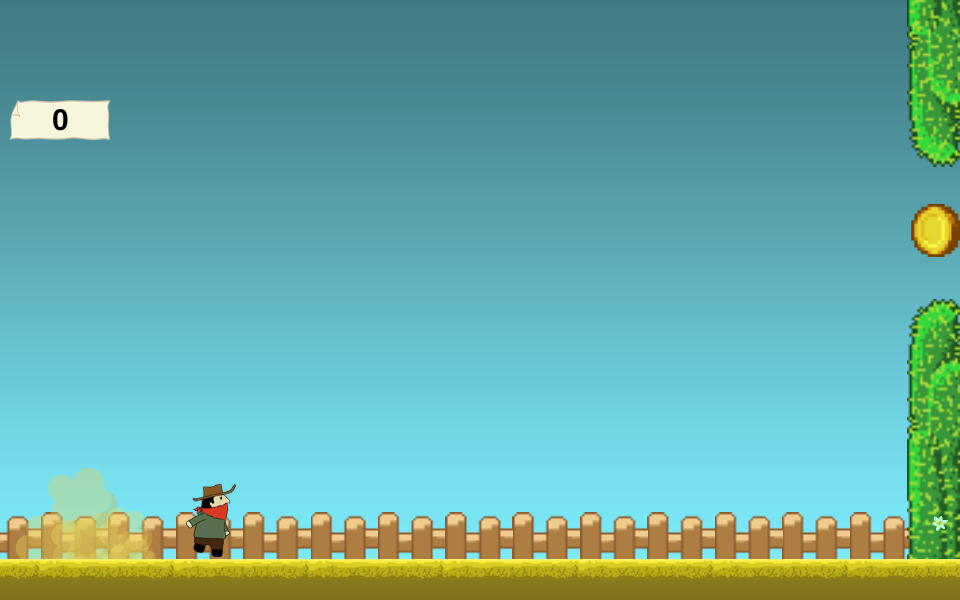
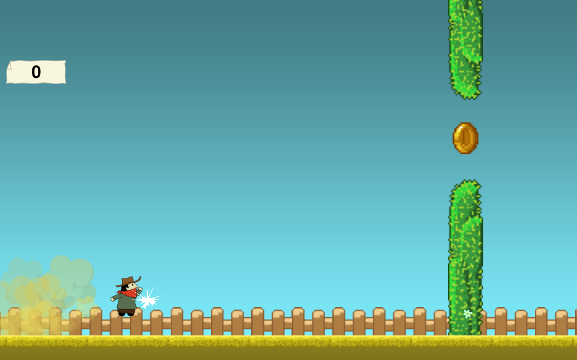
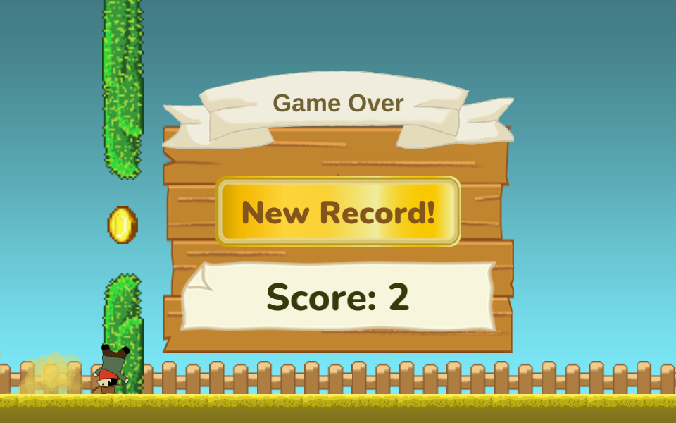
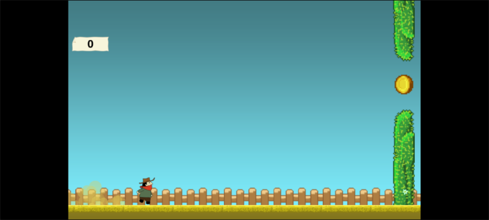

# Super Happy Jump

**Super Happy Jump** (Elvis Brevi, [itch.io](https://elvisbrevi.itch.io/super-happy-jump)) is an
endless jumping game: "double jump, cactus and coins". A cowboy with a red neckerchief runs on his own
to the right; you tap to jump and tap again in the air for the double jump. Every 2.5
seconds a pair of cacti appears with a coin in the gap: the coin scores a point and touching
a cactus ends the run. At the end you see the score and the best one, which is saved.

It was made with Unity 4.6 for the Unity Web Player (it also came out on iOS and Android): the web version
was compiled on 9-Dec-2014. It is now ported to Rust + macroquad and plays on PC and in the browser,
also on mobile, by touching the screen. The logic was translated from the C# decompiled from
`Assembly-CSharp.dll`, and the engine pieces it uses (2D physics with Box2D, the Animator,
the particles, the `OnGUI` GUI) were recreated in [`crates/unity`](../../crates/unity) from
the game's own data. The images, sounds, scene and prefabs are the originals:
at startup the port reads the `escena.json` extracted from `web.unity3d`.

 

 

## Running

```sh
cargo run --release -p super-happy-jump
```

On Linux you need the ALSA and OpenGL/X11 headers (`sudo apt install libasound2-dev`).
The assets are embedded in the binary. The best score is saved in
`~/.local/share/museo/super-happy-jump.txt` (or in the system's data folder).

### Downloads

Windows (`.exe`) and macOS (universal, Intel + Apple Silicon) builds are on the
[itch.io page](https://elvisbrevi.itch.io/super-happy-jump); they are not kept in this repo. On macOS,
right-click → Open the first time (the binary is not signed).

### Web version

```sh
rustup target add wasm32-unknown-unknown
../../tools/build_web.sh super-happy-jump   # generates dist/super-happy-jump
```

The `index.html` comes from the common template in [`crates/museo/web`](../../crates/museo/web). On the
web the best score goes to the browser's `localStorage`, like the Web Player's `PlayerPrefs`.

### Touch controls



As in the original, there are no on-screen buttons: on phones and tablets the tap acts as a click, for
jumping and for the ▶ button. It is played in landscape; in portrait it stays centred.

<br clear="right">

## Controls

| Input | Action |
|---|---|
| Click or tap on ▶ | Start (and, on the final screen, return to the title) |
| Click or tap | Jump; in the air, double jump |

## How it was made

1. **Download**: the `web.unity3d` that itch.io served to the Unity Web Player (385,194 bytes), with the
   page's signed URL, checked against the sha256 in `originales/catalogo.json`.
2. **Triage**:
   - It is a `UnityWeb` 3.x.x bundle from Unity **4.6.0f3** compressed with LZMA. It brings
     `Assembly-CSharp.dll` (39,936 bytes), `UnityEngine.UI.dll` (from Unity, dated 18-Nov-2014) and two
     serialized files: `mainData` (271 objects, with the only scene,
     `assets/_Scenes/test.unity`) and `sharedassets0.assets` (199 objects: textures, sprites, clips,
     controllers, prefabs, the GUI skin). According to its PE header, `Assembly-CSharp.dll` was
     compiled on **9-Dec-2014** at 22:52 UTC.
   - REA ([rea.tools](https://rea.tools/), `rea-agents` 6.7.0) does not open the `UnityWeb` format
     (`inspect-artifact`: "unsupported binary format"); the bundle was opened with UnityPy.
   - `inspect-managed-artifact`: PE32, IL only, complete metadata, `unity-mono` runtime
     (`ev_f64054c153ce0f926872fcbcae608201878c960f9a54726ab4f1eaca838eb297`, on top of
     `ev_3c17806a16032c024991e4c9eccbd52ce2e79b36ea2ebf060c3afaf6bbf671ad`).
   - `inspect-managed-members`: 58 types, 218 methods, 263 fields and the strings the code loads
     (`BestScore`, the style names, `Particulas`, `Suelo`, `Game Over`...)
     (`ev_655d6009500d0e8b5f73e706945778c26b5334e3d8fe150ba9c762b9ab5e0c53`).
   - `import-managed-reconstruction`: the decompiled C# of 132 methods was anchored to the hash of their
     IL and their signature (`ev_5abb5b691908474fe84da9149e93692c15bf5eca035359224a248a88675cdf52`). The
     rest are constructors that only initialise fields and the coroutine classes.
3. **ILSpy** (`ilspycmd` 9.1): Unity 4.6's `UnityEngine.dll` does not come in the bundle (it is part
   of the Web Player), so the references were resolved with the Unity 5.1.2 one from the Linux
   version of [One Button Prototype](https://elvisbrevi.itch.io/prototipo-2000) and its Mono 2.0
   libraries; the calls the game uses are the same in 4.6. The REA payload was assembled with
   [`tools/rea_reconstruction.py`](../../tools/rea_reconstruction.py). Of the 41 files ILSpy gives,
   12 are the game's and are in `reference/csharp`: ten from the author and
   `PlatformerCharacter2D` and `Platformer2DUserControl`, from Unity's 2D example, modified
   (dust, sparks, sounds, double jump, tap to jump). The others are third-party and are not
   kept: the CrossPlatformInput from the Standard Assets and `Camera2DFollow` and `Restarter` from the
   2D example, unused in the scene, and the Cartoon FX scripts, of which the scene only uses
   `CFX_AutoDestructShuriken`.
4. **Assets** ([`tools/extraer.py`](tools/extraer.py), with UnityPy): the two serialized files
   bring the type trees, so the MonoBehaviour fields are read without
   generating them. It extracts:
   - the 17 textures that are visible, decoded to PNG as Unity stored them (DXT5 for the character
     sheet, the coins and the sign; ARGB4444 for the particle ones);
   - the five `AudioClip`s (PCM WAV);
   - and `escena.json`: the scene's 69 GameObjects with their hierarchy and components; the prefabs
     the code instantiates (`muro`, `polvo` and `dobleSalto`); the 37 sprites (rectangle, pivot
     taken from the vertices of their mesh and pixels per unit); the five Mecanim clips, whose
     *streamed clip* is decoded to keys (time, sprite); the two controllers; the three particle
     systems; the materials; the `GUISkin` styles; the `PhysicsMaterial2D`
     "Slippery" (no friction); and the time, 2D physics and sorting layer settings.

   The "Arial Rounded Bold" font the bundle brings embedded is not extracted (see
   [Differences](#differences-from-the-original)).
5. **The engine** ([`crates/unity`](../../crates/unity)), with what you cannot see by reading the C#:
   - `Time`: `deltaTime` is the frame's real time (at most the *Maximum Allowed Timestep*,
     1/3 s) times `timeScale`; the `FixedUpdate`s run at a fixed step of 0.02 s behind `Time.time`.
     With `timeScale = 0` neither `FixedUpdate`, nor `Invoke`, nor the Animator, nor the particles run,
     but `Update` and `OnGUI` do.
   - 2D physics on top of [`crates/box2d`](../../crates/box2d):
     - one Box2D body per `Rigidbody2D`, and each `Collider2D` is a fixture of the
       nearest `Rigidbody2D` upwards in the hierarchy: the dust the code hangs from the
       character becomes part of its body, and becomes static again when detached;
     - the colliders scale with `lossyScale` (boxes with their centre, with
       `SetAsBox`; circles with the largest scale), they have density 1 and afterwards
       `Rigidbody2D.mass` sets the mass with `SetMassData`. Without a material, friction is 0.4;
     - the triggers are Box2D sensors, and their `BeginContact`s are the `OnTriggerEnter2D`s, which
       both objects' scripts receive;
     - if the code moves a Transform that has a body, the body is teleported (`SetTransform`) and
       woken up. Without that, the `Destroyer`, a still dynamic body moved with the camera,
       would fall asleep and would not see the ground it has to pass ahead. After each step, the
       bodies write their position to their Transform;
     - `Physics2D.OverlapCircle` is a `QueryAABB` plus `b2TestOverlap`, filtered by layers.

     For this `crates/box2d` gained sensors, per-fixture contact events,
     `QueryAABB`, `DestroyFixture`, `ApplyForceToCenter` and `SetMassData`, translated from the same
     Box2D 2.3.1. The new "corredor" scene in
     [`comparar.sh`](../../crates/box2d/comparar/comparar.sh) (a runner with a circle and a box,
     jumps by force, cacti, coin, dust and the `Destroyer`) gives trajectories, events and
     queries bit-for-bit identical to the C++ for 300 steps.
   - Animator (Mecanim): states with a sprite clip, parameters and transitions with
     conditions, *Any State* ones first and without interruption (they are atomic). In Unity 4 the
     duration of a transition is in normalized time of the source state, so this game's last
     thousandths: 0.1 of a 1/60 s clip.
   - ParticleSystem (Shuriken): the modules the three systems use (initial, sphere and
     hemisphere shapes, emission with bursts, size and colour over lifetime, a 4-frame sheet and speed over
     lifetime), with Hermite curves and Unity gradients. As in Unity 4, the local
     simulation (*moveWithTransform*) follows the emitter and ignores its Transform's scale:
     `dobleSalto` has scale 0.5 and its sparks are seen at full size.
   - The camera is perspective (48° vertical field of view, at z = −10); everything is at z = 0, so
     1 unit is 67.4 pixels. The draw queue is sorted by sorting layer, *order in layer* and
     far to near. The particles use the `Particles/Additive`,
     `Particles/Alpha Blended` and `Particles/Multiply` shaders, rewritten in GLSL.
   - IMGUI: `OnGUI` runs once per frame event (MouseDown, MouseUp and Repaint); a button
     is pressed with MouseDown and responds when released inside; the style's *hover* and *active*
     states use their own background, and if they do not have one, none is drawn. `GUI.Window` draws on top
     of everything else, with relative coordinates and clipping its content. The text is placed with
     FreeType's vertical metrics (the ascent and the line height with the *line gap*), the same
     ones Unity stored for the embedded font.
   - `PlayerPrefs` is `museo::Preferencias`: a file on PC and `localStorage` on the web.
6. **The scripts** (`src/juego.rs`): each one is a struct with its fields; the `static`s
   (`CameraRunner.x`, `Spawn.activo`, `HUD.estadoStatic`) live outside the scene and survive
   `Application.LoadLevel`, which reloads the scene at the start of the next frame. The frame
   follows Unity's order:
   1. the `FixedUpdate`s (`PlatformerCharacter2D` and then `Platformer2DUserControl`), each
      followed by the physics step and its triggers (`Muro`, `PowerUp`, `Destroyer`);
   2. the `Update`s in the order of the objects (`CameraRunner`, `HUD` and the player control);
   3. `Spawn`'s `Invoke` and the `CFX_AutoDestructShuriken` coroutine;
   4. the Animator and the particles, and the erasing of destroyed objects;
   5. the drawing and at the end `HUD.OnGUI`.

   `TimControllerScript`, another character control (it jumped with the space bar), is
   disabled in the scene and is not translated.
7. **Fonts**: [`tools/fuentes.sh`](tools/fuentes.sh) downloads Nunito from google/fonts and instances
   it with fontTools at weights 800 and 900.

## Correspondence with the original

| Unity 4.6 | Rust |
|---|---|
| `web.unity3d` (`mainData`, `sharedassets0.assets`) | `assets/` ([`tools/extraer.py`](tools/extraer.py)) |
| `Assembly-CSharp.dll` | `src/juego.rs` |
| `Time`, GameObject, Transform, `Instantiate`, `Destroy` | `crates/unity` (`tiempo.rs`, `escena.rs`) |
| 2D physics (Box2D) | `crates/unity` (`fisica2d.rs`) and `crates/box2d` |
| Animator (Mecanim) | `crates/unity` (`animator.rs`) |
| ParticleSystem (Shuriken) | `crates/unity` (`particulas.rs`) |
| Camera, SpriteRenderer, ParticleSystemRenderer | `crates/unity` (`render.rs`) |
| `OnGUI` and the `GUISkin` | `crates/unity` (`gui.rs`) |
| AudioSource | `crates/unity` (`audio.rs`) |
| `PlayerPrefs` | `museo::Preferencias` |
| The 960×600 Web Player | `src/main.rs` with `museo::Pantalla` |

## Original quirks that are kept

- **To play again you have to go through the title.** The ▶ button on the final screen reloads the
  scene, and the scene starts at the title with time stopped: it takes two taps.
- **The ▶ button disappears when the mouse is over it and while it is pressed.** Its style only has a background
  in the normal state. After returning to the title, the mouse is still over the button and it is not visible until
  you move it away. On mobile it disappears while being touched.
- On the title the character floats a little above the ground: the scene starts frozen before his
  first fall, and when it starts he drops a few centimetres.
- **The triple jump.** The circle that detects the ground (radius 0.2, 0.65 below the centre) is still
  touching it during the first two physics steps of the jump, about 40 ms: a second tap that
  fast counts as a jump from the ground and the double jump stays available.
- **The footsteps loop, and in the air they buzz.** On every physics step without ground the code
  calls `Play` on the footstep sound, which starts over: in the air you hear only its
  first 20 ms over and over, and on the ground the loop continues. It starts with the first fall and does not
  stop until the final screen, even with the character dead.
- **The dust is left behind.** When jumping, the cloud of dust under the feet is released and stays
  where it was, emitting. Until the `Destroyer` (which is 10.8 units behind) erases it, no
  other appears: for about a second you run without dust. The `Destroyer` looks for the
  "Particulas" tag, but the dust's is "Particula"; it erases it anyway because, detached, it has no parent.
- The jump effect has two parts: the white sparks and a dark "Black Hit"
  (`Particles/Multiply`). The code puts the first in the "Player" sorting layer, but the second
  stays in "Default", the furthest back one, and the sky covers it: it is never seen.
- **The camera shake depends on frames.** On death, the camera shakes for 25 frames
  (shorter on fast screens), and the offset it ends with stays in a
  `static` field: in the next run the shake is centred on that value.
- Dead, the character stays still, but if he died in the air a tap still sets his
  vertical velocity to zero (the jump only looks at the maximum velocity to apply the force).
- The cacti come out every 2.5 s exactly (the random's minimum and maximum are equal) and at a random
  height. After dying one more comes out, off screen: the `Invoke` had already been requested.
- On the final screen the "Game Over" ribbon is wider than the window and is clipped by
  it.
- A collected coin is hidden but still there; if the dust or the `Destroyer` touches it, the script
  throws an exception (`&` without short-circuiting and a null `GetComponent`) and nothing else happens.
- The best score is saved as soon as the final screen is seen with a record.

## Differences from the original

- **Fonts**:
  - The original used the system Arial for the score and "Game Over": the port uses Liberation
    Sans 2.1.5 (SIL OFL 1.1), with Arial's metrics, from
    [`crates/construct2/fuentes`](../../crates/construct2/fuentes).
  - For "Score", "Best" and "New Record!" the game brings Arial Rounded MT Bold embedded, from
    Monotype, which cannot be redistributed: the port uses Nunito (SIL OFL 1.1, in `fuentes/`) at
    weight 800, and 900 where the style asked for bold. The text is placed with the ascent and the
    line spacing Unity saved from the original.
- **Box2D**: Unity 4.6 brought its own Box2D compiled into the Web Player, of unpublished version;
  the port uses `crates/box2d` (2.3.1). Unity groups the colliders without a `Rigidbody2D` into one
  static body; here each object has its own.
- **What Unity does internally** was deduced from its documentation and its known behaviour,
  because the engine is native and the Web Player no longer runs in browsers: that a Transform
  moved by code wakes the body, that a style state without background draws nothing, that in
  a Mecanim transition the sprite of the heavier state is seen, how a
  *stretched* particle is stretched (here, centred on its position).
- **Chance**: the order of the rolls is the code's, but the generator is macroquad's, not
  Unity's (which is not the particles' one either).
- **Sound**: the original WAVs. Each clip plays once at a time; in the game no clip is
  used by two sources at the same time.
- **Window**: the Web Player was a fixed 960×600; the port scales that screen to the window with
  black letterboxing, like the rest of the museum.
- The two quads with the `Default-Diffuse` material (`GroundSpawn` and `Destroyer`) are not drawn,
  since at 960×600 they are outside the view, nor is the `ScreenshotView` plane, which is behind the
  camera.

## Regenerating the assets

```sh
~/.venvs/museo/bin/python -I tools/extraer.py <web.unity3d>   # for example ../../originales/super-happy-jump/web.unity3d
tools/fuentes.sh                                              # Nunito, from google/fonts
```

## Tests

```sh
node ../../tools/humo/nativo.mjs super-happy-jump   # after cargo build --release
node ../../tools/humo/web.mjs super-happy-jump      # after tools/build_web.sh
```

They follow the steps in `humo.json`: the title, the tap on ▶, the run, a jump and the final
screen when hitting a cactus. On the web, desktop, mobile landscape and mobile portrait are tested.
Checked separately:
- `crates/box2d/comparar/comparar.sh`: the usual scenes and the new "corredor" one, identical
  to the Box2D 2.3.1 C++;
- `cargo test -p unity`: the curves, the gradients and the Animator transitions;
- with a temporary change that is not committed (the first two coins at the runner's height), taking
  the `record.png` capture: the coins add up and hide, the record screen, the best
  score saved (`BestScore=2`), the return to the title with the ▶ button hidden under the mouse, and
  the second run, which ends with "Score" and "Best".

It could not be compared with the original running: the Unity Web Player no longer exists in current
browsers.
