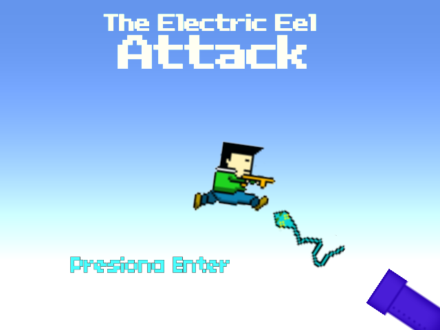
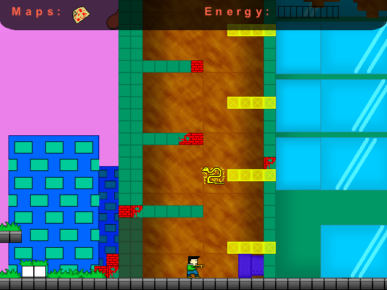
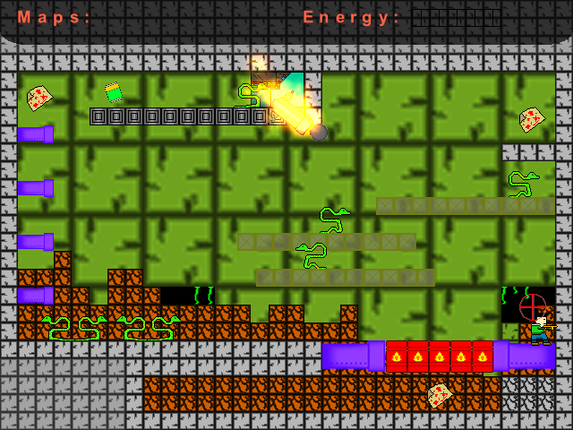
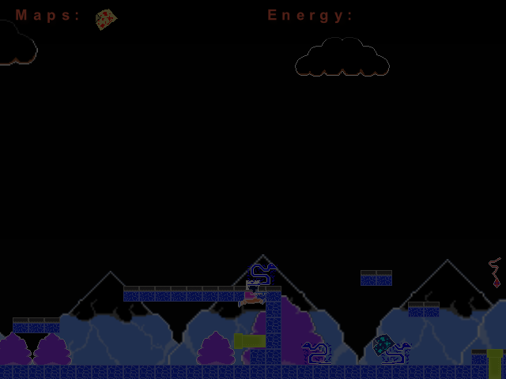
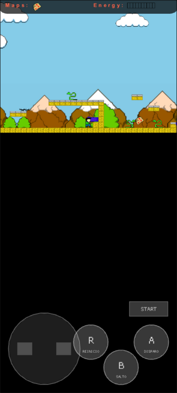

# The Electric Eel Attack

**The Electric Eel Attack** (Elvis Brevi,
[itch.io](https://elvisbrevi.itch.io/the-electric-eel-attack)) is an action platformer.
Yerko has to collect the three maps of each level so the exit vortex opens,
while electric eels attack him: the *hunters* patrol and electrify themselves every so often,
and the *kamikazes* jump from below. You can stomp on them or shoot them with the energy from the
batteries (10 shots per battery). It has four levels: the countryside, a cavern you leave through one
side and enter through the other, the city and a factory with a cannon that aims with its sight.

It was made in 2011 with C# and XNA 3.1 on top of a custom engine, `Engine.dll` (compiled on 9-Mar-2011), and
is now ported to Rust + macroquad: it plays on PC and in the browser, also on mobile. The
logic was reconstructed by reverse-engineering the two assemblies and translated almost line by
line. The graphics, fonts, maps, effects and sounds are the originals.

 

  

## Running

```sh
cargo run --release -p the-electric-eel-attack
```

On Linux you need the ALSA and OpenGL/X11 headers (`sudo apt install libasound2-dev`).
The assets are embedded in the binary.

### Web version

```sh
rustup target add wasm32-unknown-unknown
../../tools/build_web.sh the-electric-eel-attack   # generates dist/the-electric-eel-attack
```

The `index.html` comes from the common template in [`crates/museo/web`](../../crates/museo/web). When
the game starts the browser decodes the sounds, and on reaching level 3 the second song,
which may take a moment.

### Touch controls



On phones and tablets a D-pad with left and right, the A (shoot),
B (jump) and R (restart the level) buttons, and START to begin appear. They are drawn by the shared crate
[`crates/museo`](../../crates/museo), configured in `src/main.rs`. They are enabled if the browser
reports a touch pointer (`(pointer: coarse)`) or as soon as the first touch arrives. In portrait the
game sits at the top and the controls below.

<br clear="right">

## Controls

| Key | Action |
|---|---|
| ← / → | Walk |
| X | Jump (you bounce off when you stomp on an eel) |
| Z | Shoot (spends 10 energy; batteries recharge it) |
| Enter | Start from the title |
| R | Restart the level |
| Esc | Fullscreen (as in the original: it does not quit the game) |

## How it was made

1. **Download**: `The_Electric_Eel_Attack.zip` from itch.io, a ClickOnce deployment of XNA 3.1
   (version 1.0.0.13). The zip names are in CP437 (`cañon`, `montaña`). The executable
   (36 KB) was compiled on **9-Mar-2011** at 02:02 UTC and `Engine.dll` (54 KB) on 8-Mar-2011,
   according to their PE headers. Both are pure CIL for CLR 2.0, x86.
2. **REA** ([rea.tools](https://rea.tools/), `rea-agents` 6.7.0):
   - `inspect-managed-artifact`: `The Electric Eel Attack.exe`
     (`ev_d5478a582e5bf5d018c37eb2f48f62f7ee3cf54e0ae5f25788c7598b88945959`) and `Engine.dll`
     (`ev_89912de47b9d1175390d36c8dddf19c6e7ae78396bccb45c8df5326e2ceca931`).
   - `inspect-managed-members`: 11 types and 72 methods in the game
     (`ev_4cee641740877f572c0a5b1281191e0819faecf2fc40621d346cef37880b5fac`), 32 types and 196
     methods in the engine (`ev_02b38c886ecc3f066ff8cbebf4cff4defdc0411180d4c8590aa99ed3834f5f16`).
   - `import-managed-reconstruction`: the decompiled C# of the methods with a body was anchored to
     its IL hash and signature, 33 from the game
     (`ev_7d2704337defc75934720079e28fe7d85435d026fde7c5df2f6a699deb327820`) and 129 from the engine
     (`ev_6f70f86337fcb9f649d8d64e46ca3dd9a6178afd5c8c81d221427540cfe7bfe2`). The rest are
     implicit constructors and property accessors.
3. **ILSpy** (`ilspycmd` 9.1) with the references of the *XNA Framework Redistributable 3.1* and
   `Engine.dll`. To check the XNA semantics the port copies, the redistributable's
   `SpriteFont` was also decompiled: `InternalDraw` and `InternalMeasure`, with rotation, scale and
   flipped text. They are in [`crates/xna`](../../crates/xna).
4. **Assets**: [`tools/extraer.sh`](tools/extraer.sh) uses
   [`tools/xnb_extract.py`](../../tools/xnb_extract.py) for the textures, the three `SpriteFont`s
   and the 17 `SoundEffect`s (PCM; saved as WAV without converting), and copies the five XML maps
   from the engine's editor (`Content/Mapas`).
5. **Effects**: of the engine's thirteen effects, only three are visible. Their ps_2_0 pixel shaders were
   disassembled with [`tools/ps20_desensamblar.py`](../../tools/ps20_desensamblar.py) and rewritten in
   GLSL (`src/motor/shader.rs`). `varios.xnb` has seven passes, and the order of the shaders in the
   file is the reverse of the passes'.
   - `Negative`: `1 − rgb`.
   - `Brightness`: `color × Intensity`, alpha included.
   - `TopFade`: `color × v`.

   None of them uses the sprite's tint.
6. **Port**:
   - `src/motor/` translates `Engine.dll` and `src/niveles.rs` the game. The subclasses of `Objeto`
     (`Grafico`, `Plataforma`, `Personaje`, `SistemaParticulas` and `Texto`) only change loading,
     updating and drawing, so they are a single type with a `tipo` field.
   - The XML maps are read with `roxmltree` when each level loads, like `Escenario.cargar`. The
     objects request their textures, fonts and sounds by name, like `Content.Load`, from the embedded
     assets.
   - The engine's camera (`Pantalla`) stores its matrix, `Translation(−position) · Scale ·
     RotationZ`. Every object draws with it through `museo::Pantalla::vista_transformada`, on a
     640×480 virtual screen. Since each object opened its own `SpriteBatch`, the port chooses
     per object the blend mode (additive or normal), whether it uses the camera and whether it uses the scene's effect or
     its own.
   - `SoundEffectInstance` is emulated per object with one macroquad `Sound` per instance, which
     remembers until when it plays (see "Differences from the original").
   - The fixed step, `Rectangle`, `Clamp`, `SpriteFont` (with rotation, scale and flipping) and
     `System.Random` come from `crates/museo` and `crates/xna`, as in the other XNA ports.

`reference/csharp/` contains the decompiled C# of the game (`juego/`) and of the engine (`Engine/`).

## Correspondence with the original

| C# | Rust |
|---|---|
| `EAAE.Game1`, `Program` | `main.rs` |
| `EAAE.Control` | `control.rs` |
| `EAAE.Niveles.*` (`Nivel`, `Titulo`, `Nivel1`–`Nivel4`) | `niveles.rs` |
| `Engine.Datos.Escenario` | `motor/escenario.rs` |
| `Engine.Datos.Pantalla` and the static fields of `Escenario` | `motor/mod.rs` (`PantallaXna`, `Globales`) |
| `Engine.Objetos.*` (`Objeto`, `Grafico`, `Plataforma`, `Personaje`, `SistemaParticulas`, `Particula`, `Texto`, `Estado`) | `motor/objeto.rs` |
| `Engine.Fisicas.Fisica` | `motor/fisica.rs` |
| `Engine.Shaders.*` | `motor/shader.rs` |
| `Engine.Audios.Sonido` | `audio.rs` |
| `MathHelper.Clamp`, `Rectangle`, `SpriteBatch.Draw`, `SpriteFont`, `System.Random` | [`crates/xna`](../../crates/xna) |

## Original quirks that are kept

- `Escenario.getObjetoPorNombre` returns the first object whose name **contains** the searched
  text. The game looks everything up this way, every time ("bala1" finds "bala1" because it comes before
  "bala10" in the map).
- The level 1 map requests the `Negative` effect for the whole scene, but `cortina()` calls
  `desactivarShaders()` on every step and it is never seen. The scene effects that are seen are
  `Negative` on death and `Brightness` ×2 when collecting the three maps (that also doubles the alpha).
- On death the game pauses and goes negative while the curtain falls. In levels 3 and 4
  the damage from the electrified platforms and from the cannonball only counts when the hero's
  "dead" sound is already playing, one step after the hit.
- The level that requests a level change finishes its own update after loading the
  next one. During that step it still moves the camera to its hero, and the new level is drawn once
  without having been updated.
- The camera (`Pantalla`) stores its matrix and only recalculates it after a `reset()`, so when loading
  a map the new position is not applied until something calls `reset()`.
- The *hunters* subtract 1 from the blue component of their colour on every step (as a byte, wrapping
  around) and are electrified while it is between 100 and 150.
- When pushing a block, the collisions of "bloque1" are always checked, whichever block it is.
- The "The Electric Eel" title alternates between additive and normal blending on almost every frame.
- The physics uses the body computed in the previous step, and the `Grafico`s compute theirs with the
  scroll position of the previous step.
- The particle systems are updated and drawn even when inactive (the remaining particles
  finish their life).

## Differences from the original

- **Sound**: every object has its own sound instances, as in XNA. macroquad does not say whether a
  sound is still playing, so each instance remembers its duration. To avoid having to decode
  audio when loading a level, the instances are loaded at the start (two slots per sound, alternating
  between loads so that whatever is still playing from the previous level finishes).
- **Music**: both songs (400 and 213 s at 8 kHz) are decoded whole, so only the one currently needed is
  loaded. The switch when reaching level 3 may cause a brief pause.
- **Randomness**: the particles use a copy of .NET 2.0's `System.Random` seeded with the
  clock. The barrels in level 4 use `new Random(i)`, as in the original, so they fall
  exactly the same way.
- **Window**: the game is drawn at 640×480 and scaled with black letterboxing.
- The engine editor's functions were not ported (saving scenarios, grid, debug data and bodies,
  manual camera), nor the ten effects no map uses, nor pixel-perfect
  collision. Nor the mouse, which the control read but no level used.
- **For testing the port**: natively, `EEL_NIVEL=n` (from 1 to 4) starts directly at level
  n. It does not exist in the original.

## Regenerating the assets

```sh
tools/extraer.sh "<path>/Application Files/The Electric Eel Attack_1_0_0_13/Content"
```

## Tests

```sh
node ../../tools/humo/nativo.mjs the-electric-eel-attack   # after cargo build --release
node ../../tools/humo/web.mjs the-electric-eel-attack      # after tools/build_web.sh
```

They follow the steps in `humo.json`: the title, Enter, and walking, jumping and advancing in level 1. These were
checked separately, with `EEL_NIVEL`, longer runs and temporary changes that are not committed:
- levels 2 to 4;
- collecting a map;
- death (negative effect and restart);
- collecting the maps (`Brightness` ×2 and vortex);
- the level chain 1 → 2 → 3 → 4 → title when touching the vortex.
