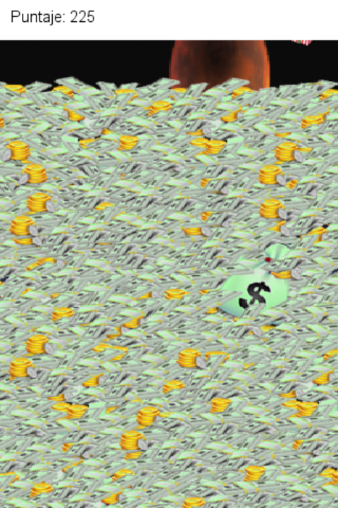

# The Meaning of Christmas

**The Meaning of Christmas** (Elvis Brevi,
[itch.io](https://elvisbrevi.itch.io/the-meaning-of-christmas)) is a Christmas game for
mobile about consumerism. Gifts fall over a night sky with a moon, and from below rises a
mountain of money: every gift that reaches the money unburnt makes it grow. To burn gifts
you have to touch three at the same height: the first one lights a band of fire at its height, the
other two have to be touched inside it, and all three turn red. Every red gift that
falls onto the money scores 25 points and makes it drop. When the money covers almost the whole screen,
you go back to the title ("The True Meaning of Christmas"), with the score. "Silent Night" plays on
the title screen and, during the game, other music.

It was made in December 2011 with Java and libGDX 0.9.2 for Android: the APK was built on
1-Jan-2012. It is now ported to Rust + macroquad and plays on PC and in the browser, also on
mobile, by touching the screen. The logic was translated from the Java decompiled from the APK, and whatever it uses from
libGDX (the drawing, the default font, the animation, the frame time and the music) was
translated from the libGDX code that comes in the same APK. The images, font and music are
the originals (the music converted from MP3 to Ogg Vorbis).

 

 

## Running

```sh
cargo run --release -p the-meaning-of-christmas
```

On Linux you need the ALSA and OpenGL/X11 headers (`sudo apt install libasound2-dev`).
The assets are embedded in the binary.

### Web version

```sh
rustup target add wasm32-unknown-unknown
../../tools/build_web.sh the-meaning-of-christmas   # generates dist/the-meaning-of-christmas
```

The `index.html` comes from the common template in [`crates/museo/web`](../../crates/museo/web).

### Touch controls


As on Android, there are no on-screen buttons: you touch the title to start and you touch the
gifts. It is played in portrait; in landscape it stays centred.

<br clear="right">

## Controls

| Input | Action |
|---|---|
| Click or tap on the title | Start |
| Click or tap on a gift | Select it (the first one lights the band; three in the band burn) |

## How it was made

1. **Download**: the APK from the itch.io page (8,158,243 bytes), checked against the sha256 in
   `originales/catalogo.json`. It was unzipped and decompiled without running anything, into
   `originales/the-meaning-of-christmas` (`jadx` and `apktool`).
2. **Triage**:
   - The images and the music are from 10 to 31-Dec-2011, and the rest of the APK was built and signed on
     **1-Jan-2012** at 17:31 (zip dates), with Android's debug certificate
     (created on 17-Aug-2011) and `android:debuggable="true"`. `minSdkVersion` 3, no
     `targetSdkVersion`, and the activity in portrait.
   - It is libGDX **0.9.2** (`com.badlogic.gdx.Version`). The game was made on top of libGDX's
     "hello world": the application package is `com.badlogic.gdx` and the game classes are in
     `com.badlogic.gdx.helloworld`, together with a desktop launcher (JOGL, 240×320) that is not
     used on Android.
   - [REA](https://rea.tools/) (`rea-agents` 6.7.0, with apktool 3.0.3) `decode-android-resources`:
     the manifest, version 1.0 and the texts ("The Meaning of Christmas" and "Welcome to The
     Meaning of Christmas"), without decoding the code
     (`ev_c5fdc5ccb3d3d000a744d250d91c5b4e0ffcbfa3c3b62acb6b399e4401ffe46e`). The REA tools that
     recover the Java ask for a JADX MCP server, which is not configured
     (`REA_JADX_MCP_JAR`), so the code was decompiled with JADX directly.
3. **JADX** 1.5.6: the game's seven classes (517 lines) are in `reference/java`, with the
   Android launcher. In addition, whatever the game uses was read from the libGDX in the same APK: `BitmapFont`
   (how the font is read and drawn), `Animation`, `SpriteBatch`, `Texture` (Nearest filter
   by default), `WindowedMean` and `AndroidGraphics` (the frame time).
4. **Assets** ([`tools/extraer.py`](tools/extraer.py), which reads the APK as a zip): the ten
   images the code loads (`campanas.png`, `game over.png` and `monedas.png` come in the
   APK but are not used), the `arial-15` font (BMFont `.fnt` and its `.png`) that libGDX brings
   for `new BitmapFont()`, and the two music tracks, from MP3 to Ogg Vorbis with ffmpeg (macroquad cannot read
   MP3).
5. **libGDX** ([`src/gdx.rs`](src/gdx.rs)), with what you cannot see by reading the game:
   - The coordinates have the origin at the bottom left, in screen pixels.
   - `new BitmapFont()` reads `arial-15.fnt` as `BitmapFontData` (without flipping: each glyph's `yoffset`
     becomes `-(height + yoffset)`) and draws with `integer`: the `y` of `draw` is the
     height of the capitals (`base - capHeight` is added to it) and positions are truncated to
     integers, with the font's kerning. The font has no space: libGDX creates one with the
     advance of "l".
   - `Gdx.graphics.getDeltaTime()` on Android is the average of the last five frames
     (`WindowedMean`), and the last one while there are not five yet.
   - `Animation.getKeyFrame(t, true)` is `(int) (t / 0.025) % 4`.
   - A `Music` that ends stops playing, and the game starts it again on the next frame
     (`if (!isPlaying()) play()`): here it loops.
6. **The game** ([`src/juego.rs`](src/juego.rs)): `Juego.render`, `Inicio`, `Regalo`, `Cielo`,
   `Animacion` and the `static` fields of `Operaciones`, in the same order: the title or, in the
   run, the money check, the touches and the fall of each gift, the fall into the
   money (`controlarCaida`) and the drawing.

## Correspondence with the original

| libGDX (Android) | Rust |
|---|---|
| `assets/data`, `com/badlogic/gdx/utils/arial-15.*` from the APK | `assets/` ([`tools/extraer.py`](tools/extraer.py)) |
| `com.badlogic.gdx.helloworld` | `src/juego.rs` |
| `SpriteBatch`, `Texture`, `BitmapFont`, `Animation`, `Music`, `Gdx.graphics`, `Gdx.input` | `src/gdx.rs` |
| The phone screen | `src/main.rs` with `museo::Pantalla` (320×480) |

## Original quirks that are kept

- **Two of the eight columns are off screen.** Every gift comes out again in a
  random column from 10 % to 115 % of the width, in steps of 15: in the 100 % and 115 % ones it falls without
  being seen, nobody can touch it and it always makes the money grow.
- **There is always one gift waiting.** There are nine gifts for eight columns, and one that comes out in
  an occupied column stays still, drawing another column every frame, until it finds
  a free one.
- **At the start, the money jumps up.** The nine gifts start at (0, 0), so on the
  first frame of the first run all of them fall into the money.
- **How far the money moves depends on the frame**: a lost gift raises it `5 * delta * 60`
  pixels and a burnt one lowers it `10 * delta * 60`, so at 60 fps that is 5 and 10 pixels, and with
  slower frames, more.
- **Selected gifts stay in the air.** A selected gift does not fall: if you select one
  or two and do not complete the band, they stay still until a touch outside the band cancels
  everything (they turn white again). What counts for the band is the point touched, not the gift.
- **A red gift can be counted again**: after burning it keeps falling red and not
  selected, so touching it inside a new band scores again, and touching it outside
  cancels nothing.
- **The fire goes faster than the code says.** `Animacion` has speed 0.1, but
  time advances every time it is drawn, and the band is 13 pieces: the fire goes 1.3 times
  faster than without slowing down, and neighbouring pieces can show different frames.
- **The speed is not reset.** The gifts accelerate in score steps (from 1.2 above 500
  to 2.8 above 4500, with the limits excluded: exactly at 1000, 1500... nothing changes), and in the next
  run they start at the speed the previous one ended with. Nor are the
  positions, the colours or a half-finished band reset.
- The money is drawn on top of the gifts: the ones that reach it sink into it.
- The moon is drawn at 30 % of the width and height, so on a portrait phone it comes out oval;
  the title image is stretched to 110 % of the width and goes 10 % past the edge.
- The title says "The True Meaning of Christmas" and the application, "The Meaning of Christmas". The
  text asks you to "click" on a phone.

## Differences from the original

- **Screen**: the game measures everything in percentages of the phone screen, except the font,
  which is 15 pixels. The port uses 320×480, that of an Android HVGA: the APK, with `minSdkVersion` 3 and without
  declaring other screens, runs in compatibility mode with that density. It is scaled to the
  window with letterboxing, like the rest of the museum.
- **Music**: Ogg Vorbis instead of the original MP3s, looping (see above). On the web the
  browser lets nothing play until the first touch, which also starts the run: the first
  time the title stays silent.
- **Chance**: the order of the rolls is the code's, but the generator is macroquad's, not
  `java.util.Random`.
- On PC the click acts as a touch.

## Regenerating the assets

```sh
python3 -I tools/extraer.py "<The Meaning Of Christmas.apk>"   # ffmpeg is required
```

## Tests

```sh
node ../../tools/humo/nativo.mjs the-meaning-of-christmas   # after cargo build --release
node ../../tools/humo/web.mjs the-meaning-of-christmas      # after tools/build_web.sh
```

They follow the steps in `humo.json`: the title, the tap to start and the run, with the gifts
falling and the money rising. On the web, desktop, mobile landscape and mobile portrait are tested.
Checked separately, with temporary changes that are not committed: an automatic player that touches gifts in
the band (the `fuego.png` captures: the band, the red gifts, the score and the two gifts
that stay in the air with the band half-finished), and the money placed near the limit to reach
the end of the run (`dinero.png` and the title with the score, `fin.png`). A trace of the
positions confirmed that the gifts fall at 60 pixels per second and the two columns off
screen.

## Pending

- Sound was not tested on real hardware (the server has no sound card).
- The touch controls were tested only in Chromium emulation.
- REA's Android tools that recover the Java (the JADX ones) are not configured: a JADX MCP
  JAR is missing in `REA_JADX_MCP_JAR`.
